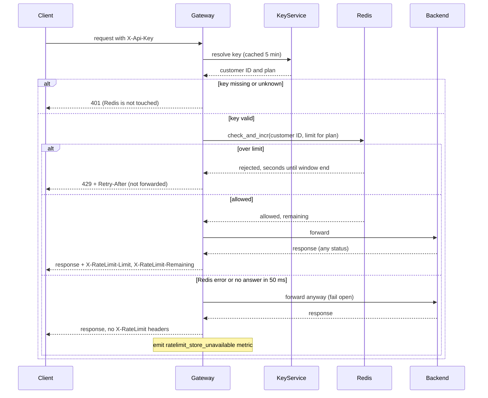

# Rate limiting

Per-customer rate limiting in the API Gateway. After the gateway authenticates a request, it asks Redis whether the customer has budget left in the current minute. If yes, it forwards the request. If no, it replies 429.

Today the gateway (6 stateless instances behind a load balancer) reads the `X-Api-Key` header, asks the Key Service for the customer ID and plan (cached 5 minutes), forwards to the backend and returns the response.

Terms:
- **Budget**: requests allowed per minute for one customer, shared by all their keys. Standard is 100. Enterprise is not decided yet.
- **Window**: one fixed clock minute, taken from the Redis server clock. The budget resets at the start of each minute.
- **check_and_incr**: one Lua script in Redis. It runs atomically, so requests from different instances cannot overshoot the limit.

Notes:
- The gateway sends Redis only the customer ID and the plan's limit (Standard 100, Enterprise open). It never sends the raw key.
- Redis key: `rl:{customerId}:{minute}`. It expires after 120 seconds, which only cleans up old minutes.
- The script rejects without incrementing when the count is already at the limit, so 429s use no budget. Otherwise it increments and returns the remaining count.
- Retry-After is the seconds left in the current minute (at least 1). A 429 carries only Retry-After.
- An allowed request counts even if the backend returns 500.
- The 50 ms is a timeout on the Redis call.
- Fixed windows allow a burst of up to 2x the limit across a minute boundary. Accepted for version 1.

Open questions:
- Enterprise limit: Product has not decided. Until then, what Enterprise requests get is undecided.
- Who watches `ratelimit_store_unavailable`, and any alert threshold: not decided.
- Key Service down or slow: unchanged existing behavior, not covered here.
