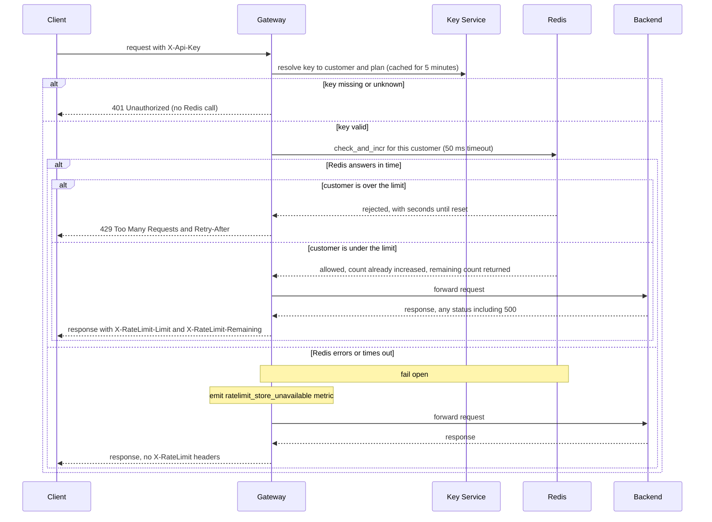

## Rate limiting

Per-customer rate limiting in the API Gateway. Each customer may send 100 requests per minute on the Standard plan. The Enterprise limit has not been set yet, so it is not implemented. The shared counters are kept in Redis.

Terms used below:

- **API key**: a secret string that a client sends in the `X-Api-Key` header to identify itself.
- **Customer**: the account that owns one or more API keys. The limit applies to the customer, so all of its keys share one budget.
- **Plan**: the customer's service tier, either Standard or Enterprise.
- **Key Service**: the service that turns an API key into a customer ID and a plan.
- **Gateway**: the API Gateway. All public traffic goes through it. It runs as six identical, stateless instances behind a load balancer, so any instance can receive any request.
- **Backend**: the service that owns the route a request is for. The gateway forwards the request there and returns the backend's response.
- **Redis**: a shared in-memory data store. All six gateway instances read and write the same counters in it.
- **Window**: the one-minute period during which a customer's requests are counted.
- **Fail open**: when the rate-limit store is unavailable, the gateway forwards the request anyway instead of blocking it.

Notes:

- **Order of checks.** Authentication comes first. A missing or unknown key gets 401 before any Redis call, so it never reads or changes a counter. The rate-limit check runs after authentication and before the request is forwarded.
- **Key lookup cache.** The gateway caches key lookups for 5 minutes, so most requests do not call the Key Service. A plan change can therefore take up to 5 minutes to take effect.
- **Who is counted.** The counter belongs to the customer ID, not the API key. All of a customer's keys share one budget.
- **Shared counting across instances.** Redis is one store used by all six gateway instances. A customer's count is the same no matter which instance receives the request, so spreading traffic across instances does not multiply the limit.
- **No overshoot.** `check_and_incr` is a Lua script (a small program that Redis runs). Redis runs a script as one uninterrupted step, so two instances cannot both read 99 and both allow the 100th request. The script reads the count. If the count is below the limit, it adds 1 and allows the request. Otherwise it adds nothing and rejects the request.
- **Rejected requests cost nothing.** A request over the limit adds nothing to the counter, so it uses no budget.
- **Window.** The window is fixed at 60 seconds. The customer's first counted request creates the counter, and that counter's key gets a TTL (time to live, the time after which Redis deletes the key) of 60 seconds. When the key expires, the window ends, and the next request starts a new window.
- **Known trade-off.** Because the window is fixed, a customer can send 100 requests at the end of one window and 100 more at the start of the next. That is up to 200 requests within a few seconds. This is accepted for the first version.
- **Retry-After.** This is the time left on the counter key's TTL, in whole seconds, rounded up. Redis holds the TTL, so every instance gives the same answer.
- **Counted before forwarding.** A request is counted before it is sent to the backend. If the backend then returns 500, the request still used budget.
- **Limits.** Standard is 100 requests per minute. Enterprise is to be set by Product. Do not ship an Enterprise limit until it is set.
- **Fail open.** If Redis errors or does not answer within 50 ms, the gateway forwards the request, sends no X-RateLimit headers, and emits the `ratelimit_store_unavailable` metric. The API stays up during a Redis outage, but limits are not enforced during that outage.