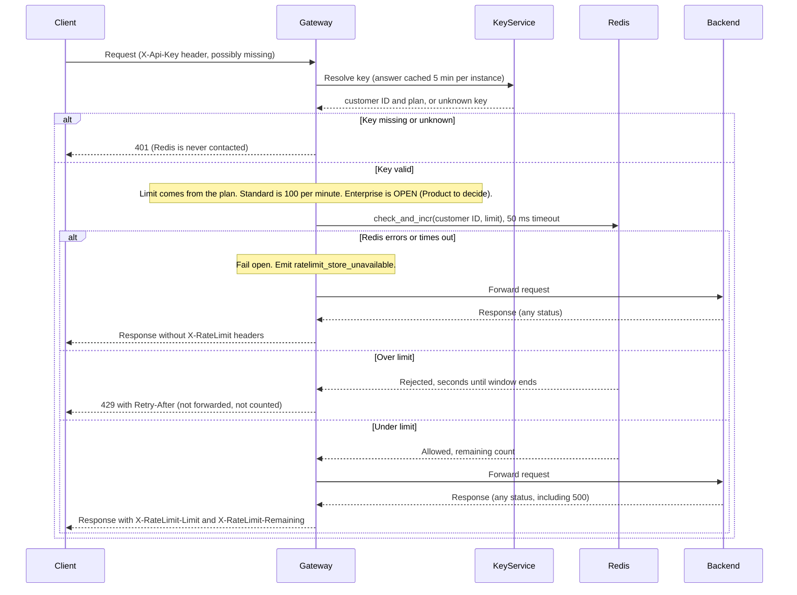

## Per-customer rate limiting in the API Gateway

**How it works.** The 6 gateway instances share one Redis (an in-memory key-value store). Redis holds one counter per customer per minute. After authenticating a request, the gateway calls one Redis script. The script is atomic, meaning Redis runs it start to finish without running other commands in between. It checks the counter and increments it only if the customer is under the limit. Every instance uses the same counter, so spreading a customer's traffic across instances does not raise their limit.

### Notes

- **Store.** One shared Redis instance. The gateway keeps no other rate-limit state.
- **Counter key.** `rl:{customerId}:{minute}`, where `minute` is the current Unix time divided by 60, rounded down. The gateway resolves each API key to a customer ID before the check, so all of a customer's keys share one counter and one budget.
- **Window.** Fixed calendar minutes: the counter resets at the start of each minute. A customer can therefore send up to 2x the limit in a short burst across a minute boundary (the end of one minute plus the start of the next). We accept this in the first version. Each counter expires after 120 seconds, so old ones are cleaned up automatically.
- **Atomicity.** `check_and_incr` is one Lua script (Redis's built-in scripting language). It reads the counter. If the count is below the limit, it increments the counter and returns "allowed" with the remaining budget. Otherwise it returns "rejected" and does not increment. Two instances racing for the last slot cannot both get it, and 429 responses use no budget.
- **Clock.** The script reads the time from Redis (`TIME`), not from the gateway instances. Instances with skewed clocks therefore agree on which minute it is.
- **Retry-After.** The seconds left in the current minute, rounded up, never less than 1. The script computes this from the Redis clock and returns it with the rejection.
- **Counting.** The increment happens before forwarding and is never refunded. A request that passes the check counts even if the backend then returns 500.
- **Limits.** Standard: 100 requests per minute. **Enterprise: open, to be decided by Product.** No number is chosen here. Until Product sets one, the gateway has no Enterprise limit to pass to the script, so the check cannot run for Enterprise customers. How they are treated in the meantime (for example, unlimited or a temporary cap) is part of this open decision. The diagram's "Key valid" branch shows only the path for a plan that has a limit.
- **Headers.** `X-RateLimit-Limit` is the customer's limit. `X-RateLimit-Remaining` is the budget left after this request. Both appear only on responses to requests that passed the check. The 429 does not carry them.
- **Fail open.** If Redis returns an error or does not answer within 50 ms, the gateway forwards the request and emits the `ratelimit_store_unavailable` metric. It returns the backend's response without `X-RateLimit-*` headers, because the real counts are unknown. A Redis outage does not take the API down, but during one, limits are not enforced.