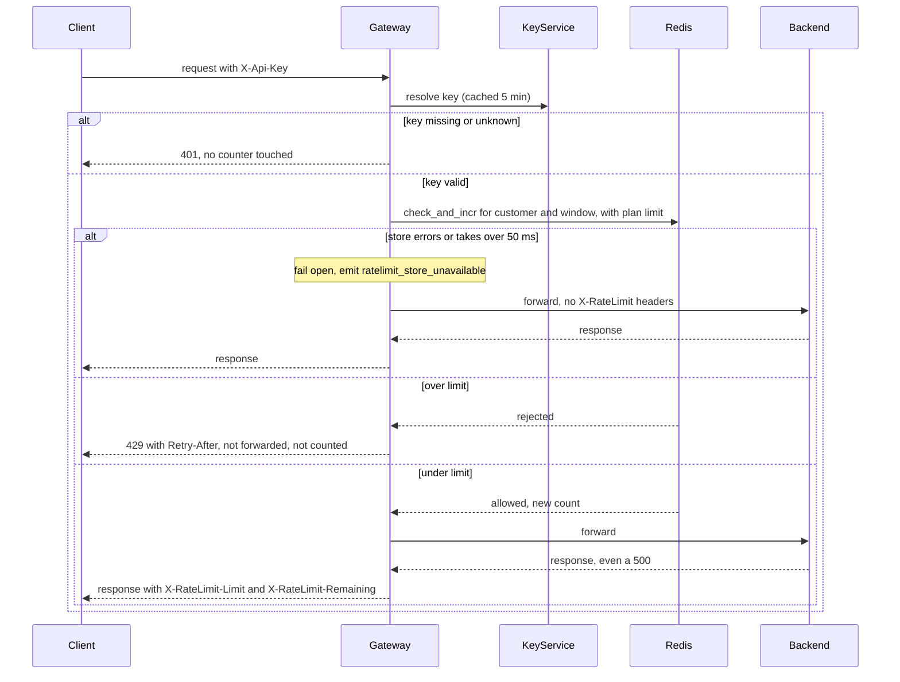

# Per-customer rate limiting

Today every public request goes through the API Gateway, which runs as 6 stateless instances. The gateway resolves the `X-Api-Key` header to a customer and plan through the Key Service, caches that answer for 5 minutes, and forwards the request to the backend. This design adds a per-customer request limit. All gateway instances share one counter in Redis, so a customer cannot get 6 times its limit by spreading traffic across instances.

**Terms**

- **Customer**: the account that owns one or more API keys. All of its keys share one budget.
- **Plan**: Standard or Enterprise. The plan sets the limit.
- **Window**: one clock minute, such as 12:00:00 to 12:00:59.
- **Counter**: the number of requests a customer has used in the current window. It is one Redis key per customer per window, named `rl:<customer_id>:<window>`.
- **check_and_incr**: a Lua script in Redis. It reads the counter. If the counter is at the limit, it rejects the request. Otherwise it adds 1 and returns the new count. Redis runs the whole script as one step, so two instances cannot both take the last slot.
- **Fail open**: when the counter store errors or does not answer within 50 ms, the request goes through without a check.

**Steps**

1. **Authenticate.** Starts when a request reaches any gateway instance. The gateway reads `X-Api-Key` and resolves it to a customer and plan, using its in-memory cache. Each instance keeps its own cache for 5 minutes. If the key is missing or unknown, return `401`. Do not touch any counter.
2. **Choose the limit.** Standard customers get 100 requests per minute. Enterprise customers: limit TBD (Product). A plan change takes up to 5 minutes to apply, because of the cache.
3. **Check and count.** Starts once the limit is known. The gateway calls check_and_incr with the customer's counter for the current window and the limit. Redis keeps the counter. Its key expires after 60 seconds, which is set when the counter is first created. If the call errors or takes over 50 ms, go to step 5.
4. **Reject or forward.** If the script says the customer is over the limit, return `429` with a `Retry-After` header. `Retry-After` is the number of seconds until the next minute starts, which is 60 minus the current second within the minute. The request is not forwarded and not counted. If the script allows the request, forward it to the backend. The request is already counted, so a backend failure still uses budget.
5. **Fail open.** Starts when the store errors or misses 50 ms. Forward the request without a check, and emit the `ratelimit_store_unavailable` metric. Responses to these requests carry no `X-RateLimit` headers, because no check passed. Nothing is kept.
6. **Respond.** Starts when the backend replies. For requests that passed the check, add `X-RateLimit-Limit` (the plan limit) and `X-RateLimit-Remaining` (the limit minus the count after this request). Otherwise return the backend's response unchanged.

**What happens when things fail**

| What goes wrong | What the client gets | Counted? |
|---|---|---|
| Key missing or unknown | `401` | No |
| Over the limit | `429` with `Retry-After`, not forwarded | No |
| Backend fails, for example `500` | The backend's `500`, with rate-limit headers | Yes |
| Counter store errors or takes over 50 ms | Normal response with no rate-limit headers, metric emitted | Maybe. Redis may have run the script before the timeout. |

**Notes**

- Windows are fixed clock minutes. A customer can send 100 requests at 12:00:59 and 100 more at 12:01:00. This is accepted for a first version.
- Counter keys expire on their own, so old windows do not need cleanup.

**Open questions**

- What is the Enterprise limit? Until it is set, what do Enterprise requests get?
- What happens when the Key Service is down? This design does not change that behavior.