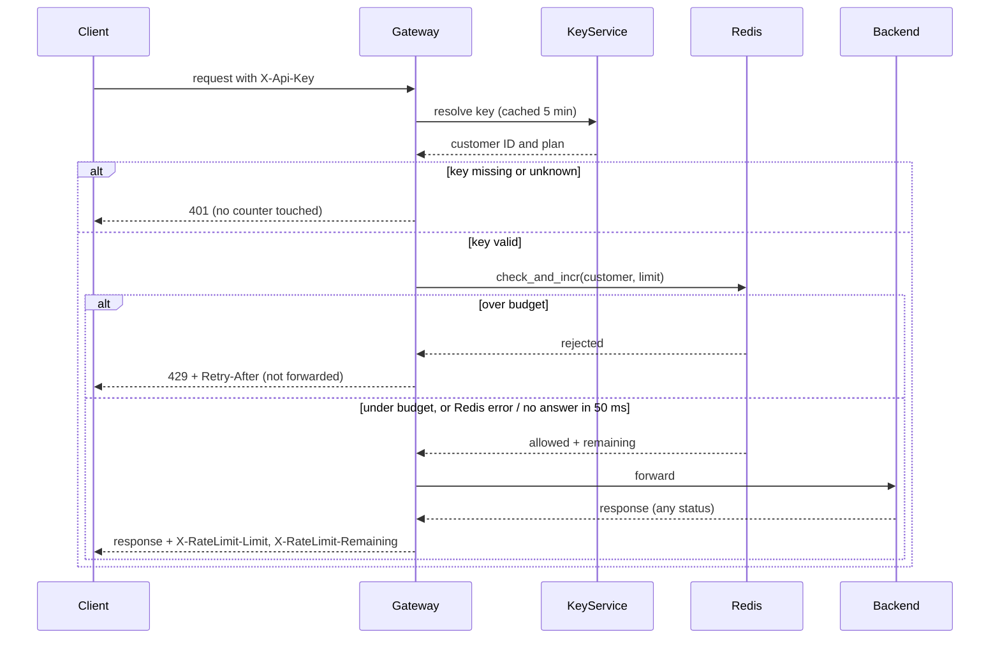

## Rate limiting

Per-customer rate limiting in the API Gateway, backed by one shared Redis. After the gateway authenticates a request, it asks Redis whether the customer still has budget in the current minute. If yes, it forwards the request. If no, it answers 429 and never forwards.

Today, the gateway (6 stateless instances) resolves the `X-Api-Key` header to a customer ID and plan through the Key Service, caches that answer for 5 minutes, forwards the request to the backend and returns the response. This design adds one step between authentication and forwarding.

### Terms

- **Customer**: the owner of one or more API keys. The budget belongs to the customer, so all of a customer's keys share it.
- **Budget**: the number of requests allowed per minute. Standard is 100. Enterprise is not decided (open question below).
- **Window**: one calendar minute. The counter starts at 0 each minute and is not a sliding window.
- **Counter**: a number in Redis, one per customer per minute, that expires after the minute ends.
- **check_and_incr**: one Lua script that runs inside Redis. It reads the counter, and adds 1 only if the customer is under budget. Redis runs it as one indivisible step, so requests from different gateway instances cannot overshoot the limit.

### Main flow

### Notes on the steps

1. **Authenticate.** Started by every request. The gateway resolves the key through the Key Service (or its cache). A missing or unknown key gets 401, and Redis is not contacted. On Key Service failure, behaviour is unchanged from today.
2. **Check budget.** Started by a valid key. The gateway calls `check_and_incr` with the customer ID and the plan's limit. The counter key is the customer ID plus the current minute, and it expires shortly after that minute ends. Redis keeps the data. A call that errors or takes longer than 50 ms fails open (see failures).
3. **Reject.** Started when the script says the customer is over budget. The gateway returns 429 with `Retry-After` set to the seconds left until the next minute starts (at least 1). The request is not forwarded. The script does not add to the counter, so 429s use no budget.
4. **Forward.** Started when the request is allowed. The gateway sends it to the backend and returns the response. The request already counted, even if the backend returns an error such as 500.
5. **Respond.** Responses to allowed requests carry `X-RateLimit-Limit` (the plan's limit) and `X-RateLimit-Remaining` (budget left after this request).

### When things fail

| Step | Failure | What happens |
|---|---|---|
| Authenticate | Missing or unknown key | 401, no counter read or changed |
| Check budget | Redis errors or does not answer in 50 ms | Fail open: forward the request, emit the `ratelimit_store_unavailable` metric, and leave out the `X-RateLimit-*` headers because the remaining budget is unknown |
| Reject | Over budget | 429 with `Retry-After`, not forwarded |
| Forward | Backend fails | Response passed through. The request still counted |

### Open questions

- Enterprise limit: not decided by Product. Until it is set, the Enterprise limit has no value.