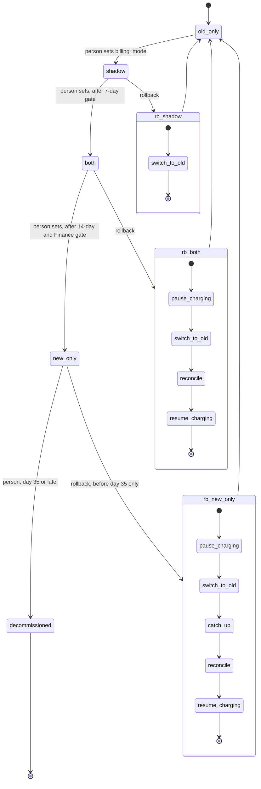

## Billing engine rollout

This moves billing from the old engine to a new engine in four modes, one forward step at a time. A person makes each forward move, and only after its gate passes. A rollback can start from `shadow`, `both` or `new_only`, and it always ends in `old_only`.

Today, the old billing workers read usage events, compute invoices, write them to the ledger (the system of record) and charge customers through the payment provider. The new engine runs alongside it and is checked against it before it takes over charging.

### Terms

- **billing_mode**: a flag in the config service. It holds the current mode.
- **Usage event log**: keeps usage events for 35 days. Both engines read it.
- **Ledger**: the system of record for invoices and charges.
- **Shadow store**: a separate store for invoices that are never charged.
- **comparison_results**: one row per customer per billing period, written by the nightly job. It holds both invoice totals and a mismatch flag.
- **Mismatch**: the two totals for a customer and period differ by more than one cent.
- **Mismatch rate**: mismatches divided by invoices compared.
- **Rollback record**: one row per rollback. It lists that rollback's steps and whether each one is done.

### Diagram

### What each mode does

- **old_only**: the old engine charges and writes the ledger. The new engine is off.
- **shadow**: the old engine charges and writes the ledger. The new engine computes its invoices into the shadow store. It never charges and never writes the ledger.
- **both**: the new engine charges and writes the ledger. The old engine keeps computing its invoices into the shadow store, without charging, so it stays current.
- **new_only**: the new engine does everything. The old engine stops.

Both engines read the same usage event log. State lives in four places: billing_mode (config service), the shadow store, comparison_results and the rollback record.

### Nightly comparison

- **Starts**: each night.
- **What it does**: for each customer and billing period, it compares the two engines' invoice totals, wherever each engine writes its invoice. It writes one comparison_results row for each. Each night counts as one day.
- **Data**: comparison_results.
- **If it fails**: no row is written for that night. The day does not count toward the 7-day or 14-day gate (see open questions).

A mismatch is resolved when the customer's newest comparison_results row for that period has no mismatch flag. A person finds the cause. The next night that matches clears the flag.

### Forward moves

A person sets billing_mode. The controller refuses the move unless its gate has passed. It never moves on its own.

1. **old_only to shadow**
   - **Starts**: a person sets billing_mode to `shadow`.
   - **Gate**: none.
   - **Data**: billing_mode.
   - **If it fails**: the mode stays `old_only`.
2. **shadow to both**
   - **Starts**: a person sets billing_mode to `both`.
   - **Gate**: 7 consecutive days with a mismatch rate under 0.1%, and at least 5,000 invoices compared.
   - **Data**: billing_mode and comparison_results.
   - **If the gate fails**: the controller refuses. The mode stays `shadow`.
3. **both to new_only**
   - **Starts**: a person sets billing_mode to `new_only`.
   - **Gate**: 14 days in `both` with no unresolved mismatches, and Finance sign-off.
   - **Data**: billing_mode and comparison_results.
   - **If the gate fails**: the controller refuses. The mode stays `both`.

### Rollback

**Starts** in one of two ways:
- **By hand**: on-call, at any time up to day 35.
- **Automatically**: in `both` or `new_only`, when the new engine's charge failure rate is above 2% over any 10-minute window. Errors in `shadow` never start a rollback.

Only one rollback runs at a time. A second trigger is logged and starts nothing.

When a rollback starts, its record is written with the steps for its starting mode, all marked not done. Each step runs in the order below.

| Starting mode | Steps, in order |
| --- | --- |
| `shadow` | switch_to_old |
| `both` | pause_charging, switch_to_old, reconcile, resume_charging |
| `new_only` | pause_charging, switch_to_old, catch_up, reconcile, resume_charging |

Each step has the same parts:

1. **pause_charging**
   - **Starts**: the rollback record.
   - **What it does**: stops the new engine's charges.
   - **Data**: the rollback record marks the step done.
   - **If it fails or hangs**: see the failure table.
2. **switch_to_old**
   - **Starts**: after pause_charging.
   - **What it does**: sets billing_mode to `old_only`.
   - **Data**: billing_mode.
   - **If it fails or hangs**: see the failure table.
3. **catch_up** (`new_only` only)
   - **Starts**: after switch_to_old.
   - **What it does**: the old engine processes the usage events it skipped, read from the usage event log. It writes the resulting invoices to the shadow store.
   - **Data**: reads the usage event log, writes the shadow store.
   - **If it fails or hangs**: see the failure table.
4. **reconcile**
   - **Starts**: after catch_up, or after switch_to_old in `both`.
   - **What it does**: for each customer and billing period, the amount due is the old engine's invoice in the shadow store. The amount charged is the sum of that customer's ledger charges for the period. It charges only the difference, once. It checks the ledger before each charge, so a rerun cannot charge twice.
   - **Data**: reads the shadow store and the ledger, writes charges to the ledger.
   - **If it fails or hangs**: see the failure table.
5. **resume_charging**
   - **Starts**: only after reconcile has finished.
   - **What it does**: the old engine charges again.
   - **Data**: the rollback record marks the step done.
   - **If it fails or hangs**: see the failure table.

Every step marks itself done when it finishes. Every step is safe to run twice. A retry skips the done steps and runs the rest.

**Retries.** The rollback runner retries a failed or hung step automatically. A step that passes its time limit without finishing is hung. A step still inside its limit is slow, not hung. On-call is alerted at the first failure.

**After a rollback**, billing_mode is `old_only`. To move forward again, a person sets `shadow`. This move has no gate. The gates start over: the 7-day count restarts at zero, and Finance sign-off must be given again. Old comparison_results rows stay as history and do not count.

### Decommissioning the old engine

A person decommissions the old engine when the rollout has been in `new_only` for 35 days and no rollback has happened. The clock starts when the rollout enters `new_only`. The old engine stops computing then, and its skipped usage events begin to age out of the 35-day log. From day 35 on, there is no way back.

### What happens when things fail

| What fails | What happens |
| --- | --- |
| Forward move gate not met | The controller refuses. The mode does not change. |
| A rollback step fails or hangs | Charging stays paused. The record shows the step. On-call is alerted. The runner retries the step. No later step runs. |
| Retries run out | On-call takes over. Charging stays paused. |
| Charge failures above 2% in a 10-minute window (`both`, `new_only`) | Automatic rollback starts. |
| New-engine errors in `shadow` | Recorded only. No rollback. |
| Rollback trigger while one is running | Logged. No second rollback starts. |
| Rollback requested on day 35 or later in `new_only` | Refused. There is no way back. On-call is told. |

### Open questions

- Does the 5,000-invoice minimum count across the 7 days, or for each day?
- What is the denominator of the 2% charge failure rate?
- How long can charging stay paused before a person must act?
- How many automatic retries run, and what time limit makes a step hung?
- If a charge has reached the payment provider but is not yet in the ledger, how does reconcile treat it?
- If the ledger holds more for a period than the old engine's invoice, what does reconcile do? The brief has no refund rule.
- If the new engine fails after day 35, when there is no way back, what happens? The brief is silent.
- In `shadow`, the old engine's invoices are not written to the shadow store. Where does the nightly job read the old engine's invoice total from?