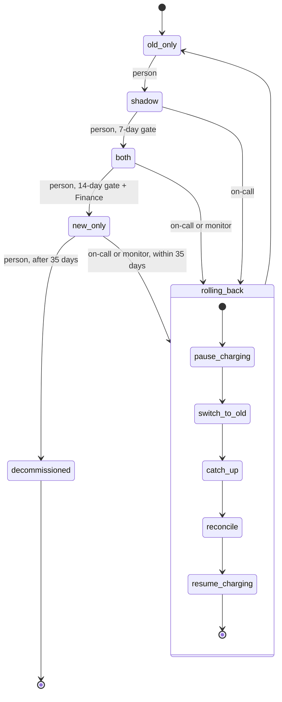

# Billing engine rollout

We are replacing the old billing engine with a new one. A person moves one flag, `billing_mode`, forward one mode at a time. Rollback is the only way back, and it always ends in `old_only`. The rollout must never charge a customer twice for a billing period.

Today: billing workers run the old engine. It reads usage events from the usage event log, computes invoices, writes them to the ledger and charges customers through the payment provider.

## Terms

- `billing_mode`: the one global flag, in the config service. It selects the mode. Each engine reads it at the start of every billing run.
- `charging_paused`: a second setting next to `billing_mode`. While it is on, neither engine charges.
- Charge check: before each charge, an engine re-reads `billing_mode` and `charging_paused`. It charges only if the mode names it as the charging engine and charging is not paused. So a run that started before a mode change cannot charge after it.
- Usage event log: the input both engines read. It keeps events for 35 days.
- Ledger: the billing system of record. Only the charging engine writes to it. It holds at most one charge per customer and billing period: an engine checks before charging and skips if one exists, and the ledger rejects a second one. This prevents double charging at every mode change.
- Shadow store: a separate store for invoices that are computed but not charged.
- Nightly comparison job: runs once a night in `shadow` and `both`. It compares the two engines' invoices per customer and billing period, for invoices computed since its last run, and writes the result to `comparison_results`. A mismatch is a total that differs by more than one cent.
- Billing monitor: watches the new engine's charge failure rate and calls the rollback runner when it is too high.
- Rollout tool: the command a person runs to move the mode forward. It refuses if the gate is not met or a rollback is in progress.
- Rollback runner: a service that runs the five rollback steps in order. On-call starts it by command, or the billing monitor starts it. It writes the rollback record after each step.
- Rollback record: stored next to `billing_mode` in the config service. It holds the current rollback step. While it shows a rollback in progress, new start requests are ignored, so only one rollback runs at a time. The runner clears it when the last step finishes.

## Modes

| Mode | Old engine | New engine |
|---|---|---|
| `old_only` | computes, charges, writes ledger | off |
| `shadow` | computes, charges, writes ledger | computes into the shadow store only |
| `both` | computes into the shadow store only | computes, charges, writes ledger |
| `new_only` | stopped | computes, charges, writes ledger |

Exactly one engine charges in every mode. Double charging could only happen at a mode change, and the charge check and the ledger rule cover that. The engines do not see a flag change at the same instant, so for a short time neither may charge. A charge missed that way is made on the next billing run. Forward moves need no pause. Rollback adds a pause and a reconcile step as extra safety.

## Diagram

## Forward moves

A person runs the rollout tool for each move. Nothing moves automatically. If the tool fails, the flag does not change and the person runs it again.

- `old_only` to `shadow`: no gate.
- `shadow` to `both`: 7 consecutive days with a mismatch rate under 0.1% and at least 5,000 invoices compared, read from `comparison_results`.
- `both` to `new_only`: 14 days in `both` with no unresolved mismatches, plus Finance sign-off.
- `new_only` to `decommissioned`: allowed after 35 days in `new_only`. From then on there is no way back.

## Rollback

Start: on-call can start it by hand at any time within the 35 days. The billing monitor starts it automatically when, in `both` or `new_only`, the charge failure rate is above 2% over any 10-minute window. New-engine errors in `shadow` are recorded but never start a rollback.

Steps, in order:

1. `pause_charging`: turn `charging_paused` on. Customers due meanwhile wait and are charged in `reconcile`.
2. `switch_to_old`: set `billing_mode` to `old_only`. The charge check now stops the new engine from charging, even in a run that started earlier.
3. `catch_up`: the old engine reprocesses usage events from the time it stopped, which is when `new_only` began. Only needed from `new_only`.
4. `reconcile`: the old engine works out from the usage events what is due for each customer and billing period, checks the ledger, and charges what is due and not yet charged.
5. `resume_charging`: turn `charging_paused` off. The old engine charges again. The runner clears the rollback record.

Which steps run:

| Rolling back from | Steps run |
|---|---|
| `shadow` | `switch_to_old` only. The new engine never charged. |
| `both` | all except `catch_up`. The old engine kept computing. |
| `new_only` | all five. |

After a rollback the gates reset. The rollout goes through `shadow` again and the 7-day count starts over.

## Where state lives

- `billing_mode`, `charging_paused` and the rollback record: config service.
- Invoices and charges: the ledger. Shadow invoices: the shadow store.
- Comparison results: `comparison_results`.

## When things fail

| What fails | What happens |
|---|---|
| A forward move | The flag is unchanged. Run the tool again. |
| A rollback step | The record keeps the failed step. The runner retries it. Each step is safe to repeat, because `reconcile` checks the ledger before charging. |
| The rollback runner crashes | Not decided. See open questions. |
| Nightly job | No result for that day. The gate count does not advance. |
| Monitor and on-call both start a rollback | The second request is ignored. |

## Open questions

- Is "at least 5,000 invoices" a per-day or a seven-day total? Assumed: seven-day total.
- What makes a mismatch "resolved", and what is done about a mismatch?
- Who alerts if a rollback step keeps failing?
- What resumes a rollback if the runner itself crashes?
- Does the ledger really reject a second charge for the same customer and period? Assumed yes.
- Who writes to the usage event log?
- How often does each engine start a billing run?
