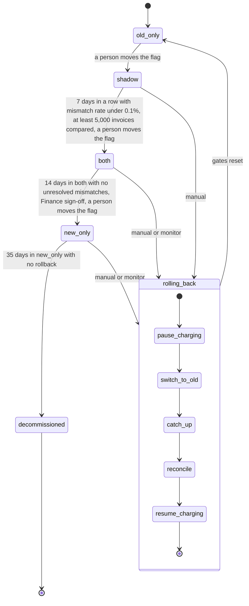

## Billing engine rollout

We are replacing the old billing engine with a new one. The switch is gradual and reversible, and it must never charge a customer twice.

The rollout moves through named modes. One config flag holds the current mode. A person always makes forward moves. A rollback can start by hand or automatically, and it always ends with the old engine in charge.

**Key terms**

- **Usage event:** a record of billable usage. Both engines read the same usage events.
- **Invoice:** the bill for one customer for one billing period.
- **Charge:** money taken from a customer through the payment provider.
- **Ledger:** the billing ledger. It is the system of record. Only the engine that is charging writes real invoices to it.
- **Shadow store:** a separate store for invoices that are computed but not charged.
- **Mismatch:** an invoice total that differs by more than one cent between the two engines, for the same customer and period.
- **Mismatch rate:** the share of compared invoices that are mismatches.
- **Charge failure rate:** the share of the new engine's charge attempts that fail.

**Flag:** `billing_mode` in the config service. It holds the current mode: `old_only`, `shadow`, `both`, or `new_only`. The diagram also shows a `rolling_back` state for the rollback path. The brief does not say whether the flag holds that value during a rollback. This is an open question.

**Where the state lives**

- **The current mode:** the `billing_mode` flag.
- **Rollback progress:** the rollback record. It logs each rollback as it runs and marks which steps have finished.
- **Comparison results:** `comparison_results`. The nightly comparison job writes here, and the gate checks read from here.
- **Invoices:** charged invoices go to the ledger. Invoices that are computed but not charged go to the shadow store.
- **Usage events:** the usage event log. It keeps events for 35 days.

**Pieces involved**

- **Rollout tool:** the controller that moves the flag forward. It is not written yet.
- **Billing monitor:** watches the new engine's charge failure rate. It starts a rollback when the rate is too high.
- **Nightly comparison job:** once a night, compares the old and new engines' invoices for each customer and writes the results to `comparison_results`.
- **Rollback record:** a log of each rollback and which of its steps have finished.

**How to read the diagram.** Each arrow is one move. A forward move (old_only to shadow to both to new_only) is one step, and a person makes it. The rollback path leads from shadow, both, or new_only into `rolling_back`. Rollback then runs its five steps in order and ends in `old_only`. The diagram shows every rollback step. Some steps are skipped in some cases, as described under Rollback.

### What each mode does

- **old_only:** The old engine does everything. It reads usage events, computes invoices, writes the ledger, and charges customers. The new engine is off.
- **shadow:** The old engine still does everything it did in `old_only`. The new engine also reads the same usage events and writes its invoices to the shadow store. The new engine never charges and never writes the ledger. The nightly comparison checks each customer's invoices. Mismatches are recorded here.
- **both:** The new engine charges customers and writes the ledger. The old engine keeps computing every invoice into the shadow store, without charging. This keeps it current, so it can take over again. The nightly comparison keeps running.
- **new_only:** The new engine does everything. The old engine stops computing.
- **decommissioned:** The old engine is removed. There is no way back from this point.

### Forward moves and gates

Forward moves go one step at a time, in this order: `old_only`, `shadow`, `both`, `new_only`. No step can be skipped. A person always makes the move. A move happens only when its gate is met.

- **shadow to both:** 7 days in a row with a mismatch rate under 0.1%, and at least 5,000 invoices compared. A day that fails breaks the streak.
- **both to new_only:** 14 days in `both` with no unresolved mismatches, plus Finance sign-off.
- **new_only to decommissioned:** 35 days in `new_only` with no rollback. Only then may the old engine be decommissioned.

### Rollback

Rollback always ends in `old_only`. It can start from `shadow`, `both`, or `new_only`.

**What starts a rollback**

- **By hand:** on-call can start a rollback at any time, as long as the 35-day limit below has not passed.
- **Automatically:** in `both` or `new_only`, when the new engine's charge failure rate is above 2% over any 10-minute window. The billing monitor starts the rollback.
- **Never from shadow errors:** new-engine errors in `shadow` are recorded, but they never start a rollback.

**Steps**

1. **pause_charging:** stop charging, so no new charge goes out during the switch.
2. **switch_to_old:** hand charging back to the old engine.
3. **catch_up:** the old engine reprocesses the usage events it skipped. This is needed only when rolling back from `new_only`, because the old engine stopped computing there. A rollback from `shadow` or `both` skips this step, because the old engine has already computed every invoice into the shadow store.
4. **reconcile:** check each customer and billing period against what has already been charged and written to the ledger. This stops a period from being charged twice, and stops a charge that is due from being dropped.
5. **resume_charging:** the old engine starts charging again.

Each step can be retried if it fails. The rollback record shows which steps have finished, so a retry picks up at the step that failed.

**After a rollback:** the mode is `old_only`, and all gates reset. The rollout must go through `shadow` again, and the 7-day count starts over from zero.

### The 35-day limit

The usage event log keeps events for 35 days. The old engine can only catch up on events that are still in the log. So:

- A rollback from `new_only` works only while the events the old engine skipped are still in the log.
- From day 35 onward, there is no way back to the old engine. At that point the old engine may be decommissioned.
- The count starts when the rollout enters `new_only`, which is when the old engine stops computing.

### When something fails

- **Mismatches in `shadow` or `both`** block the next forward gate. They do not trigger a rollback by themselves.
- **New-engine errors in `shadow`** are recorded only. They do not trigger anything else.
- **A charge failure rate above 2% in any 10-minute window**, in `both` or `new_only`, starts a rollback automatically.
- **A rollback step that fails** can be retried. The rollback record shows where it stopped.
- **After day 35 in `new_only`**, a rollback is no longer possible.