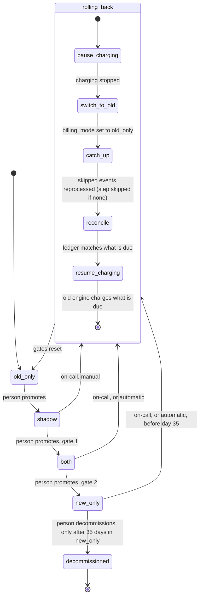

## Billing engine rollout: state machine

We are replacing the old billing engine with a new one. The rollout must be gradual, reversible, and must never charge a customer twice for the same billing period.

A single global flag, `billing_mode`, in the config service selects the mode. It has four values: `old_only`, `shadow`, `both` and `new_only`.

- **Forward** moves go through the modes in that order, one step at a time, with no skipping. A person always makes them. Nothing advances automatically, even when a gate is met.
- **Rollback** jumps back to `old_only` from any later mode.

**Terms**
- **Engine**: the code that reads usage events and computes invoices. There is an old one and a new one.
- **Usage event log**: the input to both engines. It keeps events for 35 days.
- **Ledger**: the billing ledger, the system of record. Only the engine that is currently charging writes to it.
- **Shadow store**: a separate store for invoices that are never charged and never entered in the ledger.
- **Mismatch**: a customer whose old and new invoice totals differ by more than one cent.
- **Billing period**: the period an invoice covers. No customer may be charged twice for one period.
- **Gate**: a condition that must hold before a person may make a forward move.
- **On-call**: the engineer who is currently responsible for responding to production problems.

### Diagram

`decommissioned` is not a value of `billing_mode`. It means the old engine has been removed, and `billing_mode` stays `new_only`.

**Gate 1 (`shadow` to `both`)**: 7 consecutive days with a mismatch rate under 0.1%, and at least 5,000 invoices compared.
**Gate 2 (`both` to `new_only`)**: 14 days in `both` with no unresolved mismatches, plus Finance sign-off.
**Automatic rollback trigger**: in `both` or `new_only`, the new engine's charge failure rate is above 2% over any 10-minute window.

### What each mode does

| Mode | Old engine | New engine |
|---|---|---|
| `old_only` | Computes, writes the ledger, charges. | Off. |
| `shadow` | Computes, writes the ledger, charges. | Reads the same usage events and writes invoices to the shadow store only. It never charges and never writes the ledger. |
| `both` | Computes every invoice into the shadow store only, so it stays current. It does not charge. | Computes, writes the ledger, charges. |
| `new_only` | Stops computing. | Does everything. |

In `shadow` and `both`, a nightly job compares the two engines' invoices per customer and records the results in `comparison_results`. Both gates are measured from this table.

### Rollback

Rollback can start from `shadow`, `both` or `new_only`, and always ends in `old_only`.

- **Manual**: on-call can start it at any time. In `new_only` this is possible only before day 35.
- **Automatic**: it starts on the trigger above.
- **Not a trigger**: errors in the new engine during `shadow` are recorded but never start a rollback, because the new engine is not charging.

The steps, in order:
1. **pause_charging**: stop charging by both engines, so nothing can be charged twice while the mode changes.
2. **switch_to_old**: set `billing_mode` to `old_only`.
3. **catch_up**: the old engine reprocesses the usage events it skipped. This matters only after `new_only`, when the old engine had stopped computing. From `shadow` or `both` the old engine never stopped, so there is nothing to catch up and this step is skipped. The skipped events are still in the log because rollback is allowed only before day 35.
4. **reconcile**: for each customer and billing period, compare the ledger with what the old engine says is due. This ensures no period is charged twice and no due charge is missing.
5. **resume_charging**: the old engine charges everything that is due and not already charged. Charges that came due during the pause are delayed, not dropped.

After any rollback the gates reset. The rollout must go through `shadow` again, and its 7-day count starts over.

### Where state lives

- **Mode**: `billing_mode` in the config service. It is the only source of truth for which mode is active.
- **Gate evidence**: `comparison_results`, written by the nightly job. The rollout tool reads it to decide whether a gate is met. It also holds the day counts, which restart at zero after a rollback.
- **Rollback progress**: a rollback record, stored durably, holding the current step and the status of each step. It lets a failed rollback resume from where it stopped.
- **Charges**: the ledger. Reconcile and charging both use it to check whether a customer's period has already been charged.

### When something fails

- **Charge failures in `both` or `new_only`** above the threshold start a rollback automatically. The billing monitor watches the failure rate and starts the rollback.
- **Errors in a rollback step**: each step can be retried safely, because it first checks whether its work is already done. If a step keeps failing, the rollback stays at that step, charging stays paused, and on-call is paged. No step is skipped, except `catch_up` when there is nothing to catch up.
- **A gate not met**: the rollout stays in its current mode. A person decides what to do.
- **Day 35 in `new_only`**: the old engine may be decommissioned. From then on there is no way back, because the old engine is gone and the log no longer holds the events it would need. A failure after this point must be fixed in the new engine.