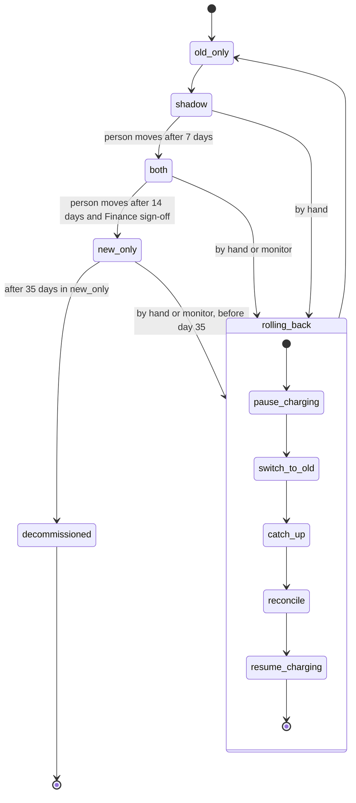

## Billing engine rollout

**Today:** the billing workers run the old engine. It reads usage events from the usage event log (kept 35 days), computes invoices, writes them to the billing ledger (the system of record) and charges customers through the payment provider.

**The change:** a new engine replaces the old one in steps. A flag, `billing_mode`, moves the system through four modes, one step forward at a time. A person makes every forward move. A rollback can return the system to the old engine from any mode except `old_only`. A rollback must never charge a customer twice for a billing period, and it must never drop a charge that is due.

**Terms**
- **Mode:** the value of `billing_mode` in the config service: `old_only`, `shadow`, `both` or `new_only`.
- **Shadow store:** a separate store for invoices that are computed but not charged.
- **Comparison:** a nightly job that compares both engines' invoices per customer and saves the results to `comparison_results`. A mismatch is an invoice total that differs by more than one cent.
- **Billing monitor:** watches the new engine's charge failure rate.
- **Rollback record:** the record of a rollback.

**Modes**
- `old_only`: the old engine does everything. The new engine is off.
- `shadow`: the old engine still charges and writes the ledger. The new engine reads the same usage events and writes its invoices to the shadow store. It never charges and never writes the ledger. Its errors are recorded but never start a rollback. Moving to `both` needs 7 consecutive days with a mismatch rate under 0.1 percent and at least 5,000 invoices compared.
- `both`: the new engine charges and writes the ledger. The old engine keeps computing every invoice into the shadow store without charging, so it stays current. Comparison continues. Moving to `new_only` needs 14 days in `both` with no unresolved mismatches, plus Finance sign-off.
- `new_only`: the new engine does everything. The old engine stops computing. It may be decommissioned after 35 days in `new_only`.

**Rollback**

A rollback starts from `shadow`, `both` or `new_only` and always ends in `old_only`. It starts by hand at any time, or automatically from `both` or `new_only` when the new engine's charge failure rate is above 2 percent over any 10-minute window.

From `new_only`, a rollback works only within 35 days, because the usage event log keeps only 35 days of events for the old engine to reprocess. From day 35 there is no way back.

The steps run in order. Each step can be retried, and a retry must not charge anyone twice.

| Step | What it does | Data it uses | If it fails |
|---|---|---|---|
| 1. Pause charging | Stops the new engine from charging. | Ledger | Retry. Do not go on until it succeeds. |
| 2. Switch to old | Sets the mode to `old_only`, so the old engine is in charge. | `billing_mode` | Retry. |
| 3. Catch up | The old engine reprocesses the usage events it skipped in `new_only`. | Usage event log, shadow store | Retry. If events are missing, stop and tell a person. |
| 4. Reconcile | Checks charges per customer and billing period, so no period is charged twice and no due charge is dropped. | Ledger, `comparison_results`, rollback record | Retry. Send any gap to a person. |
| 5. Resume charging | The old engine charges again. | Ledger | Retry. |

Skipped steps:
- From `shadow`, the new engine never charged, so only step 2 is needed.
- From `both`, the old engine is already current, so step 3 is skipped.

After any rollback the gates reset. The rollout returns to `shadow`, and the 7-day count starts over.

**What happens when things fail**
- Mismatches in `both` block the move to `new_only` until they are resolved.
- Charge failures above 2 percent over 10 minutes in `both` or `new_only` start an automatic rollback.
- New-engine errors in `shadow` are recorded only.
- A rollback requested from `new_only` on or after day 35 is refused. There is no way back.

**Open questions**
- Where the day counts for the 7-day and 14-day gates are kept.
- What the rollback record holds.
- How catch-up finds the usage events it skipped.
- How a person records a forward move and the Finance sign-off.
- Assumed: the 35 days count from entering `new_only`.