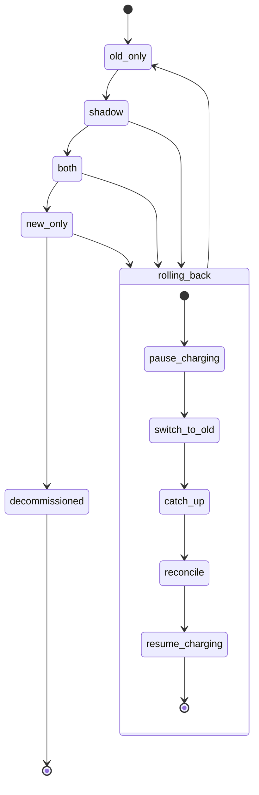

# Billing engine rollout

This document models the move from the old billing engine to the new one as a state machine. The rollout is gradual and reversible, and it must never charge a customer twice.

Today, billing workers run the old engine. They read usage events from the usage event log (kept for 35 days), compute invoices, write them to the billing ledger and charge customers through the payment provider. The rollout adds the new engine beside it in steps. A person moves it forward one mode at a time. A rollback sends it back to the start.

## Terms

- `billing_mode`: one global flag in the config service. It holds the current mode. The config service is where the rollout state lives.
- Mode: one of `old_only`, `shadow`, `both`, `new_only`.
- Shadow store: a separate store for invoices that must not be charged or written to the ledger.
- Ledger: the billing ledger, the system of record for invoices.
- Nightly comparison job: compares the old and new engines' invoices per customer. A mismatch is an invoice total that differs by more than one cent. It writes its results to `comparison_results`.
- Billing monitor: watches the new engine's charge failure rate. It can start a rollback.
- Rollback record: a record of which rollback step has finished, so a rollback can be resumed.
- Decommissioned: the old engine is retired and there is no way back.

## What each mode does

| Mode | Old engine | New engine |
|---|---|---|
| `old_only` | Charges, writes the ledger | Off |
| `shadow` | Charges, writes the ledger | Reads the same usage events, writes only to the shadow store, never charges |
| `both` | Computes every invoice into the shadow store, never charges | Charges, writes the ledger |
| `new_only` | Stopped | Charges, writes the ledger |

The nightly comparison runs in `shadow` and `both`.

## Diagram

## Moving forward

A person makes every forward move, one step at a time, with no skipping.

1. `old_only` to `shadow`: a person sets the flag.
2. `shadow` to `both`: needs 7 days in a row with a mismatch rate under 0.1% and at least 5,000 invoices compared.
3. `both` to `new_only`: needs 14 days in `both` with no unresolved mismatches, plus Finance sign-off.
4. `new_only` to decommissioned: allowed after 35 days in `new_only` without a rollback. From day 35 on there is no way back.

If a forward move fails, the flag stays where it was. A person tries again.

## Rolling back

Rollback can start from `shadow`, `both` or `new_only`, and always ends in `old_only`.

Who starts it:
- On-call, by hand, at any time within the 35-day limit.
- The billing monitor, automatically, when the new engine's charge failure rate is above 2% over any 10-minute window in `both` or `new_only`.
- New-engine errors in `shadow` are recorded only. They never start a rollback.

Steps, in order. Each step is recorded in the rollback record when done. Skip a step where it is not needed.

1. Pause charging, so nobody is charged during the switch.
2. Switch the flag to `old_only`.
3. Catch up: the old engine reprocesses the usage events it skipped. This is needed only when rolling back from `new_only`.
4. Reconcile by customer and billing period, so no one is charged twice and no due charge is dropped.
5. Resume charging.

Afterwards the gates reset. The rollout must go through `shadow` again, and its 7-day count starts over.

## When things fail

| Where | What happens |
|---|---|
| A rollback step fails | Run the step again. Use the rollback record to resume from the last finished step. Repeating a step must not charge twice. |
| Reconcile finds a conflict | Do not resume charging. Alert on-call. |
| Rollback needed after day 35 in `new_only` | Not possible. |

## Open questions

- Who is paged when a rollback step keeps failing.
- How the 35-day limit is counted if a rollback is started right at the edge.
