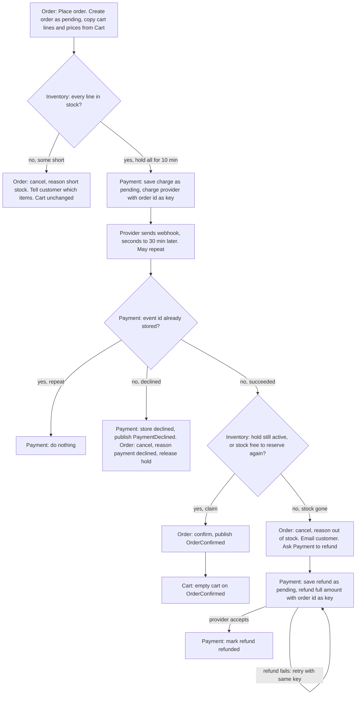

## Checkout plan

Today checkout runs inside the monolith. This plan splits it across four services: Cart, Inventory, Payment and Order. Order coordinates the flow. It creates the order, holds stock in Inventory, charges through Payment, then either confirms the order or cancels it and refunds the money.

Main flow: Place order, hold stock for 10 minutes, charge with the order id as the key, wait for the provider's webhook, claim the stock, confirm the order, then empty the cart.

### Terms

- **Hold**: stock set aside for one order for 10 minutes. Inventory keeps it.
- **Claim**: turning a hold into a sale after payment succeeds. The stock is sold, so on-hand stock goes down and the hold no longer counts as a hold.
- **Order id**: the key sent with every charge and refund. A retry with the same key cannot charge or refund twice.
- **Webhook**: the provider's message saying a charge succeeded or was declined. It can take up to 30 minutes and can arrive more than once.
- **Event**: a message on the shared broker, such as OrderConfirmed. A service subscribes to the events it needs.
- **Refund row**: Payment's record of one refund, either pending or refunded.
- **Order status**: pending, confirmed or cancelled. A cancelled order has a reason: short stock, payment declined or out of stock. Only Order sets it.

Each service stores only its own data. No service reads another's tables.

### Diagram

Notes:
- The cart changes only on OrderConfirmed. Every failure before that leaves the cart as it was.
- Each Place order creates a new order id. A customer whose checkout failed can press Place order again.

### Steps

Each step says what starts it, what it does, what it keeps, and what happens when it fails.

1. **Place order (Order).**
   - Starts: the browser calls Order's start-checkout endpoint with the cart id.
   - Does: asks Cart for the cart's lines and prices, saves the order as pending with that copy, then asks Inventory to reserve stock. Steps 2 and 3 run in this same browser request.
   - Keeps: the order row in Order's database.
   - If it fails: if the Cart call or the save fails, the customer sees an error and the cart is unchanged. If Order crashes after the save but before the reserve call, nothing is reserved or charged. The order stays pending and the customer can press Place order again.

2. **Reserve stock (Inventory).**
   - Starts: Order sends the order id and the order's lines.
   - Does: in one transaction, checks that every line fits in free stock. Free stock is on-hand minus unexpired holds. If all lines fit, saves one hold for the order, expiring 10 minutes later. If any line is short, saves nothing and returns the short items.
   - Keeps: hold rows in Inventory's database.
   - If it fails: on short items, Order cancels with reason short stock, the browser shows the short items, and no payment is requested. If the call itself fails, Order retries with the same order id. Inventory keeps one hold per order id, so a retry is safe.

3. **Take payment (Payment).**
   - Starts: Order asks Payment to charge the order total, after the hold succeeds.
   - Does: saves the charge as pending, then sends it to the provider with the order id as the idempotency key. The provider's immediate reply is ignored. Only the webhook sets the outcome. Once the charge is saved as pending, Place order replies to the browser with 'payment processing'.
   - The customer sees the result when the browser polls Order's status until it is no longer pending. It then shows confirmed, or cancelled with its reason.
   - Keeps: the charge row in Payment's database.
   - If it fails: Order retries the charge with the same order id, so the provider cannot charge twice. If every retry fails, the browser shows an error, the order stays pending, the hold lapses after 10 minutes, and no charge is known. The customer can press Place order again. If the provider did charge but its reply was lost, its webhook still arrives and step 4 handles it.

4. **Handle the webhook (Payment).**
   - Starts: the provider sends the outcome, from seconds up to 30 minutes after the charge. It may arrive more than once. Payment hosts the endpoint, because only Payment talks to the provider.
   - Does: if the event id is already stored, does nothing. Otherwise, in one transaction, stores the event id, finds the charge by its order id, and sets it to succeeded or declined. Then publishes PaymentSucceeded or PaymentDeclined.
   - Keeps: processed event ids and charge status in Payment's database.
   - If it fails: if the transaction fails, nothing is stored, and the provider's resend is processed as new. If publishing fails, Payment retries until the event is published.

5. **Declined (Order and Inventory).**
   - Starts: PaymentDeclined.
   - Does: Order sets the order to cancelled, reason payment declined. Then Order asks Inventory to release the hold. The cancel does not wait for the release.
   - Keeps: order status in Order's database. Inventory deletes the hold row.
   - If it fails: Order retries the release. A missed release still frees the stock when the hold expires. If the hold has already expired or was never saved, the release does nothing.

6. **Claim stock (Inventory).**
   - Starts: Order receives PaymentSucceeded from the broker. The event carries the order id, which Order uses to find the order. Order then calls Inventory over HTTP to claim the order's stock.
   - Does, depending on the order's status:
     - Confirmed: Order does nothing and acknowledges the event.
     - Cancelled: not expected, because a cancelled order is never charged. Order skips the claim and refunds, as in step 7.
     - Pending: Inventory checks the hold. If it is still active, Inventory marks it claimed. If it has expired or is missing, Inventory runs the all-or-nothing reserve again for the same lines. If all lines fit, it saves a new hold marked claimed in one transaction, replacing any old expired hold for that order id. If any line does not fit, it saves nothing.
   - The result is claimed or not claimed. A repeat claim for an order that is already claimed returns claimed.
   - Keeps: the hold row, marked claimed.
   - If it fails: Order retries the claim with the order id. A claimed order stays claimed, so the retry is safe. Order acknowledges PaymentSucceeded only after it has a claim result. If no result ever comes, the order stays pending and the customer has been charged. See open questions.

7. **Confirm or refund (Order and Payment).** Starts on the claim result.
   - Claimed: Order sets the order to confirmed and publishes OrderConfirmed. If the publish fails, Order retries until it succeeds.
   - Not claimed: Order sets the order to cancelled, reason out of stock, and emails the customer. Order asks Payment to refund the full amount. Payment saves a refund row as pending and replies to Order. Payment then calls the provider with the order id as the key, retries until the provider accepts, and marks the row refunded. Order does not wait for the provider.
   - Keeps: order status in Order's database. The refund row in Payment's database, pending or refunded. Rows are never deleted. A pending refund raises an alert.
   - If it fails: if Payment cannot save the refund row, Order retries the request with the same order id. If the provider call fails, Payment retries with the same key, so it cannot refund twice. Until the refund is accepted, the customer sees 'cancelled, out of stock', and the email says the refund is on its way.

8. **Clear cart (Cart).**
   - Starts: OrderConfirmed.
   - Does: empties the cart. Emptying an empty cart does nothing.
   - Keeps: the cart in Cart's database.
   - If it fails: the broker should redeliver the event. If Order crashes after saving confirmed but before publishing, the cart is not cleared. See open questions.

### Open questions

- What does the provider's webhook contain? Payment needs the order id and a unique event id from it.
- Does the provider send a webhook when it rejects a charge at once? If not, the order stays pending until the hold lapses.
- How many charge retries, and how far apart? The brief does not say.
- How many claim retries? Does the broker redeliver unacknowledged events? How long does Order keep trying?
- If the claim never gets a result, the customer has been charged and the order stays pending. The brief says we never keep money for an order we cannot fulfil, but not what to do then.
- Who cancels a pending order that never gets a webhook, or was stranded by a crash?
- If Order crashes after saving confirmed but before publishing, the cart is not cleared. Fixing this needs an outbox, which the brief does not ask for.
- Who gets the pending-refund alert, who acts on it, and how many refund retries come before it?
- If a late payment finds the stock still free, this plan reserves it again. The brief describes only the sold-out case, so confirm this is wanted.