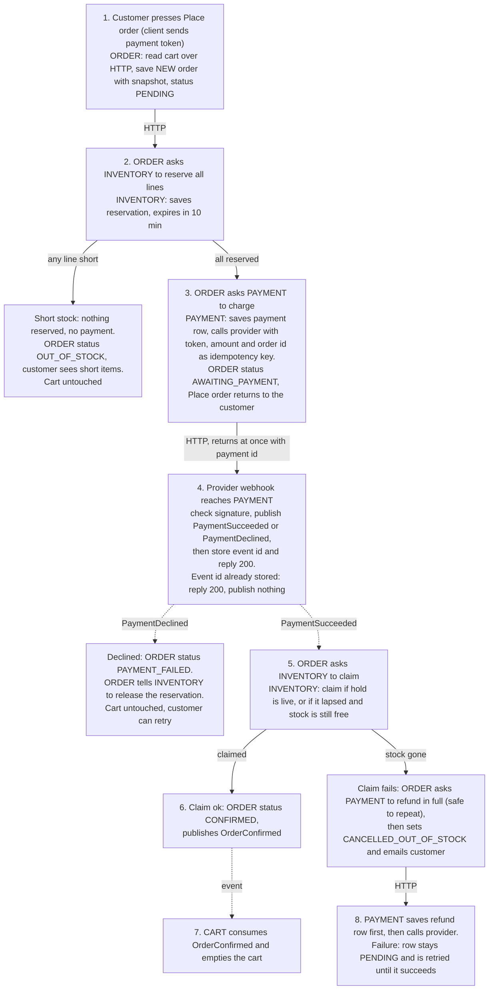

# Checkout plan

Checkout moves out of the monolith into four services. When the customer presses Place order, Order snapshots the cart, Inventory reserves stock, and Payment charges the card. The provider answers later by webhook, and only then is the order confirmed and the cart emptied. If the stock is gone by the time a payment succeeds, the customer is refunded and the order is cancelled.

## Terms

- **Cart**: holds the customer's lines. Its DB stores cart lines.
- **Inventory**: owns stock. Its DB stores available stock counts and reservations (order id, lines, expires_at, status).
- **Payment**: the only service that talks to the payment provider. Its DB stores payments, processed webhook ids and refunds.
- **Order**: runs the checkout. Its DB stores each order, its snapshot of lines and prices, and its status.
- **Reservation**: stock held for one order for 10 minutes, all-or-nothing across lines. Reserving lowers the available count. The sweep or a release raises it again.
- **Claim**: turns a reservation into a sale once payment has succeeded. Claiming an already claimed reservation succeeds.
- **Release**: Order tells Inventory to give a reservation back. Inventory marks it RELEASED and raises the counts. If it was already swept or released, nothing happens and the call succeeds. Release is sent only before any claim.
- **Payment token**: a one-time token for the card. The customer types card details into the provider's own form, so card numbers never reach our services. The client sends only the token.
- **Events**: messages on the shared broker. Delivery is at-least-once, so consumers must cope with repeats. A consumer acknowledges an event only after handling it, so a crash means redelivery.
- No service reads another's DB. Services talk by HTTP (solid arrows) or events (dotted arrows).

## Flow

## Steps and failures

| Step | Starts when | Failure handling |
|---|---|---|
| 1 Order | Customer presses Place order; Order reads the cart | Cart unreachable: checkout fails, nothing to undo. Each press makes a new order id, so a retry after a decline is a fresh order. If Order crashes while PENDING, a periodic check sets any order still PENDING after 10 minutes to FAILED. Nothing was charged and any reservation has lapsed. The customer presses Place order again |
| 2 Reserve | Order calls Inventory | Short: see diagram. Inventory unreachable: order fails, cart untouched |
| 3 Charge | Order calls Payment. Payment returns a payment id without waiting for the outcome, and Place order returns the order id with status AWAITING_PAYMENT (or OUT_OF_STOCK with the short items). The order page shows later changes | Payment or provider call fails or times out: the order stays AWAITING_PAYMENT. Order's periodic check repeats the call for orders with no payment id. This is safe because the order id is the provider key, so no double charge. After a fixed number of tries Order sets PAYMENT_FAILED and releases the reservation. A success that arrives later is refunded (step 5) |
| 4 Webhook | Provider calls Payment, within seconds or up to 30 min | Payment publishes first, then stores the event id, then replies 200. Crash before the reply: the provider redelivers and the event is published again. This is harmless because Order acts only on an order in AWAITING_PAYMENT. Repeat after the id is stored: ignored. Bad signature: rejected. No webhook after 30 min: Payment asks the provider for the payment's status and handles the answer as if it were the webhook |
| 5 Claim | Order receives PaymentSucceeded or PaymentDeclined, which carry the order id | Only an order in AWAITING_PAYMENT acts on the event. Repeat on a finished order: ignored. Success for an order already PAYMENT_FAILED: Order requests a full refund, keeps PAYMENT_FAILED and emails the customer that the payment was refunded. Lapsed hold with stock sold: refund path. Order crashes or Inventory is unreachable: the event is not acknowledged, so it is redelivered and the claim repeats safely |
| 6-7 Confirm | Claim succeeded | Cart never gets the event: the cart stays full and the broker redelivers. Clearing twice is harmless |
| 8 Refund | Order requests it, keyed by order id. A repeat request finds the existing refund row | Payment answers once the refund row is saved, not when the provider has refunded. Order then sets CANCELLED_OUT_OF_STOCK, and the money follows when the provider succeeds. Provider failure: retried until success, alert after repeated failures. Never dropped. Order crashes after asking but before saving the cancel: the event is redelivered, the claim fails again, and the repeated refund request is harmless |

How Inventory handles a claim: it marks the reservation CLAIMED. If the hold is live, or lapsed but not yet swept, the stock is already set aside. If the sweep has returned it, Inventory checks in one transaction that every line's available count covers the order, then lowers the counts. If any line falls short, the claim fails.

Expiry: Inventory alone owns the 10-minute timer. A periodic sweep returns unclaimed lapsed reservations to stock. Order is not told. It learns the outcome only when the payment result arrives and the claim is tried. Meanwhile the customer sees the order as awaiting payment.

Customer notice: after a cancel and refund the customer gets an email saying the refund is on its way, and the order page shows the final status.

## Open questions

- Webhook authenticity is assumed to be the provider's signature with a shared secret. The provider's actual method is not confirmed.
- How the email is sent (Order directly, or a notification service) is not decided. A crash can send it twice.
- Whether Order publishes events through an outbox is not decided. Without one, a crash between saving CONFIRMED and publishing leaves the cart full.
- Retry timing, the number of charge tries in step 3, and when the refund alert fires are not decided.
- Whether the provider's status lookup (used when no webhook arrives) exists is not confirmed.
