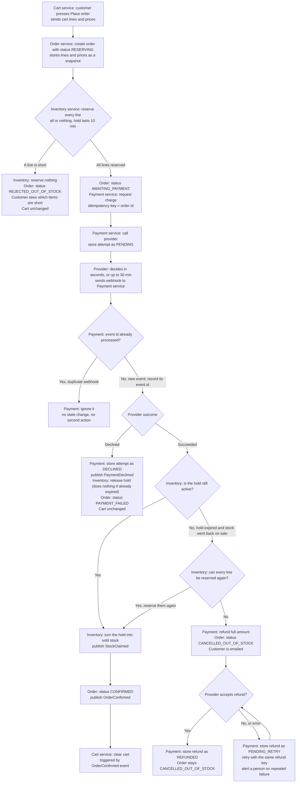

## Checkout plan

Checkout involves four of our services and one outside company:

- **Cart** holds the customer's basket.
- **Inventory** tracks stock and holds (reservations of stock).
- **Payment** records charges and refunds. It is the only service that talks to the payment provider.
- **Order** holds the order, its status, and the prices the customer agreed to.
- **Payment provider** is an external company that actually moves the customer's money. We do not run it.

Each service has its own database, and no service reads another service's tables. Services talk to each other in one of two ways:

- **HTTP:** one service calls another directly and waits for the answer.
- **Events:** one service publishes a short message to the shared message broker, and any other service can subscribe to it. The publisher does not need to know who is listening.

### Terms used below

- **Hold:** a reservation of stock for a set of order lines. A hold lasts 10 minutes. If the order does not claim the stock in that time, the hold expires and the stock goes back on sale.
- **Snapshot:** a copy of the cart lines and prices, taken when the customer presses Place order. Later cart edits and price changes do not touch it.
- **Idempotency key:** a unique key sent with a charge request. If the same request is sent twice, the provider treats it as one charge. We use the order id as the key, so retrying a charge for an order cannot charge the customer twice.
- **Refund key:** the same idea as the idempotency key, but for refund requests. It is sent with each refund request and reused on every retry, so a retried refund cannot refund twice.
- **Webhook:** an HTTP message the provider sends to Payment when a charge reaches an outcome. The same webhook can arrive more than once.
- **Event id:** the unique id of each webhook. Payment remembers which event ids it has already handled.
- **All or nothing:** either every line of the order is reserved, or none is. A partial reservation is never kept.
- **Status values:** Payment stores each charge attempt and each refund with a status. PENDING means the provider has not given an answer yet. DECLINED, REFUNDED and PENDING_RETRY are described below.

### The flow

### How to read the diagram

- Rectangles are steps. Diamonds are decisions. In each box, the text before the colon names the service that does the step.
- Each step starts when the step before it finishes, or when a message arrives.
- The **happy path** runs from Place order, through reservation and payment, to CONFIRMED. The cart is cleared last, after the order is confirmed.
- The **failure branches** are:
  - **Short stock (C to D):** nothing is reserved and no charge is made.
  - **Declined payment (J to K):** the stock is released and the order fails. The cart is kept.
  - **Late success after the hold has lapsed (L to N, then P):** the stock is reserved again if possible. If not, the money is refunded and the order is cancelled.
  - **Failed refund (S to U):** the refund is retried until the provider accepts it, and a person is alerted if retries keep failing.
  - **Duplicate webhook (H to I):** the repeat is ignored.
- Two kinds of step have no service that owns them in the diagram. The provider decides the outcome (J) and whether it accepts a refund (S), so those are results the provider reports, not work we assign. The customer messages in D and P are not yet assigned to a service. See "Open points" below.

### What each service stores

- **Cart:** the customer's cart lines. Only the customer changes the cart. The cart is cleared only after OrderConfirmed.
- **Inventory:** stock levels and holds. A hold lists the lines and quantities it reserves, and an expiry time 10 minutes after it was created. A background timer releases any hold that is not claimed by its expiry, which puts the stock back on sale.
- **Payment:** each charge attempt and its status, the event ids of webhooks already handled, and each refund and its status. Payment is the only service that talks to the provider.
- **Order:** the order, its status, and the price snapshot taken when Place order was pressed.

### Order statuses

- **RESERVING:** the order exists and stock is being reserved.
- **REJECTED_OUT_OF_STOCK:** at least one line was short. Nothing was reserved and no payment was requested.
- **AWAITING_PAYMENT:** stock is held and a charge has been requested. The order stays in this status until the provider's outcome is known, even if the hold has since expired.
- **PAYMENT_FAILED:** the provider declined the charge.
- **CONFIRMED:** payment succeeded and the stock is sold to this order.
- **CANCELLED_OUT_OF_STOCK:** payment succeeded but the order cannot be fulfilled. The customer is refunded and emailed.

### Events

- **StockClaimed** (Inventory): a hold became sold stock.
- **PaymentDeclined** (Payment): the provider declined the charge.
- **OrderConfirmed** (Order): the order is confirmed. The Cart service clears the cart when it receives this event.

### Rules that make the flow safe

- **Timing.** A hold lasts 10 minutes, but a provider result can take up to 30 minutes. Stock can therefore go back on sale while a payment is still pending. The late-success branch handles this.
- **Stock before payment.** Stock is reserved before any charge is requested. If any line is short, nothing is reserved and no charge is made.
- **No double charges.** Every charge request carries the order id as its idempotency key. If a request is retried, the provider treats it as the same charge.
- **Duplicate webhooks.** Payment records each webhook event id when it first handles it. A repeat is acknowledged and ignored. An order never moves back to an earlier status, so a repeated webhook cannot confirm an order twice.
- **Late success.** If the hold has lapsed, Inventory first tries to reserve the lines again, then turns that new hold into sold stock. If it cannot, the full amount is refunded automatically, the order is cancelled as out of stock, and the customer is emailed. A partial order is never shipped.
- **Declined after expiry.** If the hold has already expired when a decline arrives, releasing the hold does nothing.
- **Refunds are never dropped.** A refund that the provider rejects or fails on is stored as PENDING_RETRY and retried with the same refund key. Retries continue until the provider accepts the refund. Repeated failures raise an alert so a person can act. The order stays CANCELLED_OUT_OF_STOCK until the refund is stored as REFUNDED.
- **Failed checkout leaves the cart alone.** On every failure branch the cart is unchanged, so the customer can try again. The cart is cleared only when the order is CONFIRMED.

### Open points

The brief does not settle these. They need an owner before build:

- **Customer emails:** which service sends the "out of stock, refunded" email, and which service sends the "these items are short" message on the short-stock branch.
- **Late-success timing:** the hold is 10 minutes and the provider can take 30. The plan does not say what the order shows the customer while it waits.
- **Successful charge record:** the diagram shows Payment storing a PENDING attempt and a DECLINED attempt, but not how it records a successful one. A status name for success needs to be chosen and added.