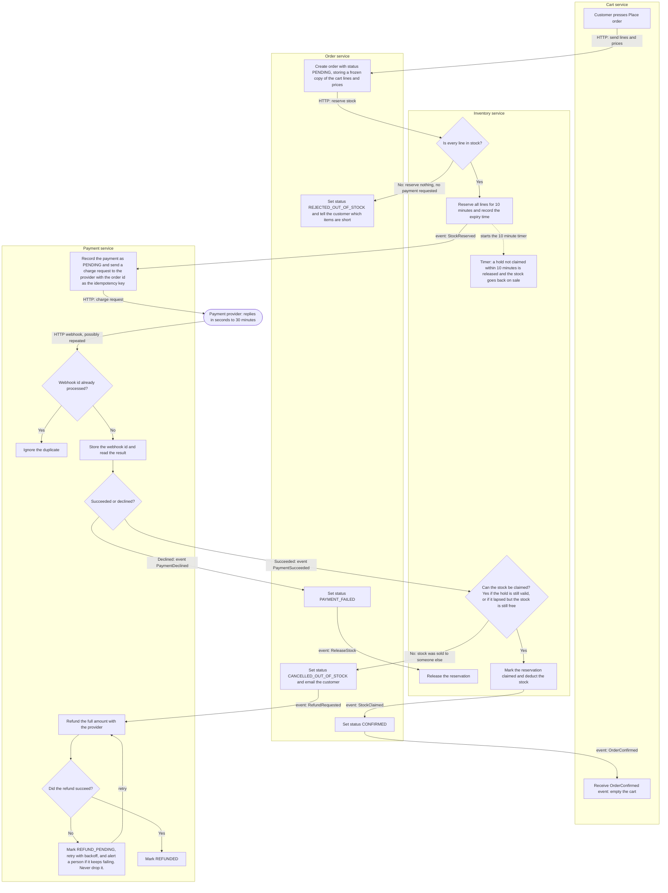

## Checkout plan

Checkout is split across four services plus the external payment provider. In short: Cart starts checkout, Order coordinates it, Inventory reserves stock before any money is requested, and Payment charges the customer. The provider's result arrives later by webhook. If that result arrives after the stock hold has lapsed and the stock has been sold, the customer is refunded in full and the order is cancelled.

Each service has its own database, and no service reads another's tables. Services talk by direct HTTP calls or by events (messages) on the shared message broker.

| Service | Responsibility | What it stores (its own DB) |
|---|---|---|
| **Cart** | Holds the customer's lines. Starts checkout. Empties the cart once the order is confirmed. | Cart lines |
| **Order** | Owns the order and its status. Coordinates the steps. Emails the customer. | Orders: a frozen copy of the cart's lines and prices, plus a status |
| **Inventory** | Reserves, releases and claims stock. | Stock levels, and reservations (order id, lines, expiry time) |
| **Payment** | The only service that talks to the payment provider. Charges and refunds. | Payments and refunds (order id, status, retry count), and the ids of webhooks already processed |
| **Payment provider** (external) | Charges cards. Reports the result later by webhook. | n/a |

### Terms used below

- **Reservation (hold):** stock set aside for one order for 10 minutes. If the order hasn't claimed it by then, it goes back on sale.
- **Claim:** turning a reservation into a permanent deduction from stock. It is attempted once payment succeeds.
- **Webhook:** an HTTP call from the provider to Payment reporting a charge result (succeeded or declined). It usually arrives within seconds but can take up to 30 minutes, and the provider may deliver the same one more than once.
- **Idempotency key:** a value sent with a charge request so the provider treats repeats of that request as one. We use the order id, so a retried request can never charge the customer twice.

### Flowchart

Read top to bottom. Each box sits in the service that performs the step. Each arrow label says how the next step is triggered: "HTTP" is a direct call, "event" is a message on the broker. The dotted line starts a timer; it is not a call.

### Notes

**Happy path.** Place order creates a PENDING order with a frozen copy of the cart, so later cart edits or price changes don't affect it. Inventory reserves all the stock, and only then does Payment charge. When the provider's webhook reports success, Inventory claims the reservation, Order becomes CONFIRMED, and only then does Cart empty itself.

**Failure branches**
- **Short stock.** Inventory checks every line first. If any line is short it reserves nothing. Order is marked REJECTED_OUT_OF_STOCK and tells the customer which items are short. Payment is never contacted.
- **Declined payment.** Order becomes PAYMENT_FAILED and Inventory releases the reservation right away rather than waiting for the 10-minute timer.
- **Late success after the hold lapsed.** The webhook can arrive up to 30 minutes after the charge, but a hold lasts 10, so the stock may already have been released. On success, Inventory tries to claim the stock. If the hold lapsed but the stock is still free, the claim succeeds. If the stock has been sold to someone else, the claim fails. Order then becomes CANCELLED_OUT_OF_STOCK and emails the customer, and Payment refunds the full amount. We never ship partial orders and never keep money for an order we cannot fulfil.
- **Failed refund.** The provider can reject a refund. The refund is marked REFUND_PENDING in Payment's database and retried with backoff. If it keeps failing, a person is alerted. A refund is finished only once it is marked REFUNDED, so it is never silently dropped.
- **Duplicate webhooks.** Payment stores the id of every webhook it processes. A repeat finds its id already stored and is ignored. This is separate from the idempotency key: the order id on every charge request stops a retried charge request from charging the customer twice.

**Cart is untouched on any failure.** Only the OrderConfirmed event empties the cart. In every failure branch the cart stays exactly as it was, so the customer can try again.

**Statuses.** Order: PENDING, CONFIRMED, REJECTED_OUT_OF_STOCK, PAYMENT_FAILED, CANCELLED_OUT_OF_STOCK. Refund (stored by Payment): REFUND_PENDING, REFUNDED.

**Design choice to confirm.** On a late success, the design lets the claim succeed if the lapsed stock is still free, since refunding a customer whose stock is available would be needless. If you would rather always refund once a hold has lapsed, remove that case from the claim check.