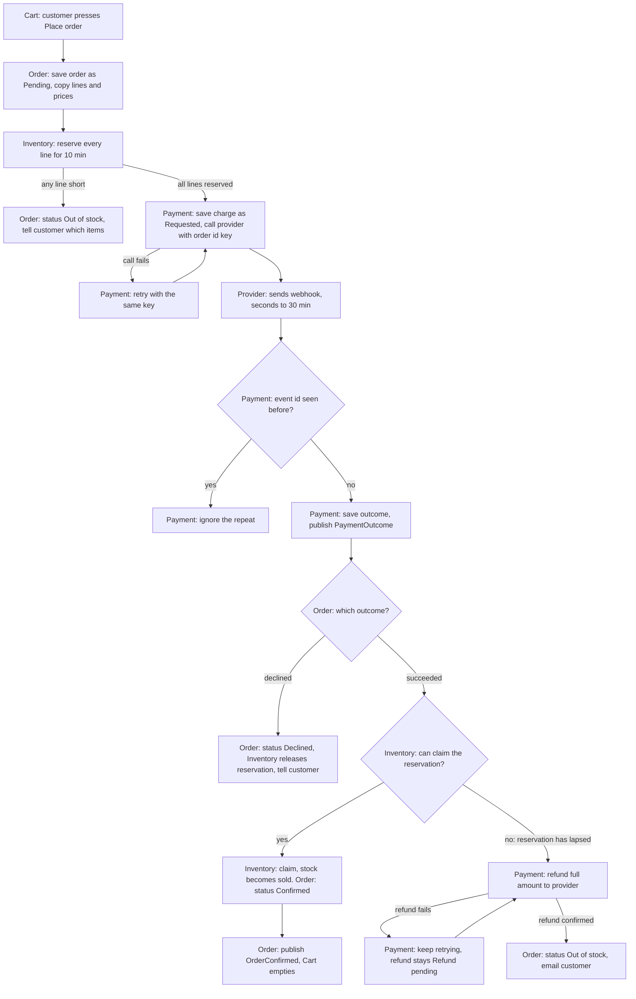

# Checkout plan

Checkout moves out of the monolith into four services: Cart, Inventory, Payment and Order. The plan holds stock before any money is requested. If a payment succeeds after the stock hold has lapsed, the money is refunded and the order is cancelled. The cart is emptied only after the order is confirmed.

## Terms

- **Order**: the customer's purchase. It stores a copy of the lines and prices from Place order, plus the order's status.
- **Cart**: the customer's basket before checkout.
- **Inventory**: stock counts and reservations.
- **Reservation**: stock held for one order for 10 minutes. It expires by itself if not claimed.
- **Claim**: turn a reservation into sold stock. Only done after payment succeeds.
- **Payment**: the only service that talks to the payment provider.
- **Provider**: the outside payment company.
- **Order id**: the id of the order. It is the idempotency key on every charge and refund. A repeat with the same key is treated as the same request, so the customer is never charged twice.
- **Webhook**: a message from the provider that reports a charge outcome. It can arrive up to 30 minutes late and can arrive more than once.
- **Event**: a message on the shared message broker.

Notes:
- Order statuses are Pending, Confirmed, Declined, Out of stock and Refund pending. Order saves each change in its own database.
- Stock is reserved before any payment is requested. If any line is short, nothing is reserved.
- The diagram does not show the 10-minute expiry. Inventory drops any reservation that is not claimed in time, and sends no message.

## Steps

Each step runs in order. Each step lists what starts it, what it does, which service keeps the data, and what happens when it fails.

1. **Create the order (Order).**
   - Starts: the customer presses Place order in Cart.
   - Does: Cart sends its lines and prices to Order. Order saves them as a Pending order. The copy never changes after this.
   - Kept by: Order database.
   - If it fails: nothing is saved. The customer sees an error. The cart is unchanged.

2. **Reserve stock (Inventory).**
   - Starts: Order asks Inventory to reserve the order's lines.
   - Does: Inventory checks every line in one transaction. If all lines are in stock, it reserves them all for 10 minutes. If any line is short, it reserves none.
   - Kept by: Inventory database. It stores stock counts and reservations (order id, lines, expiry time).
   - If it fails: a short line means Order sets status Out of stock and tells the customer which items. No payment is requested. If the call itself fails, Order retries with the same order id. Inventory ignores a repeat for an order it has already reserved.

3. **Request payment (Payment).**
   - Starts: Order asks Payment to charge the order total, with the order id.
   - Does: Payment saves the charge as Requested. It calls the provider and sends the order id as the idempotency key.
   - Kept by: Payment database. It stores each charge and each webhook event id.
   - If it fails: Payment retries with the same key. The provider does not charge twice. If there is still no answer, the charge stays Requested until a webhook arrives.

4. **Receive the outcome (Payment).**
   - Starts: a webhook from the provider.
   - Does: Payment checks whether it has already seen this event id. If yes, it ignores the webhook and replies OK. If no, it saves the event, sets the charge to Succeeded or Declined, and publishes PaymentOutcome.
   - Kept by: Payment database.
   - If it fails: if saving fails, Payment replies with an error. The provider sends the webhook again.

5. **Act on the outcome (Order and Inventory).**
   - Starts: the PaymentOutcome event.
   - Does:
     - Declined: Order sets status Declined. Inventory releases the reservation. The customer is told.
     - Succeeded: Inventory tries to claim the reservation.
       - Claim works: Order sets Confirmed. Go to step 6.
       - Claim fails because the reservation lapsed: go to step 7.
   - Kept by: Order database (status). Inventory database (claim or release).
   - If it fails: the broker redelivers the event. Claim and release are safe to repeat for the same order id. If release fails, the reservation expires by itself after 10 minutes.

6. **Confirm and clear the cart (Order and Cart).**
   - Starts: Order publishes OrderConfirmed.
   - Does: Cart empties the customer's cart.
   - Kept by: Cart database.
   - If it fails: the broker redelivers until Cart acknowledges. Emptying twice does no harm.

7. **Refund a late payment (Order and Payment).**
   - Starts: the payment succeeded but the reservation had lapsed.
   - Does: Order sets status Refund pending and asks Payment to refund the full amount. Payment calls the provider with the order id plus "refund" as the idempotency key.
   - Kept by: Payment database (refund record). Order database (status).
   - If it fails: Payment keeps retrying. The refund record stays Refund pending. It is never deleted.

8. **Cancel and email (Order).**
   - Starts: Payment reports that the refund succeeded.
   - Does: Order sets status Out of stock and emails the customer that the order is cancelled and refunded. Order waits for the refund so the email is true when sent.
   - Kept by: Order database.
   - If it fails: the email is retried until it is sent. The status does not change.

## What happens when things fail

| Failure | What happens | Cart |
|---|---|---|
| A line is short | Nothing reserved, no payment, status Out of stock | Unchanged |
| Payment declined | Reservation released, status Declined | Unchanged |
| Payment succeeds after the reservation lapsed | Full refund, then status Out of stock and email | Unchanged |
| Refund fails at the provider | Payment retries. Refund stays Refund pending until the provider confirms | Unchanged |
| Duplicate webhook | Payment ignores the repeat | Unchanged |
| Payment call fails or times out | Retry with the same order id key. No double charge | Unchanged |
| Order cannot be saved at step 1 | Nothing saved, customer sees an error | Unchanged |
| Cart misses OrderConfirmed | Broker redelivers | Emptied once Cart acknowledges |
| Release call fails | Reservation expires after 10 minutes | Unchanged |

## Open questions

- If no webhook arrives, the order stays Pending. Should Payment ask the provider for the charge status, and after how long? Not decided.
- Does the provider answer a refund at once, or by webhook? The plan assumes Payment reads the answer from the refund call. Unknown.
- How long may a refund stay Refund pending before a person is alerted? Not decided.
- If the reservation has lapsed but the stock is still free, should we reserve again before refunding? The brief says refund and cancel, so this plan does not re-reserve. Confirm this.