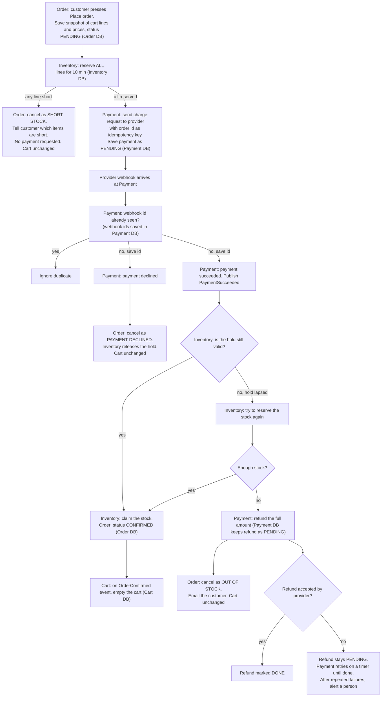

## Checkout plan

Checkout moves out of the monolith into four services: Cart, Inventory, Payment and Order. When the customer presses Place order, Order snapshots the cart, Inventory holds the stock, and Payment charges the customer through the payment provider. The provider answers later by webhook. If the order is paid and the stock is still held, the order is confirmed and the cart is emptied. Otherwise the customer is refunded and the cart is left alone.

### Terms

- **Order snapshot**: the cart's lines and prices copied into the order at the moment of Place order. Later cart or price changes do not touch it.
- **Reservation**: stock held for an order for 10 minutes. If the order has not claimed it by then, it goes back on sale.
- **Idempotency key**: the order id, sent with every charge request, so a retried request can never charge twice.
- **Webhook**: the provider's call to Payment reporting that a charge succeeded or was declined. It takes seconds, but can take up to 30 minutes, and may arrive more than once.
- **Event**: a message on the shared broker. Services never read each other's databases. They use HTTP or events.

### Diagram

Each box names the service that does the step and the database that service writes to.

### Steps

Each step lists what starts it, what it does, where it keeps data, and what happens when it fails.

1. **Place order**
   - Starts: the customer presses Place order.
   - Does: Order saves the snapshot with status PENDING, then asks Inventory to reserve.
   - Data: Order DB.
   - If it fails: nothing was reserved or charged. The customer sees an error and the cart is unchanged.

2. **Reserve stock**
   - Starts: Order's request to Inventory.
   - Does: reserves every line for 10 minutes, or none.
   - Data: Inventory DB.
   - If a line is short: nothing is reserved, no payment is requested, Order cancels as short stock and tells the customer which items are short.

3. **Request payment**
   - Starts: Order, once the reservation succeeded.
   - Does: Payment sends the charge to the provider with the order id as idempotency key. Only Payment talks to the provider.
   - Data: Payment DB (payment status PENDING).
   - If the request fails or times out: Payment retries with the same key, which is safe.

4. **Receive the webhook**
   - Starts: the provider calls Payment, up to 30 minutes later.
   - Does: Payment checks whether it has seen this webhook id. If so, it ignores it. If not, it saves the id, then acts on succeeded or declined.
   - Data: Payment DB (webhook ids, payment status).
   - Declined: Order cancels as payment declined, Inventory releases the hold, and the cart is unchanged.

5. **Confirm the order**
   - Starts: PaymentSucceeded event.
   - Does: if the hold is still valid, Inventory claims the stock and Order sets CONFIRMED. If the hold has lapsed, Inventory tries to reserve the stock again, and if that works the order is confirmed.
   - Data: Inventory DB, Order DB.

6. **Empty the cart**
   - Starts: OrderConfirmed event.
   - Does: Cart empties itself.
   - Data: Cart DB.
   - If it fails: the event is redelivered, and emptying an already-empty cart does nothing.

7. **Out of stock after payment**
   - Starts: the hold lapsed and the stock cannot be reserved again.
   - Does: Payment refunds the full amount, Order cancels as out of stock, and the customer is emailed. No partial orders are shipped.
   - Data: Payment DB (refund record), Order DB.
   - If the refund fails at the provider: the refund stays PENDING and Payment retries on a timer until it succeeds. After repeated failures a person is alerted. A refund is never dropped.

### What happens when things fail

| Situation | Result |
|---|---|
| Any line short | Nothing reserved, no payment, customer told which items are short, cart unchanged |
| Payment declined | Order cancelled, hold released, cart unchanged |
| Duplicate webhook | Ignored |
| Success after hold lapsed, stock gone | Full refund, order cancelled as out of stock, customer emailed, cart unchanged |
| Refund fails at provider | Stays PENDING, retried until done, person alerted after repeated failures |
| Charge request retried | Same order id key, so no double charge |

### Open questions

- How many refund retries before a person is alerted, and how is that person alerted?
- Does the customer also get an email when the order is declined or short, or only an on-screen message?