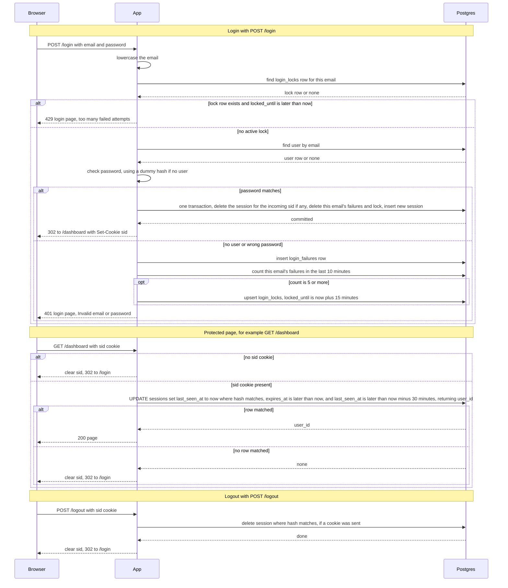

## Auth plan

### Summary

This adds sign-in to the team-scheduling app. Today every page is public. After this change, every page except `/login` needs a signed-in user. The app is server-rendered: pages are HTML and users submit forms. There are no separate API clients.

Today the app has no sign-in. It runs as two identical instances behind a load balancer, with no sticky sessions. A load balancer sends each request to either instance, so a session cannot live in one instance's memory. Both instances already share one Postgres database, so sessions, failure counts and locks are stored there.

Here is the flow from start to finish. A user posts an email and password to `/login`. If the email is not locked and the password is right, the server creates a session row in Postgres and sets a `sid` cookie. The cookie holds only a random session ID. Each later request looks up that row and checks that it has not expired. Logout deletes the row. Sign-up and password reset are out of scope.

### Terms

- **Session:** a record on the server that says which user is signed in and when that sign-in ends.
- **Session ID:** a random string from a secure random source. The browser keeps it in the `sid` cookie.
- **Session ID hash:** the SHA-256 hash of the session ID. The table stores the hash, so a copy of the table cannot be used to sign in.
- **Cookie `sid`:** the browser's copy of the session ID. It is set with HttpOnly, Secure and SameSite=Lax.
- **Failed attempt:** a `POST /login` where the email is unknown or the password is wrong.
- **Lock:** a row in `login_locks` that refuses logins for one email until a set time.
- **Idle timeout:** a session ends after 30 minutes with no requests.
- **Absolute timeout:** a session ends 12 hours after login, even if it is still active.
- **Transaction:** a group of database changes that either all happen or none happen.
- **Upsert:** insert a row, or update it if it already exists.
- **Dummy hash:** a fixed bcrypt hash. An unknown email is checked against it, so the login takes about as long as a real check.
- **Cleanup:** a timed delete that removes expired rows.

Tables:
- `users` (existing): `id`, `email` (stored lowercase, unique), `password_hash` (bcrypt).
- `sessions`: `session_id_hash` (primary key), `user_id`, `created_at`, `last_seen_at`, `expires_at` (`created_at` plus 12 hours).
- `login_failures`: `email`, `attempted_at`. One row per failed attempt.
- `login_locks`: `email` (primary key), `locked_until`.

### Diagram

### Rules that the diagram does not show

- **Email matching.** The app lowercases the submitted email before any check.
- **Lock rule.** Five failed attempts within any 10 minutes lock that email for 15 minutes. The count looks back 10 minutes from now. The 5th failed attempt still gets the 401 response. After that, logins for that email get 429 without a password check.
- **Locked requests are not counted.** A request refused by a lock is not recorded as a failure, so it does not extend the lock.
- **Lock ends by time.** A lock is ignored once `locked_until` has passed. Cleanup deletes it.
- **Success clears the count.** A successful login deletes that email's failure rows and its lock row.
- **Same answer for unknown and wrong.** An unknown email and a wrong password both get HTTP 401 and the text "Invalid email or password". For an unknown email, the password check still runs against the dummy hash, so response time does not show whether the account exists. The 429 response is the same for every email, so it reveals nothing either.
- **New session ID on every login.** Each successful login creates a new random session ID, even if the browser sent a `sid` cookie. The session named by the incoming cookie is deleted in the same transaction as the new insert, whether or not it is still valid.
- **Timeouts.** A session is valid only while now is before `expires_at` and before `last_seen_at` plus 30 minutes. Every valid request sets `last_seen_at` to now.
- **Refused protected requests** clear the cookie and redirect to `/login`.
- **Logout** behaves the same with a session, with an unknown session, or with no cookie.
- **Cookie contents.** The cookie holds only the raw session ID. No user data goes in it.

### Design choices

- **Storage: Postgres.** Sessions, failure counts and locks live in Postgres. Process memory is not shared between the two instances, so it cannot hold them. Redis would add a new service that the stack does not have today. Both instances already use Postgres, so it meets the need without a new service.
- **Session IDs are stored hashed.** The table stores only the hash. The cookie holds the ID.
- **Locks are per email, not per IP.** The brief asks for a lock on "that email".
- **Failures count for unknown emails too.** If only real accounts were counted, a 429 would reveal that the account exists.
- **Expiry is checked on every request** by comparing timestamps. The app does not rely on cleanup to refuse expired sessions.
- **Cleanup runs in each app instance every 10 minutes.** Each run is one delete per table. Running it twice does no harm, so both instances can run it.
- **Database errors fail closed.** The user sees an error page. No one is signed in or signed out by accident.

### Steps

1. **Login.** Starts when a user submits the login form to `POST /login`.
   - The app lowercases the email.
   - It reads `login_locks` for that email. If a lock is active, it returns 429 and stops. Data kept here: `login_locks`.
   - It looks up the user in `users` and checks the password. If there is no user, it checks against the dummy hash.
   - On success, one transaction deletes the session named by the incoming `sid` cookie (if any), deletes this email's failure rows and lock row, and inserts a new session row. Then the app sets the new `sid` cookie and redirects to `/dashboard`. Data kept here: `sessions`, `login_failures`, `login_locks`.
   - On failure, the app inserts a `login_failures` row and counts this email's failures from the last 10 minutes. If the count is 5 or more, it upserts a `login_locks` row with `locked_until` set to now plus 15 minutes. Then it returns the login page with 401.
   - If a database call fails or times out, the app returns the 503 page and changes nothing. See the failure table.
2. **Protected request.** Starts when a browser asks for any page except `/login`.
   - If there is no `sid` cookie, the app clears the cookie and redirects to `/login`.
   - If there is a cookie, one UPDATE on `sessions` does three things in one step. It finds the row whose hash matches the hash of the cookie's ID, where `expires_at` is later than now and `last_seen_at` is later than now minus 30 minutes. It sets `last_seen_at` to now. It returns `user_id`.
   - If a row matched, the app serves the page.
   - If no row matched, the app clears the cookie and redirects to `/login`.
   - Data kept here: `sessions`.
3. **Logout.** Starts with `POST /logout`.
   - If the request has a cookie, the app deletes the `sessions` row whose hash matches. It does this before it replies.
   - Then it clears the cookie and redirects to `/login`.
   - With no session, or no cookie, the result is the same.
   - Data kept here: `sessions`.
4. **Cleanup.** Starts on a timer in each app instance, every 10 minutes. It runs one delete per table:
   - `sessions` rows past `expires_at`, or idle for more than 30 minutes.
   - `login_failures` rows older than 10 minutes.
   - `login_locks` rows past `locked_until`.
   - Both instances can run it at once. If it fails, it logs the error and tries again at the next tick. Step 2 refuses expired sessions even before cleanup removes them.

### What happens when things fail

| Where | What goes wrong | What the user sees | What the app does |
|---|---|---|---|
| Login lock check, user lookup or session write | Database error or timeout | 503 login page: "Sign-in is unavailable right now. Try again shortly." | Sets no cookie and changes nothing. The transaction is all or nothing. |
| Recording a failed attempt | Database error | Same 503 page | Does not accept the login. Never skips the lock step silently. |
| Protected request check | Database error or timeout | 503 error page | Keeps the cookie and does not redirect, so a database blip does not sign users out. |
| Logout | Database error or timeout | 503 error page | Keeps the cookie. The session ends by itself after 30 minutes idle, or 12 hours after login at the latest. |
| Cleanup | Database error | Nothing shown | Logs it and retries at the next tick. |
| Session missing, unknown or expired | Normal refusal | Redirect to `/login` | Clears the cookie. |
| Email locked | Normal refusal | 429 login page: "Too many failed attempts. Try again in 15 minutes." | Refuses without a password check. |
| Wrong password or unknown email | Normal failure | 401 login page: "Invalid email or password" | Records a failure. May create a lock. |

Each database call has a timeout, so a slow database becomes a 503 and not a hanging request.

### Open questions

- What is the timeout for each database call? No value is chosen yet.
- The lock is per email, so anyone can lock a known email for 15 minutes by failing 5 times. The brief does not ask for a per-IP limit. Decide whether to add one.