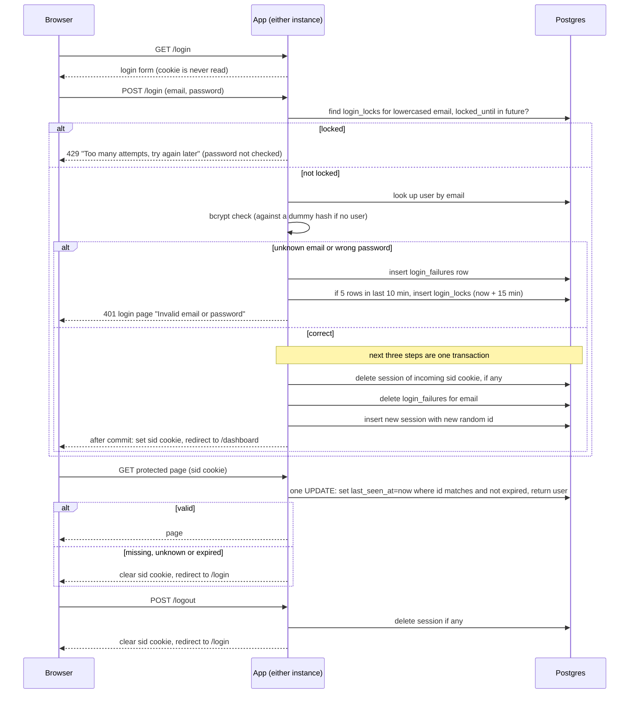

## Auth plan

Today every page of this server-rendered app (HTML pages and form posts, no SPA) is public. After this change every page except `/login` needs a signed-in user. The app runs as two identical instances behind a load balancer with no sticky sessions, so process memory cannot hold login state. All state lives in the one Postgres database both instances already use. Postgres is chosen over Redis because it is already in the stack, so no new service is added. The flow: a user posts email and password to `/login`; the app checks for a lockout, checks the password, and on success creates a session row and sets a cookie holding only the random session ID. On every later request the app looks that ID up in Postgres and either serves the page or sends the user to `/login`. Logout deletes the session row. Sign-up and password reset are out of scope.

Terms:
- Session: a row in `sessions` (id, user_id, created_at, last_seen_at). The id is a long random value, new for each login.
- `sid`: the cookie holding only the session id. Flags: HttpOnly, Secure, SameSite=Lax. No user data goes in it.
- `users`: already exists (id, email, password_hash). `email` is stored lowercase and unique; `password_hash` is bcrypt. Emails are lowercased before every lookup and every login_failures/login_locks row.
- `login_failures`: one row (email, failed_at) per failed login attempt.
- `login_locks`: one row (email, locked_until) per locked email.
- bcrypt check: compares the submitted password to the stored hash. If the email is unknown, it is run against a dummy hash so the response time looks the same.
- Fail closed: when storage fails, the user is never let in.

Steps, in the order they happen:
1. Show the form. `GET /login` is open to everyone and never reads the cookie. Someone with a valid `sid` just sees the form; if they submit it, step 4 replaces their old session.
2. Check the lock. `POST /login` lowercases the email and looks in `login_locks` for a row whose `locked_until` is in the future. If found, return HTTP 429 "Too many attempts, try again later" without checking the password. The 429 is the same for any email, existing or not, so it reveals nothing. If Postgres fails here, return the 503 below.
3. Check the password. Look up the user and run the bcrypt check (against a dummy hash if no user). An unknown email takes exactly the same path as a wrong password. Both insert a `login_failures` row, then, if that email now has 5 rows in the last 10 minutes, insert a `login_locks` row with `locked_until` = now + 15 minutes. Both return HTTP 401 and the login page showing "Invalid email or password". Lockout is per email, not per IP.
4. Succeed. In one database transaction: delete the session the incoming cookie pointed to (if any), delete that email's `login_failures`, and insert a new session with a brand-new random id. Only after commit, set `sid` and redirect to `/dashboard`. The old session is always destroyed and a new id issued, so an old or planted id never becomes a logged-in session. Other sessions of the same user are not touched. If the transaction fails, nothing changes: the old session (if any) still exists, no cookie is set, and the user gets the 503.
5. Check each protected request. One UPDATE sets `last_seen_at` = now where the id matches, `last_seen_at` is within 30 minutes and `created_at` is within 12 hours, and returns the user. A row back means valid: serve the page. No row means missing, unknown or expired: clear `sid` and redirect to `/login`. Every valid request restarts the 30-minute idle clock; the 12-hour limit counts from login and never moves. The session ends at whichever limit comes first.
6. Log out. `POST /logout` deletes the session if one exists, then clears `sid` and redirects to `/login`. It behaves the same with or without a session. The delete happens before the reply.
7. Clean up. Every 5 minutes each instance deletes expired sessions, old `login_failures` and expired `login_locks`. Deletes are safe to repeat, so both instances can run it at once. Between runs, expired rows are ignored by the checks above. A successful login also clears that email's failures.

What happens when things fail:
- Postgres unreachable or erroring during login, page validation or logout: return HTTP 503 with a plain "Something went wrong, please try again" page. The user is never let in. The cookie is not cleared, so a brief outage does not log people out.
- For logout this means the session was not destroyed, so the user stays signed in and can press logout again. Clearing the cookie would falsely claim a logout.
- Failed login (bad password or unknown email): 401, described in step 3. A DB error while recording the failure also returns 503.
- Two simultaneous failures on different instances might let one extra attempt through, because counting is not locked across instances. Accepted.

Open questions:
- None known. The 429 wording, 5-minute cleanup interval and 503 page text are my choices, not from the brief.