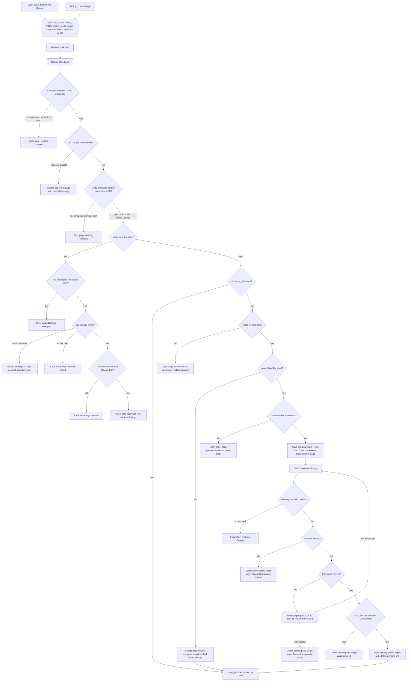

# Google sign-in

## What this is

Today a user signs in with email and password at `POST /login`. That route loads the user by email, checks a bcrypt hash, and counts failed tries. After 5 misses it locks the account for 15 minutes. On a correct password it calls `start_session`, which creates a session and sets the `sid` cookie.

This change adds "Sign in with Google" to the login page and "Link Google" to Account Settings. Both start the same Google round trip. Every successful Google sign-in ends in the same `start_session` call, so the user gets the same session as with a password.

The main flow has three parts. First, the start step sends the user to Google with a one-time `state`, a `nonce` and a PKCE verifier. All three are saved in Redis for 10 minutes. Second, the callback checks the `state`, swaps Google's code for an ID token and reads the account's `sub`. Third, the callback either signs the user in, creates a user, asks for the password of an existing account before linking, or, from Settings, links the account.

Accounts are matched by `sub`, not by email, because an email can change. An existing account is linked only after its password is entered. So a Google account cannot take over an account by email alone. Each Google account links to at most one user, and each user has at most one Google account. Google never changes our stored email.

## Terms

- **Google sign-in (OpenID Connect, OIDC)**: a way for Google to confirm who the user is. Our server asks Google, and Google replies with an ID token.
- **Authorization code**: a one-time code that Google gives us after the user agrees. Our server swaps it for an ID token.
- **PKCE**: a secret (the verifier) that we make at start, and send to Google only in hashed form (the S256 challenge). Google checks that the same server that started the sign-in finishes it, so a stolen code alone is not enough.
- **state**: a random value we send to Google and get back. It must match a saved entry, and it is used only once.
- **nonce**: a random value we send to Google. It must appear inside the ID token and match the one we saved.
- **ID token**: a signed statement from Google. We check its signature, issuer, audience, expiry and nonce, then read `sub`, `email` and `email_verified`. We keep nothing else from Google.
- **sub**: Google's permanent ID for the account. It does not change when the email does.
- **mode**: either `login` or `link`. The start step saves it, so the callback knows which one applies.
- **return page**: the page the user started from, either the login page or Settings.
- **next**: the page to open after sign-in. The start step saves it. It is used only if it is a relative path on our site, such as `/home`, with no domain in front.
- **user_identities**: a new table. Each row links one Google `sub` to one user.
- **Pending link**: a short-lived record saying that a Google account wants to link to a named user, once that user's password is confirmed. It holds the user ID, the `sub` and `next`.
- **Pending ID cookie**: a browser cookie that holds the random ID of a pending link. Only the browser that finished the Google round trip has it.
- **Redis**: a fast store for short-lived entries. The entries here expire after 10 minutes.
- **start_session**: the existing function that creates a sessions row and sets the `sid` cookie.
- **sid cookie and sessions row**: the browser cookie that holds the session ID, and the database row it points to.
- **failed_logins and locked_until**: the lockout fields on `users`. `failed_logins` counts wrong passwords. `locked_until` is the time until which password checks are refused.

## Flow

Notes:
- The login page and Settings use the same start step. The saved mode tells the callback which one it is.
- An existing account is linked only after its password is entered, and the usual lockout applies.
- Google sign-in does not check `locked_until` for a known `sub`. The lock stops password guessing, and a Google sign-in has no password to guess. The confirm step does check it, because that step asks for a password.
- Google never changes our stored email. We store a Google email only when we create a user from it.
- Every refusal shows a short message on the return page. The wording is not fixed here.

## Steps

1. **Start.** Starts when the user clicks Sign in with Google on the login page, or Link Google in Settings. The server makes a random `state`, `nonce` and PKCE verifier. It saves them in Redis as `oauth_state:<state>` for 10 minutes. The same entry holds the mode, the return page, the `next` value (login only) and the signed-in user ID (link only). It then redirects the browser to Google with the scopes `openid email profile`, the state, the nonce, and the S256 challenge of the verifier. If Redis is unavailable, it shows an error page and changes nothing.

2. **Callback: check the state.** Starts when Google redirects the browser back. The server reads and deletes `oauth_state:<state>` in one step, using the state from the URL. Deleting it in the same step as reading it means the state works only once.
   - If the entry is missing, because the state was unknown, expired after 10 minutes, or already used, show an error page and change nothing. The whole round trip to Google must finish within those 10 minutes.
   - If Redis is unavailable, show an error page and change nothing.
   - If Google's reply contains an error, such as the user pressing Cancel, send the user to the return page with a neutral message. Google's error reply carries the same state, so the entry is still found. The state is used up either way.
   - Otherwise, keep the mode, the return page and `next` from the entry, then go to step 3.

3. **Callback: exchange the code.** The server sends the code and the saved verifier to Google's token endpoint. It then checks the ID token: signature, issuer, audience, expiry, and that its nonce matches the saved one. The verifier and the ID token are used once and then dropped. If the exchange fails, the ID token fails a check, or Google is down or too slow, show an error page and change nothing. The user must start again. There is no retry.

4. **Link mode (from Settings).** Starts when the saved mode is `link`. The browser's `sid` must belong to the user ID saved at start. If it does not, show an error page and change nothing. Then:
   - If the `sub` is linked to another user, refuse: this Google account is already in use.
   - If the `sub` is already linked to this user, go back to Settings and say it is linked.
   - If this user already has a different Google account linked, refuse.
   - Otherwise insert a `user_identities` row and go back to Settings.

   No password is asked for, emails are not compared, and no session is created.

5. **Login mode: known account.** Starts when the saved mode is `login` and a `user_identities` row has this `sub`. The server calls `start_session` for that user and redirects to the saved `next`, or to `/home`. The lockout fields are not checked.

6. **Login mode: unknown account.** Starts when the saved mode is `login` and no `user_identities` row has this `sub`. Check `email_verified` from the ID token.
   - **False:** refuse, and point the user to email and password. Nothing is created.
   - **True, and no user has this email** (compared lowercased): create a user with no password and the email marked verified now. Insert a `user_identities` row for it, then call `start_session`.
   - **True, a user has this email, and that user has no password:** refuse. Tell the user to set a password with the reset email.
   - **True, a user has this email, and that user has a password:** save a pending link `pending_link:<id>` in Redis for 10 minutes, holding the user ID, the `sub` and `next`. Put the random ID in an HttpOnly cookie and show the confirm password page. No session is created. If the browser already holds a pending link, the new one replaces the cookie. The older one is never used and expires on its own.

7. **Confirm password (loop).** Starts when the user submits the confirm page. The server reads the ID from the pending ID cookie and loads that pending link. The cookie is HttpOnly, Secure and SameSite=Lax. Only this browser sends it, and cross-site form posts do not.
   - **Pending link missing or expired, or no cookie matches it:** show an error page and change nothing.
   - **Account locked** (`locked_until` is in the future): delete the pending link and show the login page with "Account temporarily locked". The password is not checked.
   - **Password wrong:** add 1 to `failed_logins`, as `POST /login` does. When it reaches 5, set `locked_until` to now plus 15 minutes and `failed_logins` to 0. If that locks the account, delete the pending link and show the login page with "Account temporarily locked". Otherwise show the confirm page again. The user may retry until the 10 minutes end.
   - **Password right:** check whether the account already has a different Google account linked. If it does, delete the pending link, refuse, and show the login page with a message. Otherwise insert the `user_identities` row, set `failed_logins` to 0, delete the pending link, and call `start_session` with the `next` from the pending link.

   If the user walks away, nothing permanent has changed, and the pending link expires on its own after 10 minutes. A locked user can still start Google again and get a new confirm page. The lock is checked only at submit, so nothing changes until the 15 minutes end.

8. **Session.** Called from steps 5, 6 and 7. `start_session` runs exactly as it does for password login. If the browser sent a `sid`, it first deletes that sessions row, even when the old session belongs to a different user. It then inserts a new sessions row that lasts 14 days, slid forward on each request, and sets the `sid` cookie (HttpOnly, Secure, SameSite=Lax). It redirects to the saved `next` if that is a relative path on our site, otherwise to `/home`. Google sign-in creates no other kind of session.

9. **Unlink (Settings).** Starts when the user clicks Unlink. If `password_hash` is NULL, the user has no password. Show a message to set one first with the reset email (`POST /forgot`), and change nothing. Otherwise delete the user's `user_identities` row. No password is asked for.

## Where the new state lives

| What | Where | Lifetime | What removes it |
|---|---|---|---|
| Start entry `oauth_state:<state>`: nonce, verifier, mode, return page, next, and user ID for link | Redis | 10 minutes | The callback reads and deletes it in one step, or Redis expires it |
| Pending link `pending_link:<id>`: user ID, Google `sub`, next | Redis | 10 minutes from when it is saved | Confirm success, lockout, refusal, or expiry |
| Pending ID cookie (holds `<id>`) | Browser | Same as the pending link | Cleared whenever the pending link is deleted. A new pending link in the same browser replaces it. If left behind, it points at nothing |
| `user_identities` row | Postgres | Permanent | Unlink, or deleting the user (cascade) |
| Google-created user | `users` row | Permanent | Same as any user. No new removal rule |
| `users.password_hash` | Postgres | Permanent. NULL for Google-only users | Set by password reset |

Google's tokens are not stored. The verifier and the ID token are used once and then dropped.

## What happens when things fail

| Failure | What happens |
|---|---|
| Google sends an error (for example, Cancel) | Back to the return page with a neutral message. The state is used up |
| Unknown, expired or used state | Error page. Nothing changes |
| Code exchange fails, ID token check fails, or Google is down or slow | Error page. Nothing changes. The user starts again |
| Redis unavailable at start, callback or confirm | Error page. Nothing changes |
| Link mode, and the `sid` does not belong to the saved user | Error page. Nothing changes |
| Unverified Google email | Refused. Nothing is created |
| Email matches an account with no password | Refused. The user is told to use the reset email |
| Google account already linked to someone else | Refused |
| Wrong password | `failed_logins` goes up by 1. At 5, the account locks for 15 minutes |
| Fifth wrong password | Pending link deleted. Login page shows "Account temporarily locked". Starting Google again gives a confirm page, but the password is not checked until the lock ends |
| Locked account at confirm | Pending link deleted, and the attempt is rejected |
| Pending link expired, or no cookie matches it | Error page. Nothing permanent changed |
| Google-only user (no password) tries `/login` | Generic wrong-password message. Lockout fields are not changed |
| Unlink with no password | Refused. The user is told to use the reset email |

## Build and rollout (not part of the sign-in flow)

- Migration: `ALTER TABLE users ALTER COLUMN password_hash DROP NOT NULL;` and create `user_identities (google_sub TEXT PRIMARY KEY, user_id BIGINT NOT NULL UNIQUE REFERENCES users(id) ON DELETE CASCADE)`. The primary key allows one user per Google account. The UNIQUE on `user_id` allows one Google account per user.
- `POST /login` treats a NULL `password_hash` as a wrong password, with the same generic message, and does not change the lockout fields.
- A Google-created user can get a password only through the reset email (`POST /forgot`), which sets `password_hash` and marks the email verified. Until then the user signs in with Google only, and cannot unlink.
- Configuration: the Google client ID, the client secret, and the callback URL registered with Google.
- Email and password login, password reset and sign-out are unchanged.

## Open questions

- When an existing account is linked, should `email_verified_at` be set? Current choice: no.
- Should the state also be tied to the browser with a cookie? Current choice: no. PKCE and the nonce are the protection.
- Should Link Google ask for a recent sign-in? The brief does not say.
- How long is the timeout for calls to Google? Not set.
- Two callbacks may create the same new email at the same time. The unique index on `users.email` stops the second insert. How that is shown to the user is not decided.