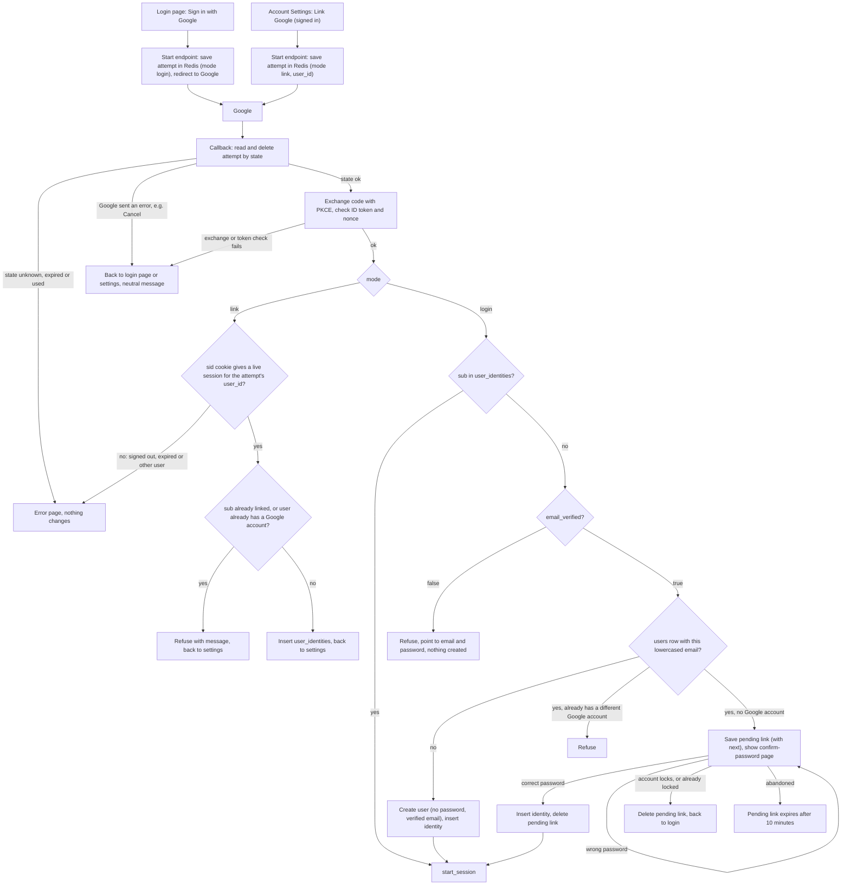

# Google sign-in

Today one server-rendered backend handles sign-in. Users sign in with email and password at `POST /login`. PostgreSQL holds `users`, `sessions` and `password_reset_tokens`. Redis exists but holds only short-lived data such as rate limits. A successful login calls `start_session`.

This change adds "Sign in with Google" (OpenID Connect, authorization-code flow with PKCE, a `state` and a `nonce`, scopes `openid email profile`) in two places: the login page and Account Settings. Both use one start endpoint and one callback. The start endpoint saves a short-lived record in Redis and sends the browser to Google. The callback reads that record, checks Google's answer, and then does one of three things: signs the user in, links Google to a signed-in account, or asks for an existing account's password before linking. Every Google sign-in ends in the same `start_session` a password login uses, so there is no new session type. We keep no Google access or refresh tokens. At sign-in we read only the ID token's `sub`, `email` and `email_verified`. The scopes are fixed by the brief; nothing from `profile` is read or stored.

## Terms

- **sub**: Google's permanent ID for a Google account. We identify people by `sub`, never by email.
- **state**: a random value sent to Google and returned unchanged. It finds our saved attempt and makes each callback usable once.
- **nonce**: a random value Google copies into the ID token. We check it matches, so an old token cannot be replayed.
- **PKCE verifier**: a random secret we keep. We send its hash to Google at the start and the secret itself when exchanging the code.
- **attempt**: the Redis entry `oidc:attempt:<state>`. It holds the nonce, the PKCE verifier, the mode (`login` or `link`), the `user_id` (link mode only) and the `next` path (login mode only, kept only if it is a relative path on our site). It lives 10 minutes, the limit for the round trip to Google, and is deleted the moment the callback reads it.
- **pending link**: the Redis entry `oidc:pending:<random id>`. It holds a verified Google `sub`, the existing user it would link to, and the `next` path copied from the attempt (the attempt is gone by then). It lives 10 minutes. The browser holds the random id in an HttpOnly cookie.
- **user_identities**: a new PostgreSQL table: `user_id` (references `users`, ON DELETE CASCADE, UNIQUE), `google_sub` (PRIMARY KEY) and `created_at`. The two unique columns enforce one Google account per user and one user per Google account. This is the permanent link.
- **start_session**: the existing function. It deletes the old `sessions` row if the browser sent a `sid` cookie, inserts a new `sessions` row (14 days, slid forward on each request), sets the `sid` cookie (HttpOnly, Secure, SameSite=Lax) and redirects to `next` if it is a relative path on our site, otherwise `/home`. The row holds only an id and a user id, nothing about Google.
- **lockout rules**: those of `POST /login`. Reject without checking the password while `locked_until` is in the future. Otherwise bcrypt-compare. A wrong password adds 1 to `failed_logins`; at 5 the account locks for 15 minutes and the count resets to 0. A right password sets `failed_logins` to 0.

## How it runs

1. **Start from the login page.** The button requests `GET /auth/google/start?next=...`. The server makes state, nonce and a PKCE verifier, saves an attempt (mode `login`) and redirects to Google. If Redis is down, show an error and start nothing.
2. **Start from settings.** The signed-in user presses Link Google, which `POST`s to the same start endpoint. The server first checks that the `sid` cookie gives a live session. If not, it sends the user to the login page and saves nothing. Otherwise it saves an attempt with mode `link` and the current `user_id`, and answers with a 303 redirect to Google, which the browser follows with a GET. The mode is kept server-side in the attempt and is never taken from the callback request.
3. **Callback** (`/auth/google/callback`, the one callback for both modes). It reads and deletes the attempt by `state` in one atomic step, so a second use finds nothing. It keeps what it read, including `next`, for the rest of this request.
   - No attempt (unknown, expired or already used): error page, nothing changes.
   - Google returned an error (such as Cancel): send the user back to the login page or settings, according to the attempt's mode, with a neutral message.
   - Otherwise exchange the code with the PKCE verifier (10 second timeout, our choice) and check the ID token's signature, issuer, audience, expiry and nonce. If the exchange or any check fails, treat it as a Google error. The attempt is already gone, so the user simply tries again.
4. **Link mode.** The callback reads the `sid` cookie and looks up the `sessions` row, which must exist and not be expired. The browser sends the cookie on the return from Google because that return is a top-level GET navigation and the cookie is SameSite=Lax. The row's `user_id` must equal the attempt's `user_id`. If the user signed out, the session expired during the round trip, or it is a different user, show the error page and change nothing; the user signs in and starts again. Then refuse if this `sub` is linked to anyone, or the user already has a Google account. Otherwise insert the `user_identities` row and return to settings. No password is asked and the emails need not match. The session is unchanged.
5. **Login mode, known sub.** If `sub` is in `user_identities`, call `start_session` for that user, passing the `next` the callback read from the attempt (so it lands on `next`, or `/home`). Their Google email may have changed; it makes no difference. Google never changes `users.email`.
6. **Login mode, unknown sub.** Lowercase the email.
   - `email_verified` false: refuse and point to email and password. Nothing is created.
   - No user has that email: create a user with `password_hash` NULL, `email_verified_at` now and the email from the ID token. The other columns take their defaults (`failed_logins` 0, `locked_until` NULL). Insert the identity and call `start_session`.
   - A user has that email and already has a different Google account: refuse.
   - A user has that email and no Google account: save a pending link (including the attempt's `next`), set the cookie and show the confirm-password page.
7. **Confirm password.** The page needs both the pending link and its cookie. The user is loaded by the user id in the pending link. Apply the lockout rules.
   - `locked_until` already in the future, when the page opens or the password is submitted: do not check the password, show "Account temporarily locked", delete the pending link and send the user to the login page. A locked account cannot confirm for up to 15 minutes and the link would expire in 10, so keeping it is pointless.
   - Wrong password: count the failure. Show the error and keep the page, without extending the pending link's 10 minutes. If this failure locks the account, delete the pending link and send the user to the login page.
   - Right password: set `failed_logins` to 0, insert the identity, delete the pending link, call `start_session` with the `next` stored in the pending link (or `/home` if none). If the insert hits a unique conflict (a race), refuse.
8. **Unlink.** Settings shows Unlink only when `password_hash` is not NULL, and it deletes the user's `user_identities` row. A Google-only user sees "Set a password first" instead, which uses the existing `POST /forgot` reset email. That email goes to `users.email`, which for a Google-created user is the verified Google email. Using the reset link sets a password, marks the email verified and, as today, deletes all of the user's sessions (they sign in again). Afterwards email and password sign-in works, the Google link stays, and Unlink works. This stops a user being locked out.

## Where state lives and what removes it

| State | Kept in | Removed by |
|---|---|---|
| attempt | Redis `oidc:attempt:<state>`, 10 min | callback reading it, or the 10 minute expiry |
| pending link (includes `next`) | Redis `oidc:pending:<id>` plus cookie, 10 min | successful link, account locked, or the 10 minute expiry |
| Google link | PostgreSQL `user_identities` | Unlink, or deleting the user (cascade) |
| Google-created user | PostgreSQL `users` | not removed automatically |
| session | PostgreSQL `sessions`, as today | sign-out, expiry, or password reset |

## When things fail

| Where | What happens |
|---|---|
| Unknown, expired or used state | Error page. Nothing changes. |
| Google error or Cancel | Back to where the user started with a neutral message. |
| Code exchange or ID token check fails, or Google is slow | Same as a Google error. Nothing changes. |
| Redis down at start | Error shown. Nothing started. |
| Settings start without a live session | Sent to the login page. Nothing saved. |
| Link mode, user signed out, session expired or different user | Error page. Nothing changes. |
| Unverified email | Refuse, point to email and password. Nothing created. |
| Sub or user already linked elsewhere, or email's user has a different Google account | Refuse with a message. Nothing changes. |
| Wrong password on confirm | Lockout counting. Page stays. |
| Account already locked or locks on confirm, or 10 minutes pass | Pending link is thrown away. User starts again. |
| Unique conflict when inserting the identity | Refuse. |
| Unlink without a password | Refused. Tell the user to set one with the reset email. |

## Build and rollout

- Migration: create `user_identities` and run `ALTER TABLE users ALTER COLUMN password_hash DROP NOT NULL`.
- `POST /login` must treat a NULL `password_hash` as a wrong password (count the failure, show the generic message) and never call bcrypt on NULL.

## Open questions

- Login attempts are not tied to the browser that started them. An attacker can start a flow with their own Google account, stop at the callback URL (which carries their code and state), and trick a victim into opening it. The victim's browser then completes the callback and the victim is signed in as the attacker's account. State and nonce do not stop this, because they only match the callback to our saved attempt, not to a browser. A short-lived cookie holding a hash of state would fix it. Not decided.
- Does a locked account block Google sign-in for an already-linked user? As written, no: the lock guards password attempts only.
