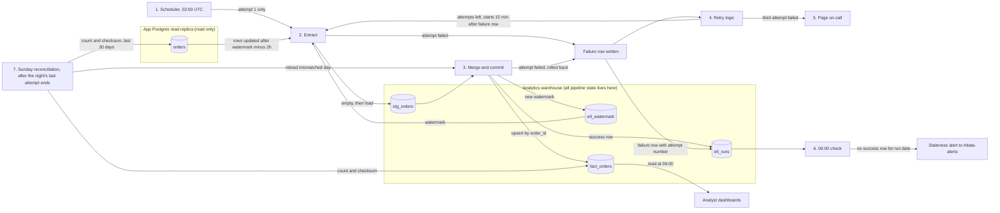

## Nightly orders ETL

**What this is.** A job runs every night at 02:00 UTC. It copies the app's `orders` table from a read-only replica of the app's Postgres database into the analytics warehouse, and keeps one current row per order in `fact_orders`. We have no write access to the app database, so all pipeline state lives in the warehouse. Each attempt reads the watermark (the time up to which data has loaded), extracts every order changed after the watermark minus a 2-hour lookback, stages those rows, and merges them into `fact_orders` in one warehouse transaction. The same transaction moves the watermark and records success. Dashboards therefore see a whole night or none of it. The lookback covers bulk imports, whose rows can become visible up to 90 minutes after their `updated_at`. A Sunday reconciliation catches rows that become visible even later.

**Terms**

- **Replica**: a read-only copy of the app's Postgres database. The pipeline only reads from it.
- **orders**: the app table. Every write, including a soft delete, sets `updated_at` to the write time. The app never hard-deletes a row. It sets `deleted_at` instead.
- **Bulk import**: an app transaction that can stay open up to 90 minutes. Its rows get `updated_at` when they are written, so they can appear up to 90 minutes later.
- **Watermark** (`etl_watermark`): a warehouse table holding one value, the UTC time up to which data has loaded successfully. It changes only at a commit.
- **Candidate watermark**: the UTC time when an attempt's Extract starts. It becomes the new watermark only if that night commits.
- **Lookback**: 2 hours. Each extract starts 2 hours before the watermark.
- **Attempt**: one run of Extract and Merge. A night gets up to three attempts.
- **Attempt number**: 1 for the scheduler's start, then 2 and 3 for retries. Each failure row records its attempt number.
- **Run date**: the UTC date a night starts, for example 2026-11-13 for the 02:00 run that day. Every attempt of that night has the same run date.
- **stg_orders**: a warehouse staging table. It is emptied at the start of each attempt and holds only that attempt's rows. Dashboards never read it.
- **fact_orders**: the warehouse table that dashboards read. It holds one row per `order_id`, the most recent version, with all order columns, including the creation date. Deleted orders stay here with `is_deleted` set.
- **Merge**: an insert-or-update keyed on `order_id`.
- **Commit**: the moment a transaction's writes become visible to readers, all at once. **Rollback**: undoing a transaction's writes so none of them remain.
- **etl_runs**: a warehouse log with one row per attempt. It holds the run date, attempt number, status (success or failed), start and end times and any error. A success row is written in the same transaction as the Merge, so it exists only if the data committed.
- **Checksum**: one number computed from a set of rows. Equal numbers mean the sets almost certainly match.
- **Creation date**: the date an order was created. Reconciliation groups rows by it.
- **Page on-call**: send an urgent alert to whoever is on call. The tool and recipient are not named (see open questions).
- **Staleness alert**: a post to #data-alerts saying that a night's data has not loaded.

**Steps**

1. **Start.** The scheduler starts attempt 1 at 02:00 UTC. Nothing is written yet. The scheduler starts only attempt 1. The retry logic starts any later attempts.

2. **Extract.** It starts when an attempt begins.
   - It records the current UTC time as the candidate watermark.
   - It reads the watermark from `etl_watermark`.
   - It reads every `orders` row, all columns, from the replica whose `updated_at` is later than the watermark minus 2 hours. The read has no upper bound.
   - It empties `stg_orders` and writes those rows into it. The replica is only read.
   - A write made after the candidate time has `updated_at` at or after that time, so the next night's window includes it.
   - Keeps its data: `stg_orders` holds this attempt's rows. The watermark does not change.
   - If it goes wrong: the attempt fails. Go to step 4.

3. **Merge and commit.** It starts when Extract finishes. It opens one warehouse transaction and handles each staged row by `order_id`.
   - If no `fact_orders` row has that `order_id`, insert it.
   - If one exists and the staged `updated_at` is later, replace its values, including `deleted_at`.
   - If the staged `updated_at` is equal or earlier, leave the existing row alone. A re-read row therefore changes nothing, and a stored row never moves back to an older version.
   - Set `is_deleted` to true when `deleted_at` is set, and to false otherwise. A soft delete is a write, so its `updated_at` is the newest and it wins.
   - Then, in the same transaction, set `etl_watermark` to the candidate watermark, write a success row to `etl_runs`, and commit.
   - Keeps its data: `fact_orders`, `etl_watermark` and `etl_runs` change only at this commit.
   - If it goes wrong: any failed write rolls back the whole transaction, so `fact_orders`, the watermark and the success row stay as they were. Go to step 4.

4. **Retry.** It starts when an attempt fails in step 2 or 3.
   - The failed attempt writes a failure row to `etl_runs`, with its run date, attempt number and error.
   - The retry logic reads the attempt numbers in `etl_runs` for that run date. If the highest attempt number is below 3, it starts the next attempt 15 minutes after that failure row is written. If the highest is 3, it goes to step 5.
   - The next attempt starts at step 2 and reads the same watermark. The watermark changes only at a commit, and the failed attempt did not commit, so every attempt of the night reads the same value.
   - Attempts run one after another, never at the same time.
   - If each attempt fails quickly, attempt 2 starts about 02:15 and attempt 3 about 02:30.
   - If the failure row itself cannot be written, no retry is scheduled. The night is then treated as a hang (see the failures table).
   - An attempt that hangs writes no failure row, so no retry starts. The brief sets no time limit per attempt (see open questions).

5. **Page.** It starts after the third failed attempt's failure row is written. It pages on-call. The night's run stops. The watermark is unchanged. The next night's extract reads every row changed after the old watermark minus 2 hours, in one window. The lookback is applied once, on the old watermark, not once per missed night. No separate catch-up run is needed.

6. **06:00 check.** It starts at 06:00 UTC, whatever the state of the load. It looks in `etl_runs` for a success row with tonight's run date. If there is none, it posts a staleness alert to #data-alerts. It changes no data.
   - Dashboards refresh from `fact_orders` at 06:00 regardless. If tonight's load has not committed, they show the last committed night.
   - If attempt 3 is still running at 06:00, the check still alerts and does not wait.
   - If the load commits later, the new night appears on the next dashboard refresh. The alert is not withdrawn.

7. **Sunday reconciliation.** It starts when the Sunday night's last attempt ends. An attempt ends when it commits (its success row is written) or when the third failure pages on-call. It runs whether or not the load succeeded, because it compares the warehouse with the replica.
   - For each creation date in the last 30 days, it computes the row count and the checksum of `order_id` and `updated_at`. It does this once on the replica and once in `fact_orders`.
   - A count difference means rows are missing from the warehouse.
   - A checksum difference with equal counts means a warehouse row has an older `updated_at`.
   - A day with either difference is reloaded. The reload reads all of that day's orders from the replica, stages them in `stg_orders`, and merges them with the step 3 rules in one transaction.
   - A reload only inserts or replaces rows, so it never deletes any. Reconciliation does not move the watermark.
   - Reconciliation uses `stg_orders`, so it must not overlap a nightly attempt (see open questions).
   - If it goes wrong: see the table below.

**What happens when things fail**

| Where | What happens |
|---|---|
| Extract (step 2) fails | The attempt fails. Nothing in `fact_orders` or the watermark changes. Retry (step 4). |
| Merge or commit (step 3) fails | The transaction rolls back. Same as above. |
| Failure row cannot be written | No retry is scheduled, the same as a hang. The 06:00 check alerts if the night is not committed. |
| An attempt hangs | No failure row is written, so no retry starts. The 06:00 check alerts if the night is not committed. See open questions. |
| Third attempt fails | Page on-call (step 5). The run stops. The watermark is unchanged. |
| No success row at 06:00 | Staleness alert to #data-alerts (step 6). Dashboards show the last committed night. |
| Rows become visible after the lookback, creation date in the last 30 days | The next Sunday reconciliation finds the count or checksum mismatch and reloads that day (step 7). |
| Rows become visible late, creation date older than 30 days | Reconciliation does not check them. See open questions. |
| Reconciliation reload fails | The transaction rolls back and that day is unchanged. See open questions. |
| The same night is run again | The window is read again. The merge leaves unchanged rows alone, so the result is the same. |

**Open questions**

- The brief gives no starting watermark or first-load rule for the very first run.
- The paging tool and the on-call recipient are not named.
- It is not stated whether a failed reconciliation, or a failed post to #data-alerts, is retried or paged.
- The brief gives no time limit per attempt. A hung attempt blocks retries until someone stops it. A timeout would turn a hang into a failure and needs a decision.
- Reconciliation checks only the last 30 days. A row that becomes visible late for an order created more than 30 days ago is never checked.
- Reconciliation reloads use `stg_orders`, which nightly attempts also empty. The brief does not say what happens if the Sunday reconciliation is still running at the next 02:00 start.
- The checksum algorithm, and how the replica and warehouse values are made comparable, are not set.
- If the replica ever holds an older version of a row than the warehouse (for example after a replica failover or restore), the merge keeps the warehouse row, and that day mismatches again each Sunday. The brief does not say what to do.
- The watermark comes from the warehouse clock and the `updated_at` stamps come from the app database clock. The 2-hour lookback is the margin. The brief does not say the clocks are synced.