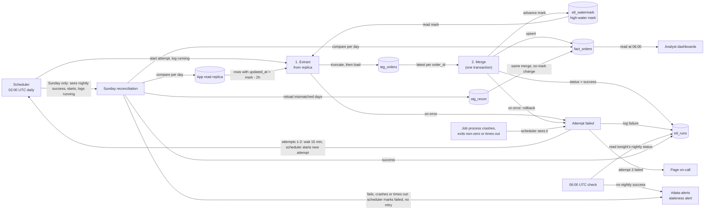

# Nightly orders ETL

Today the app's `orders` table has no copy in the warehouse. This job creates one and keeps it correct. Every night at 02:00 UTC the scheduler starts a job. The job reads only from the app's Postgres read replica, because we have no write access to the app database, so all pipeline bookkeeping lives in the warehouse. It pulls the orders that changed since the last successful run, plus a 2-hour overlap, and puts them in a staging table. It then merges them into the final table `fact_orders` in one warehouse transaction. That same transaction moves the high-water mark forward. Because the load commits all at once, dashboards never see a half-loaded night. On Sundays, once the nightly load has committed, a reconciliation repairs rows that became visible later than the overlap covers.

## Terms

- **Replica**: the app's read-only Postgres copy. The only source we read.
- **Warehouse**: the analytics database. It holds all pipeline state.
- **Scheduler**: the system that starts every job process (nightly attempts and the Sunday reconciliation), watches it, applies the time limit, and starts the next attempt after a nightly failure. It, not the job, owns retries. It writes the `etl_runs` rows that mark an attempt `running` or `failed`, pages on-call, and posts the reconciliation failure alert.
- **`updated_at`**: set to the write time on every write to an order, including deletes.
- **Soft delete**: the app never hard-deletes. It sets `deleted_at`, and that is also a write, so `updated_at` changes too.
- **High-water mark**: the `updated_at` value up to which data has been loaded successfully. Stored in the warehouse table `etl_watermark`.
- **Lookback**: each night re-reads rows from 2 hours before the high-water mark. Bulk imports in the app can keep a transaction open for up to 90 minutes, and `updated_at` is stamped at write time, not commit time. So a row can become visible up to 90 minutes after its `updated_at`. The 2 hours cover that. The stored mark itself never moves back.
- **`stg_orders`**: the nightly staging table. Emptied at the start of every attempt, then filled with the night's extracted rows.
- **`stg_recon`**: the reconciliation's own staging table, so it never shares staging with a nightly attempt. Emptied at the start of each reconciliation.
- **`fact_orders`**: the final table. Exactly one row per `order_id`, always its most recent version. Deleted orders stay, flagged `is_deleted`.
- **`etl_runs`**: a warehouse log table with one row per attempt: night (the UTC date of the 02:00 start), attempt number, kind (`nightly` or `reconciliation`), start and end time, status (`running`, `success` or `failed`), error text.
- **Run**: one night's job, with up to 3 attempts. All attempts of a run share the same night value.
- **Staleness alert**: a message to #data-alerts saying tonight's load has not committed.

## Diagram

## How it runs

1. **Start (scheduler, 02:00 UTC).** The scheduler starts the job process and writes a new `etl_runs` row with kind `nightly` and status `running`. Every attempt, including each retry, gets its own row. The scheduler passes nothing else, so the mark lives in one place and Extract finds its own starting point. If the process fails to start, the scheduler marks that row `failed` and the attempt counts as failed (see step 4).
2. **Extract.** Starts when the scheduler starts an attempt. It reads the high-water mark from `etl_watermark`. It queries the replica for rows where `updated_at` is later than that mark minus 2 hours, and notes the highest `updated_at` it saw. It empties `stg_orders` (so a retry never sees leftovers) and loads the rows into it. The mark is not touched here. Rows near the boundary are pulled again every night on purpose, and step 3 handles the duplicates. On the very first run there is no mark, so it loads everything. If the replica or warehouse is unreachable, the attempt fails.
3. **Merge.** Starts when Extract finishes. In one warehouse transaction it does three things.
   - It keeps only the highest-`updated_at` row for each `order_id` in staging. Exact ties are identical in what the warehouse stores, so either may be kept.
   - It upserts into `fact_orders` by `order_id`: insert if new; overwrite only if the staged `updated_at` is greater than the stored one. So re-extracted older or identical rows change nothing. It sets `is_deleted = (deleted_at is not null)`. A delete reaches the warehouse as an ordinary update because it also changed `updated_at`.
   - It sets the high-water mark to the highest `updated_at` extracted (unchanged if nothing was extracted) and marks the `etl_runs` row `success`. Only Merge moves the mark, so the mark advances only when the load succeeded.

   If anything fails, the transaction rolls back: `fact_orders` and the mark stay as they were. Re-running a night is therefore harmless.
4. **Retry and paging.** The scheduler notices every failure and starts every retry, so one component owns the timing and the attempt count. An attempt fails in one of two ways. Either the job catches the error, rolls back, and marks its own `etl_runs` row `failed` with the error text. Or the job process dies without logging (crash, kill, hang): the scheduler sees a non-zero exit, or sees that the process has run past its time limit and kills it, and then writes `failed` on that attempt's row itself. Either way the scheduler waits 15 minutes and starts a new attempt from Extract, with a new `running` row. The whole job is retried, not a single step. It retries up to two more times, so at most 3 attempts. Staging is emptied again and the mark is unchanged, so a retry starts clean; a crash cannot leave a half-committed load, because Merge is one transaction. After the third failed attempt, the scheduler pages on-call.
5. **06:00 UTC check.** Analyst dashboards refresh from `fact_orders` at 06:00 UTC whether or not the job has finished. Because Merge commits atomically, they see either the whole night or none of it. At 06:00 a separate check reads `etl_runs` for tonight's night value (the UTC date of today's 02:00 start), looking only at rows of kind `nightly`. Reconciliation rows are ignored, so a reconciliation can never hide a missing nightly load. If no nightly attempt of that night has status `success`, it posts a staleness alert to #data-alerts. The check only reports; it does not stop anything. An attempt still running or waiting to retry at 06:00 keeps going, and if it commits later, the dashboards pick the night up at their next refresh. This is independent of paging: paging follows the third failed attempt, the staleness alert follows the clock.
6. **Sunday reconciliation.** Some rows become visible later than the lookback covers, for example when the replica falls behind. This step repairs them.
   - *Start.* On Sundays the scheduler starts it once it sees that night's nightly attempt succeed (no separate schedule). It treats it like any job process: it writes an `etl_runs` row with kind `reconciliation` and status `running`, watches the process, applies the same time limit, and marks the row `failed` itself if the process exits non-zero or hangs. The job marks the row `success` when it finishes.
   - *Compare.* For each order-creation day in the last 30 days it compares two things between the replica and the warehouse: the row count and a checksum of `order_id` + `updated_at`.
   - *Reload.* Any day that does not match is reloaded: all of that day's rows are read from the replica into `stg_recon` and merged into `fact_orders` with the same merge logic as step 3, in one transaction. The high-water mark is not changed.
   - *Why it is safe.* Retries stop once an attempt succeeds, so no nightly attempt is still using `stg_orders`. It uses its own `stg_recon` anyway, and its writes use the same only-overwrite-if-newer upsert, so even an overlap with a later nightly run could not corrupt data.
   - *Failure.* The transaction rolls back, the scheduler marks the row `failed` (or the job does, if it caught the error), and the scheduler posts the failure to #data-alerts. It is not retried and does not page on-call.

## What happens when things fail

| Where | What happens |
|---|---|
| Extract (replica or warehouse unreachable, query error) | Attempt fails and is logged. Staging may be half-filled but is emptied next attempt. Mark and `fact_orders` untouched. |
| Merge | Transaction rolls back. Mark and `fact_orders` unchanged. Attempt fails and is logged. |
| Job process crashes, is killed, hangs or never starts | The scheduler sees the exit or the timeout, kills a hung process, marks the row `failed`, and treats it as a failed attempt. Nothing was committed, so mark and `fact_orders` are unchanged. |
| Attempts 1 and 2 fail | The scheduler waits 15 minutes and starts a new attempt, rerunning the whole job. |
| Attempt 3 fails | Page on-call. No more retries tonight. The next night starts from the old mark and so catches up, because it re-reads everything since then. |
| Not committed by 06:00 | Staleness alert to #data-alerts. Dashboards show the previous complete night. Any running or waiting attempt carries on and may still commit later. |
| Reconciliation fails (error, crash, hang or timeout) | Its transaction rolls back. The scheduler marks its row `failed` and posts to #data-alerts. It is not retried; the next Sunday covers the same days. |
| Sunday night's load never commits | Reconciliation does not run that week. |

## How to build and roll it out

1. Create `etl_watermark`, `etl_runs`, `stg_orders`, `stg_recon` and `fact_orders` in the warehouse.
2. Build Extract and Merge. Test that re-running the same night gives identical `fact_orders`.
3. Add retries (scheduler-owned, including crash and timeout detection), paging, the 06:00 check, then reconciliation (also scheduler-launched).
4. First run loads all history, then the nightly schedule is turned on.

## Open questions

- How on-call is paged (the tool) is not decided.
- Whether reconciliation should retry on failure instead of waiting a week is not decided.
- The per-attempt time limit after which the scheduler treats a hung process as failed is not decided. Reconciliation is assumed to use the same limit, which may be too short for it.
