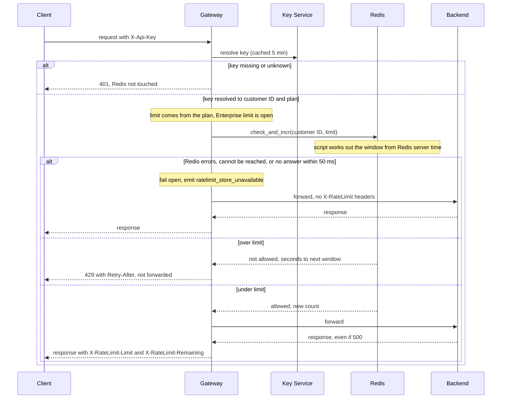

# Per-customer rate limiting in the API Gateway

## What this is

Today every public REST API request enters through the API Gateway. Six stateless gateway instances sit behind a load balancer, and any instance can take any request. The client sends its API key in the `X-Api-Key` header. The gateway asks the Key Service which customer and plan the key belongs to, and keeps that answer in memory for 5 minutes. It then forwards the request to the backend that owns the route and returns that backend's response.

This design adds one check between the key lookup and the forward. Each customer gets a budget of requests per minute, shared by all of its keys, so one noisy customer cannot degrade service for everyone else. The Standard budget is 100 requests per minute. The Enterprise budget is not set yet. The counters live in Redis, which all six instances share. A customer's traffic spread over six instances therefore counts against one budget, not six. A Lua script in Redis does the check and the count as one step, so two instances cannot both take the last slot. The check runs after the key lookup, so a bad key never touches a counter. A request over budget gets `429` and is never forwarded. If Redis errors or is too slow, the request is forwarded anyway, so a counter outage does not stop the API.

## Terms

- **Redis**: a fast in-memory data store. All six gateway instances read and write the same Redis.
- **API key**: the secret in the `X-Api-Key` header. Each key belongs to one customer.
- **Key Service**: the service that maps an API key to a customer ID and a plan.
- **Customer ID**: the owner of one or more keys. All of a customer's keys use the same counter, so they share one budget.
- **Plan**: `Standard` or `Enterprise`. The Key Service returns it with the customer ID. The plan picks the limit.
- **Limit**: the number of allowed requests per window for a plan. Standard is 100 per minute. Enterprise is not set yet.
- **Backend**: the service that owns the route the client called. The gateway forwards the request to it.
- **Window**: one whole clock minute, counted from Redis server time. Redis, not the gateway, decides which minute it is.
- **Fixed window**: the budget resets at each minute boundary. It is not a rolling count over the last 60 seconds.
- **Counter**: a number in Redis that counts one customer's allowed requests in one window. A counter that does not exist yet counts as 0.
- **Lua script**: a small program that Redis runs inside itself.
- **check_and_incr**: the Lua script that does the check and the count. It works out the window, reads the counter, compares it with the limit, and adds 1 only when the request is allowed.
- **Atomic**: Redis runs a script as one step, so no other command runs in the middle. The check and the count cannot be split.
- **TTL (time to live)**: how long Redis keeps a key before it deletes the key.
- **Cache hit**: the gateway resolved this key in the last 5 minutes on this instance, so the Key Service is not called. **Cache miss** is the opposite, so the Key Service is called.
- **Retry-After**: a response header that tells the client how many seconds to wait before it tries again.
- **Fail open**: when the counter store errors or is too slow, forward the request without a check.

## Main flow

## Steps

1. **Client sends a request.** It carries an `X-Api-Key` header. Any gateway instance can receive it. Nothing is stored yet.

2. **Authenticate.** This starts when the request arrives. The gateway looks up the key. On a cache hit, it uses the answer in its own memory. On a cache miss, it calls the Key Service, which returns the customer ID and plan. The gateway keeps that answer for 5 minutes. Each gateway instance keeps its own cache, and the caches are not shared. After a plan change, one instance can keep the old plan until its own entry expires. Instances can therefore apply different limits for up to 5 minutes, and a downgraded customer can get past the new limit for that time. The counter itself is shared, so the budget is not split. This step always comes before Redis, because the counter needs the customer ID. If the key is missing or unknown, the gateway returns `401` and does not touch Redis, so no counter is read or changed. If the Key Service fails on a cache miss, see Open questions.

3. **Check and count.** This starts when the key resolves to a customer ID and plan. The gateway calls check_and_incr with two values: the customer ID and the plan's limit. It sends no time and no window. Inside Redis, the script:
   - works out the current window from Redis server time,
   - builds the counter key,
   - reads the counter, treating a missing counter as 0,
   - if the count is below the limit, adds 1 and returns allowed with the new count. The first allowed request in a window creates the counter at 1 and sets its TTL in the same step. If the count is at or above the limit, it leaves the counter alone and returns not allowed with the seconds until the next window.

   The script keeps no limit of its own. It compares the count with the limit the gateway sends with each call. A request rejected here never uses budget. Every instance reads and writes the same counter, so all six see the same count. The Enterprise limit is not set, so this step is not defined for Enterprise requests yet (see Open questions).

4. **Over limit.** This starts when the script returns not allowed. The gateway returns `429 Too Many Requests` with `Retry-After` in whole seconds. It does not forward the request. The response carries no `X-RateLimit` headers.

5. **Under limit.** This starts when the script returns allowed. The gateway forwards the request to the backend. The count was taken in step 3, so it stays even if the backend returns 500. The gateway returns the backend's response with two more headers:
   - `X-RateLimit-Limit` is the plan's limit.
   - `X-RateLimit-Remaining` is the limit minus the new count from the reply. It is never below 0, because a count is only allowed up to the limit.

   The gateway reads only the new count from an allowed reply. No reset header is sent in v1.

6. **Store error or timeout.** This starts when Redis returns an error, cannot be reached, or does not answer within 50 ms. The 50 ms is counted from the moment the gateway starts sending the call. The script returns one of two replies: allowed with a count, or not allowed with seconds. Any other result is a failure. That includes a Redis error reply, a dropped or refused connection, a reply of neither shape, and no reply within 50 ms. All failures take the same path. The gateway forwards the request with no check, adds no `X-RateLimit` headers, emits `ratelimit_store_unavailable`, and does not retry. The script may have run before the failure. The gateway does not undo that count, so one failed call can leave at most one extra count. The gateway remembers no failure. Each request tries Redis again, so during an outage each request waits up to 50 ms before it is forwarded.

## Counter rules

- **Key:** `rl:{customer ID}:{window}`. The script builds it. The window is whole minutes from Redis server time. The budget resets at each minute boundary, and gateway clocks do not matter.
- **TTL:** 60 seconds. The script sets it only when it creates the counter, which is when the first request in a window is allowed. Later increments do not change it. The key lasts at least until its window ends, so old counters clear themselves.
- **Retry-After:** whole seconds until the next window starts, at least 1. The script computes it from Redis server time. It is sent only with `429`.
- **Window shape:** fixed. A customer can send up to 200 requests across one minute boundary, for example 100 at the end of one minute and 100 at the start of the next. This is accepted for v1.

## What happens when things fail

| Situation | Response | Counter changed? | Metric |
|---|---|---|---|
| Key missing or unknown | `401` | No | none |
| Key Service fails on a cache miss | not defined here (see open questions) | not defined here | not defined here |
| Over limit | `429` with `Retry-After` | No | none |
| Under limit, backend returns 500 | backend's 500 with `X-RateLimit-*` headers | Yes | none |
| Redis errors, cannot be reached, or is over 50 ms | forwarded, no `X-RateLimit-*` headers | Maybe, if the script ran. Not undone. | `ratelimit_store_unavailable` |
| Enterprise request | not defined here (the limit is open) | not defined here | not defined here |

## Open questions

- **Enterprise limit:** Product has not decided it. Until then, this design does not say what step 3 does for Enterprise requests. It could skip the check or use a placeholder. The choice is not made here.
- **Key Service failure:** the brief does not say what happens when the Key Service errors on a cache miss.
- **Timeout scope:** the brief does not say whether the 50 ms includes connecting to Redis. This design does not decide it.
- **Alerting:** the brief does not say who is alerted when `ratelimit_store_unavailable` fires.