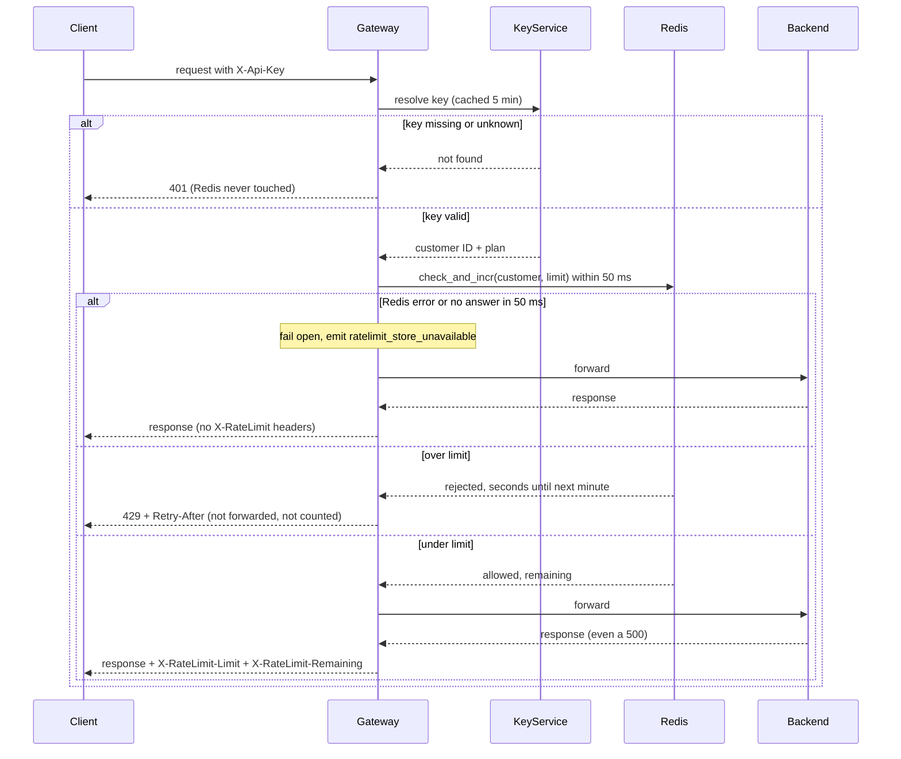

## Rate limiting

Per-customer rate limiting in the public API Gateway, backed by one shared Redis, so that one noisy customer cannot degrade service for everyone else.

Today, every public request reaches the API Gateway (6 stateless instances behind a load balancer; any instance can take any request). The gateway reads the `X-Api-Key` header, asks the Key Service which customer and plan the key belongs to (the answer is cached in memory for 5 minutes), then forwards the request to the backend that owns the route and returns the backend's response.

This design adds one step between authentication and forwarding. The gateway asks Redis, in a single atomic call, whether the customer still has budget in the current minute. If yes, the request is counted and forwarded. If not, the gateway answers `429` and does not forward. All 6 instances use the same Redis, so a customer's traffic is counted once, however it is spread (6 instances do not give 6x the limit). The steps run one after another, each waiting for the one before.

### Terms

- **Customer**: the account that owns one or more API keys. The budget belongs to the customer, not the key, so all their keys share it.
- **Plan**: Standard or Enterprise. The Key Service returns it with the customer ID. The gateway maps the plan to a limit from its own configuration.
- **Key Service**: the existing service that turns an API key into a customer ID and a plan.
- **Redis**: the shared store that holds the counters. The gateway keeps no counters itself.
- **check_and_incr**: a Lua script that Redis runs as one indivisible operation. It reads the counter, adds 1 only if the customer is under the limit, and returns the result. Because it is indivisible, two instances checking at the same moment cannot both squeeze through and overshoot.
- **Window**: a fixed calendar minute. The counter key is `ratelimit:<customerId>:<minute number>`, where the minute number is Redis's clock time (seconds) divided by 60, rounded down. Using Redis's clock means all instances agree on the minute. When the minute changes, the key changes and the count starts at 0.
- **TTL**: an expiry time on each counter key, set to 120 seconds, so old minutes delete themselves and Redis does not fill up.
- **Fail open**: if the limiter cannot answer, let the request through instead of blocking it, so a counter outage does not take the API down.

### Diagram

### Steps and rules

1. **Authenticate.** Starts when a request arrives. The gateway resolves `X-Api-Key` through the Key Service (input: the header value; output: customer ID and plan; cached 5 minutes). Authentication comes first. A missing or unknown key gets `401`, and no counter is read or changed. Key Service failures: see Open questions.
2. **Pick the limit.** The gateway looks up the plan in its configuration (no new lookup is needed, since the plan came with the customer ID). Standard is 100 per minute. Enterprise has no number yet (see Open questions). While none is configured, an Enterprise request skips steps 3 and 4, is forwarded as in step 5 but is not counted, and gets no `X-RateLimit-*` headers. This avoids blocking paying customers or inventing a number.
3. **Check and count.** The gateway calls `check_and_incr` with the customer ID and limit, and waits at most 50 ms. The script reads Redis's own clock for both the minute number and the seconds left, and reads the current minute's counter.
   - Below the limit: it adds 1, sets the 120 second TTL and returns "allowed" plus remaining budget (limit minus the new count).
   - At the limit: it returns "rejected" plus the seconds until the next minute (60 minus Redis's clock seconds within the current minute). It does not add 1, so rejected requests use no budget.
   - Redis holds the counter; the gateway keeps nothing.
4. **Over the limit.** The gateway returns `429 Too Many Requests` with `Retry-After` set to the whole seconds left until the next minute starts. The request is never forwarded. The 429 carries no `X-RateLimit-*` headers.
5. **Under the limit.** The gateway forwards the request. It has already been counted, so it stays counted even if the backend fails (for example, with a 500). The gateway adds `X-RateLimit-Limit` and `X-RateLimit-Remaining` to the response it passes back, including a backend error response.

### When things fail

| Failure | What happens |
|---|---|
| Missing or unknown key | `401`, no counter touched |
| Redis errors or does not answer within 50 ms | Fail open: forward the request, emit the `ratelimit_store_unavailable` metric, send no `X-RateLimit-*` headers (the remaining budget is unknown). The request may or may not have been counted: Redis may have run the script just before the reply was lost or late, or never received it. The gateway cannot tell which. Nothing corrects the count afterwards; it affects only that one minute's counter, by at most one request. |
| Redis down for a long time | Every request still tries Redis and waits up to 50 ms before failing open, adding up to 50 ms latency. There is no circuit breaker in this first version, to keep it simple. |
| Backend fails after the check passed | The failure goes back to the client as is. The request stays counted. |
| Key Service slow or down | Not decided here (see Open questions). |

Known limit of a fixed minute: a customer can send 100 requests at the end of one minute and 100 at the start of the next (up to 2x across the boundary). This is accepted for a first version because a fixed window is the simplest option.

### Open questions

- Enterprise limit: Product has not decided. No number is chosen. Until one is set, Enterprise requests are not limited (step 2); Product should confirm that is acceptable.
- Key Service slow or down: the brief does not say how the gateway handles a cache miss or a failing lookup today, so this design does not define it, including what the client sees when an uncached lookup fails or times out. Rate limiting does not run, because there is no customer ID.
- Key cache details: whether "not found" answers are cached, and how quickly a revoked key or changed plan takes effect, follow the existing gateway cache and are not stated in the brief. A changed answer can take up to 5 minutes to apply if answers are cached.
