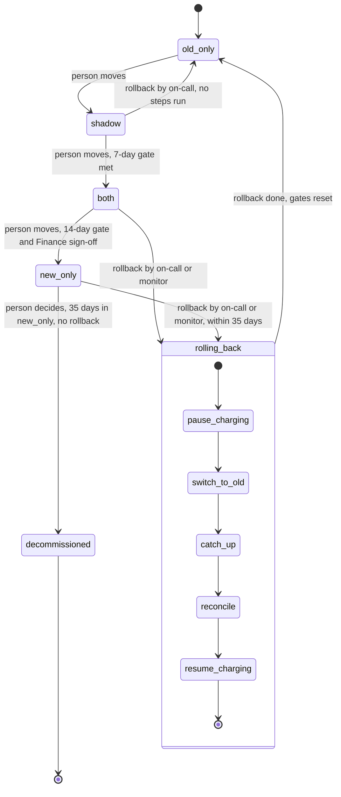

## Billing engine rollout

This file models how billing moves from the old billing engine to a new one. It is written before the rollout controller. Today the old engine runs all billing. Billing workers read usage events from the usage event log, which keeps events for 35 days. They compute invoices, write them to the billing ledger (the system of record), and charge customers through the payment provider.

The switch passes through four modes, set by one flag, `billing_mode`. The modes run in this order: `old_only`, `shadow`, `both`, `new_only`. In `old_only`, the old engine does everything. In `shadow`, the new engine runs beside the old one and never charges. In `both`, the new engine charges, and the old engine keeps computing invoices without charging. In `new_only`, the old engine stops. A person moves the mode forward one step at a time. Each move must meet its gate, and a gate that is not met stops the move. So a bad result halts the rollout before the new engine charges any customer. A rollback can return billing to the old engine from `shadow`, `both` or `new_only`, and it always ends in `old_only`. The goal is a switch that is gradual, reversible, and never charges a customer twice.

### Terms

- **Old engine**: the current billing engine. Billing workers run it.
- **New engine**: the replacement billing engine.
- **Usage event log**: the store of usage events that both engines read. It keeps events for 35 days.
- **Billing ledger**: the system of record for invoices and charges. The engine that is charging writes to it.
- **Shadow store**: a separate store for invoices. It is not the ledger. The new engine writes to it in `shadow`, and the old engine writes to it in `both`.
- **Payment provider**: the outside service that takes the charges.
- **Billing period**: the span of time that one invoice covers.
- **Due charge**: a charge that a customer owes and that must be made.
- **Config service**: the service that holds `billing_mode`.
- **`billing_mode`**: the one global flag that holds the current mode.
- **Mode**: one of four values: `old_only`, `shadow`, `both`, `new_only`.
- **Gate**: a condition that a forward move must meet before it is made.
- **Finance sign-off**: approval from Finance. It is a gate for the move to `new_only`.
- **Mismatch**: one customer's invoice totals from the two engines differ by more than one cent.
- **Mismatch rate**: the share of compared invoices that are mismatches.
- **Nightly comparison job**: runs each night and compares the two engines' invoices, customer by customer. It writes its results to `comparison_results`.
- **`comparison_results`**: the store the nightly comparison job writes to. Its contents are not yet specified.
- **Billing monitor**: watches the new engine's charge failure rate in `both` and `new_only`.
- **Charge failure rate**: the share of the new engine's charge attempts that fail.
- **Rollout tool**: the piece people use to move modes. Its interface is not yet specified.
- **Rollback**: the process that returns billing to the old engine. It always ends in `old_only`.
- **Rollback record**: a record written when a rollback starts. It shows that a rollback is in progress and holds the current step. Its other contents are not yet specified.
- **Current step**: the rollback step that the rollback last began. A retried step uses it to find where the rollback stopped.
- **Reconcile**: a rollback step that checks results customer by customer and billing period by billing period, and reports what it finds. It does not charge, refund or change ledger rows.
- **Catch up**: the old engine reprocessing usage events it skipped, read from the usage event log.

### Diagram

### Notes on the diagram

- `shadow` and `both` run both engines. `new_only` drops the old engine.
- The diagram draws every rollback step on one path. From `both` and `new_only`, the steps run as listed under Rollback. From `shadow`, no steps run and the rollback goes straight to `old_only`.
- The arrow from `new_only` to `decommissioned` is a person's decision. Nothing does it automatically.
- The rollout state lives in two places. `billing_mode` holds the current mode. The rollback record holds the progress of a rollback.
- Each rollback step is safe to run again. A failed step is retried.

### How the system runs

#### What each mode does

- **`old_only`**: the old engine does everything. The new engine is off.
- **`shadow`**: the old engine still charges and writes the ledger. The new engine reads the same usage events and writes its invoices to the shadow store. It never charges and never writes the ledger. The nightly comparison job runs. New-engine errors are recorded, but they never start a rollback.
- **`both`**: the new engine charges and writes the ledger. Each customer is charged once, by the new engine. The old engine keeps computing every invoice into the shadow store without charging, so it stays current. The comparison continues.
- **`new_only`**: the old engine stops computing. The new engine is the only engine.

#### Forward moves

A person makes each forward move with the rollout tool. The rollout tool checks the gate before it makes the move, and it refuses the move if the gate is not met. Meeting a gate never moves the mode by itself. Moves go one step at a time, in this order, with no skipping. Forward moves are refused while a rollback is in progress.

1. **`old_only` to `shadow`.** A person starts it. The brief sets no gate for this move (see Open questions). The new engine starts writing its invoices to the shadow store. `billing_mode` becomes `shadow`.
2. **`shadow` to `both`.** A person starts it. Gate: 7 consecutive days with a mismatch rate under 0.1 percent, and at least 5,000 invoices compared. The rollout tool checks the gate. Once the move is made, the new engine charges and writes the ledger. `billing_mode` becomes `both`.
3. **`both` to `new_only`.** A person starts it. Gate: 14 days in `both` with no unresolved mismatches, plus Finance sign-off. Once the move is made, the old engine stops computing. `billing_mode` becomes `new_only`.

If a gate is not met, the move is not made and `billing_mode` keeps its value. During a rollback, `billing_mode` still shows the mode from before the rollback. Refusing forward moves in that time stops a forward move from running alongside the rollback steps.

#### Rollback

**Who starts it:**

- On-call can start a rollback by hand at any time. From `new_only`, it must start within the 35-day limit under Decommission.
- The billing monitor starts a rollback on its own when, in `both` or `new_only`, the charge failure rate is above 2 percent over any 10-minute window.
- New-engine errors in `shadow` are recorded but never start a rollback.
- If a rollback is already running, a second start does not begin another one.

**The rollback record.** Starting a rollback writes the rollback record first, with the current step set to `pause_charging`. The record shows that a rollback is in progress. It holds the current step, so a retried step knows where the rollback stopped. The rollback then runs the steps in order, and it updates the current step as each step begins. From `shadow`, the record is still written, but no steps run.

**Rules for every rollback:**

- No customer is charged twice for a billing period.
- No due charge is dropped.

**Which steps run.** A step is skipped when it is not needed.

| Step | From `shadow` | From `both` | From `new_only` |
|---|---|---|---|
| 1. `pause_charging` | Skipped | Runs | Runs |
| 2. `switch_to_old` | Skipped | Runs | Runs |
| 3. `catch_up` | Skipped | Skipped | Runs |
| 4. `reconcile` | Skipped | Runs | Runs |
| 5. `resume_charging` | Skipped | Runs | Runs |

**The steps:**

1. **`pause_charging`.** It stops the new engine from charging. Its progress is kept in the rollback record. If it fails, it is retried.
2. **`switch_to_old`.** It makes the old engine charge and write the ledger again. In `both`, the old engine's invoices are already in the shadow store. How this is done is not stated (see Open questions). If it fails, it is retried.
3. **`catch_up`.** Only from `new_only`, where the old engine stopped computing. It reprocesses the usage events the old engine skipped, read from the usage event log. If it fails, it is retried.
4. **`reconcile`.** It checks results customer by customer and billing period by billing period, and reports each wrong customer or billing period. It does not charge, refund or change ledger rows. Who fixes a finding is not stated (see Open questions). If it fails, it is retried.
5. **`resume_charging`.** It restarts charging under the old engine, so that no due charge is dropped. If it fails, it is retried.

From `shadow`, all five steps are skipped. The rollback sets `billing_mode` to `old_only` at once and resets the gates.

During the steps, `billing_mode` keeps its value from before the rollback. It changes to `old_only` only when the whole rollback finishes, after `resume_charging`. A rollback cannot finish while a step keeps failing, because each failed step is retried.

**After any rollback:** the mode is `old_only` and all gates reset. The rollout goes through `shadow` again, and the 7-day count starts over. The path back to `new_only` runs through `both`, so the 14-day count and Finance sign-off are needed again.

#### Decommission

The old engine may be decommissioned after 35 days in `new_only` with no rollback. The clock starts when the mode becomes `new_only`. A person decides whether to decommission. Nothing does it automatically. The brief does not say what decommissioning involves. From day 35 on, there is no way back to the old engine. The usage event log keeps 35 days of events, so the events that catch up needs are gone by then.

#### What happens when things fail

| Where | What goes wrong | What happens |
|---|---|---|
| Forward move | Gate is not met | The move is not made. The mode stays where it is. |
| Forward move | A rollback is in progress | The move is refused. The mode stays where it is. |
| `shadow` | Mismatch | Counts against the 0.1 percent mismatch rate. |
| `shadow` | New-engine error | Recorded. It never starts a rollback. |
| `both` | Unresolved mismatch | Blocks the move to `new_only`. What makes it resolved, and who resolves it, is not stated. |
| `both` | One new-engine charge fails | It counts toward the charge failure rate. Whether it is retried is not stated. The new engine keeps charging other customers until a rollback starts. |
| `both` or `new_only` | Charge failure rate above 2 percent over any 10-minute window | The billing monitor starts a rollback. |
| Rollback step | The step fails partway | The step is retried. Each step is safe to run again, so a retry cannot charge a customer twice. The retry limit is not stated. The mode stays at its old value until every step succeeds. |
| Rollback from `both` or `new_only` | Between `pause_charging` and the end of `switch_to_old` | No engine charges. The brief says no due charge may be dropped, but it does not say when the waiting charges are made. |
| `new_only` rollback | Usage events older than 35 days are needed | They can no longer be reprocessed. There is no rollback after day 35. |
| `new_only` | 35 days pass with no rollback | The old engine may be decommissioned. A person decides. |
| Rollback | A second start while one is running | No second rollback begins. |
| Reconcile | It finds a wrong customer or billing period | It reports the finding. It does not fix it. Who fixes it, and whether it must be fixed before `resume_charging`, is not stated. |
| Any completed rollback | Gates reset | The rollout restarts at `shadow`. |

### Building the rollout

This section is not part of how the system runs. This file models the rollout before the rollout controller is written. Writing the controller comes next, after the open questions below are answered.

### Open questions

- What moves `old_only` to `shadow`? The brief sets no gate for this move.
- Does the rollout tool read `comparison_results` to check the shadow-to-both gate? If so, which data does it read?
- Is "at least 5,000 invoices compared" counted per day, or across the 7 days? What makes one day pass?
- What does the nightly comparison job write to `comparison_results`?
- What does the rollback record hold beyond the in-progress fact and the current step, and who reads it?
- Does the billing monitor change `billing_mode` itself, or does it start the rollout tool?
- How does on-call start a rollback by hand? Is it through the rollout tool?
- What runs the rollback steps: the rollout tool, the monitor, or another process?
- How is `switch_to_old` done, so that the old engine charges and writes the ledger again?
- At the shadow-to-both move, how does charging pass from the old engine to the new one? How is a customer in the middle of a billing period kept from being charged by both engines, or by neither?
- In `both`, how does the old engine learn to stop charging while it keeps computing invoices into the shadow store? Is that part of the same move? What happens to a charge the old engine has already started?
- In `both`, which stores does the nightly comparison job read, now that the new engine's invoices are in the ledger and the old engine's are in the shadow store?
- What does `reconcile` compare, and which two sources does it read?
- How does `pause_charging` handle usage events that arrive during the pause? How is a due charge kept safe during the switch, and when is a charge that waited during the pause made?
- If a new-engine charge fails in `both`, is it retried? If not, how is a failed due charge made after the rollback, and how does the old engine find it?
- What makes a mismatch resolved, and who resolves it?
- When reconcile finds a wrong customer or billing period, who fixes it? Does it have to be fixed before `resume_charging`?
- How many times is a failed step retried before the rollback stops? Who is alerted if a step keeps failing?
- While a rollback waits on a stuck step or on reconcile findings, what does the person running it see, and when does it finish?
- For a rollback started on day 34, must `catch_up` finish before day 35, when the first events expire? The brief limits when a rollback must start, not when it must finish.
- Who decides to decommission the old engine, and what does decommissioning involve?
- Should `billing_mode` show an in-progress value during a rollback? This file keeps the old value until the rollback finishes.
- Are the rollback window and the decommission clock the same clock? This file uses one clock, counted from entering `new_only`.