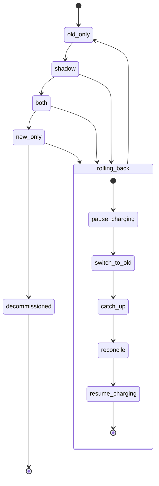

## Billing engine rollout

Today the old billing engine does everything. It reads usage events, computes invoices, writes them to the ledger and charges customers through the payment provider. This document models the switch to a new engine as a state machine. The switch is gradual and reversible, and it never charges a customer twice. A person moves the rollout forward one mode at a time, in order, with no skipping, and each move must pass a gate. The mode lives in one flag. A rollback can start from `shadow`, `both` or `new_only` and always ends in `old_only`, until the old engine is decommissioned. The rollout is modelled as a state machine so each move and each failure has one defined outcome before the rollout controller is written.

### Terms

- `billing_mode`: the one global flag in the config service. Values: `old_only`, `shadow`, `both`, `new_only`.
- Old engine / new engine: the existing and the replacement billing code. Either can compute invoices. Only the charging engine charges customers and writes the ledger.
- Usage event log: the record of usage events both engines read. It keeps 35 days.
- Ledger: the billing system of record. When the ledger and the payment provider disagree, the ledger is right. It holds at most one entry per customer and billing period.
- Payment provider: the outside service that actually charges customers.
- Shadow store: where the engine that is not charging writes its invoices, so they can be compared without affecting customers.
- Nightly comparison job: compares the two engines' invoice totals per customer.
- `comparison_results`: table with one row per compared invoice. Each row says whether it is a mismatch and whether it is resolved.
- Mismatch: an invoice total that differs by more than one cent.
- Rollout tool: the program a person uses to make forward moves and to run rollbacks. It checks gates and sets the flag. It also keeps the gate evidence and Finance sign-off.
- Billing monitor: watches the new engine's charge failure rate and starts automatic rollbacks.
- Rollback record: one record holding the rollback's start mode, current step and which steps are done. At most one exists at a time.
- Charging-paused switch: a second setting in the config service. While it is on, the charging engine makes no charges. (Added here to explain how a pause works; the brief names no mechanism.)
- Billing period: the span an invoice covers. A customer is charged at most once per period.
- Stop point: the usage event log position when the rollout moved to `new_only`, when the old engine stopped reading events. The rollout tool records it at that move.

### Diagram

### What each mode does

- `old_only`: the old engine does everything. The new engine is off.
- `shadow`: the old engine charges and writes the ledger. The new engine reads the same usage events and writes invoices only to the shadow store. It never charges and never writes the ledger. Its errors are recorded but never start a rollback.
- `both`: the new engine charges and writes the ledger. The old engine keeps computing every invoice into the shadow store, without charging, so it stays current. The comparison continues.
- `new_only`: the old engine stops computing. The new engine charges and writes the ledger.
- `decommissioned`: the old engine is removed. There is no way back.

### Where state lives

- Current mode: `billing_mode` in the config service.
- Pause during rollback: the charging-paused switch in the config service.
- Gate evidence: `comparison_results`, plus the date the last rollback finished, the date `new_only` began and the stop point, all kept by the rollout tool.
- Rollback progress: the rollback record.
- Finance sign-off: recorded in the rollout tool.

### Forward moves

A person asks the rollout tool for the next mode. It refuses to skip a step and refuses if a rollback record is open. It checks the gate, then sets `billing_mode`. If the gate fails, nothing changes and the tool says which condition failed.

1. `old_only` to `shadow`: no gate beyond the rules above.
2. `shadow` to `both`: 7 consecutive days with a mismatch rate under 0.1% and at least 5,000 invoices compared, read from `comparison_results`. After a rollback, only rows dated after the rollback finished count, so the count starts over.
3. `both` to `new_only`: 14 days in `both` with no unresolved mismatches, plus Finance sign-off. Days count from the move into `both`. A day whose nightly comparison did not run does not count, so it lengthens the wait. The unresolved-mismatch check is made when the person asks for the move. A mismatch is resolved when a person marks its row resolved with a reason, or when a later comparison of that invoice is within one cent. At this move the tool records the date and the stop point.
4. `new_only` to `decommissioned`: allowed only after 35 days in `new_only` with no rollback running. From day 35 on there is no way back.

Nightly comparison: in `shadow` and `both`, the job compares the two engines' invoice totals per customer and writes one row per invoice to `comparison_results`. If it fails to run, that day counts toward no gate.

### Rollback

Starting a rollback:
- By hand: on-call runs the rollout tool's rollback command at any time from `shadow`, `both` or `new_only`. This is the only way to start one from `shadow`, because the monitor does not act there.
- Automatically: in `both` or `new_only`, a new-engine charge failure rate above 2% over any 10-minute window makes the billing monitor start one.
- The 35-day limit: counted from the day `new_only` began. The usage event log keeps 35 days, and the old engine must replay the events it skipped, so from day 35 the oldest are gone. From day 35 on the tool refuses a rollback from `new_only`, and an automatic trigger also pages on-call. Rollback from `shadow` or `both` is not limited by this.
- If a rollback record is already open, a second request is ignored and the tool says one is running.

Rules: never charge anyone twice for a billing period, and never drop a charge that is due.

Steps:
1. `pause_charging`: the tool turns on the charging-paused switch. The charging engine checks it before every charge, so nothing is charged mid-switch. Due charges are only delayed.
2. `switch_to_old`: the tool sets `billing_mode` to `old_only`.
3. `catch_up`: the old engine processes the usage events it skipped, read from the usage event log starting at the stop point. This brings its own state up to date. It computes invoices and writes ledger entries only for customer and billing periods that have no entry yet. An entry the new engine already wrote is kept, so there are no duplicates. It does not charge, because charging is paused.
4. `reconcile`: for each customer and billing period, compare the ledger's charges with the payment provider's charges. The ledger wins. A ledger entry with no provider charge is a due charge never made: charge it once. A provider charge with no ledger entry, or a second provider charge for one ledger entry, is flagged for a person. The tool never refunds or removes anything automatically. All charging in a rollback happens here, so double charges are checked in one place.
5. `resume_charging`: the tool turns the charging-paused switch off. The flag is already `old_only`, so the old engine charges again. The rollback record is closed and its finish date stored for the gates.

Steps by start mode (the tool decides; the rollback record is used every time, so forward moves stay blocked until it closes):
- From `shadow`: only `switch_to_old` runs, because the new engine charged no one.
- From `both`: `catch_up` is skipped. The new engine wrote the ledger and the old engine was kept current, so the old engine just resumes.
- From `new_only`: all steps run.

After any rollback the gates reset: the rollout goes through `shadow` again and the 7-day count starts over. Old `comparison_results` rows stay as history.

### What happens when things fail

| Failure | Result |
|---|---|
| Gate check fails | Flag unchanged. Tool names the failed condition. |
| Rollback step fails | Tool retries that step from the rollback record. If retries keep failing, it pages on-call. Charging stays paused until the rollback finishes. |
| Second rollback request while one runs | Ignored. |
| Monitor fires or rollback requested on day 35 or later in `new_only` | Refused. Automatic trigger pages on-call. |
| New-engine errors in `shadow` | Recorded only. |
| Nightly comparison does not run | That day counts toward no gate. |

### Open questions

- Who handles a flagged double charge or an unmatched provider charge, and how quickly, is not decided.
- Retry count and delay for a failed rollback step are not decided.
- The exact form of the rollback command is not designed yet.
- Who may mark a mismatch resolved is not decided.
- Whether the old engine already keeps its own read offset that could replace the stop point is unknown.
