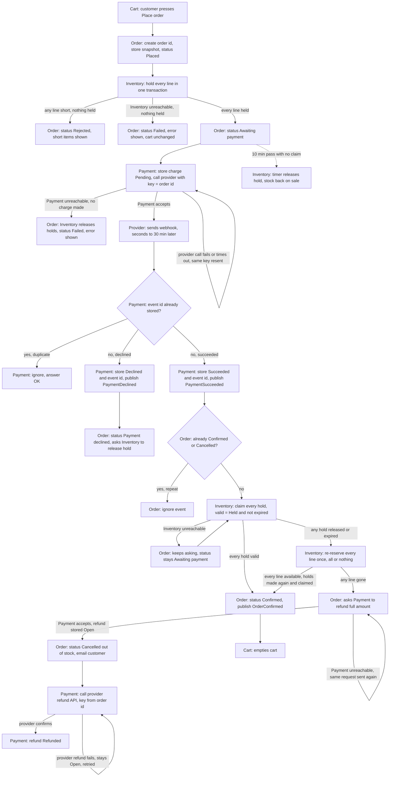

## Checkout plan

**What this is.** This is the checkout design for moving checkout out of the monolith. Checkout runs across four services: Cart, Inventory, Payment and Order. The payment provider is outside our system. Each service owns its own database. Services talk over HTTP or through events on the shared message broker. No service reads another service's tables.

The flow starts when the customer presses Place order. Order records the order and a copy of the cart's lines and prices. Inventory holds stock for every line, or for none. Payment asks the provider to charge the customer, using the order id as the charge key. The provider reports the result later, by webhook. If the payment succeeds and the stock is still held, Order confirms the order and Cart is emptied. If the payment succeeds after the stock has gone, Order refunds the customer and cancels the order. If checkout fails at any point, the cart stays exactly as it was and the customer can try again.

The shape follows from three rules. Stock is held before any money is requested. The provider can take up to 30 minutes to report, so the design does not wait for it, and it ignores repeated webhooks. We never keep money for an order we cannot fulfil, and we never ship a partial order.

### Terms

- **Order id**: a unique id that Order creates when the customer presses Place order. Every service names the order by this id.
- **Snapshot**: a copy of the cart's lines and prices, taken at Place order. Later cart edits and price changes do not change it.
- **Hold**: stock set aside for one line of one order. A hold lasts 10 minutes. A hold is Held (set aside), Claimed (sold to the order) or Released (back on sale).
- **Valid hold**: a hold whose state is Held and whose expiry time is still in the future.
- **Claim**: Inventory turns the valid holds of an order into a sale. Order asks for this once payment succeeds.
- **Charge**: a request to the provider to take money. Payment stores each charge as Pending, Succeeded or Declined.
- **Idempotency key**: a value sent with a charge or refund. The provider makes at most one charge or refund per key, so a resent request cannot charge or refund twice. The charge key is the order id. The refund key is made from the order id.
- **Webhook**: an HTTP message the provider sends to Payment when it decides a charge. It usually arrives within seconds, and can arrive up to 30 minutes later. The same webhook can arrive more than once.
- **Event id**: the provider's unique id for each webhook. Payment uses it to spot a repeat.
- **Broker**: the shared message system. An event is a message on the broker that another service reads.
- **PaymentSucceeded, PaymentDeclined**: payment outcome events. Payment publishes one on the broker after a charge is decided. Order reads it.
- **OrderConfirmed**: an event Order publishes on the broker when it confirms an order. Cart reads it.
- **Refund**: money sent back from the provider to the customer. Payment stores each refund as Open (not yet confirmed by the provider) or Refunded.
- **Order status**: one of Placed, Awaiting payment, Rejected (short stock), Failed (could not reserve, or could not reach Inventory or Payment), Payment declined, Confirmed, or Cancelled (out of stock).

### The flow

Notes:
- Each box names the service that does the step.
- The dotted line is the 10-minute timer in Inventory. It is not a call.
- A refund happens only on the late-success path. It never happens on a confirmed order.
- If Payment does not accept a refund request, Order sends it again. The order stays Awaiting payment until Payment accepts it.
- After Rejected, Failed or Payment declined, a retry starts again at Place order with a new order id. See Retry after a failed order below.

### Steps

1. **Place order (Cart and Order).** Starts when the customer presses Place order. Cart sends its lines and prices to Order over HTTP. Order creates the order id, stores the snapshot and sets status Placed. From this point Order owns the order. The order id must exist before stock is held, so the holds can name it. Order DB keeps the order, the snapshot and the status. Cart DB keeps the cart, which does not change here. If Order cannot create the order, nothing is stored. The customer sees an error and can try again. The cart is unchanged.

2. **Hold stock (Inventory).** Starts once the order is Placed. Order asks Inventory to hold every line for the order id. Inventory checks all the lines and writes all the holds in one database transaction, so it holds every line or none. This runs before any payment is requested, so we never ask for money for stock we have not reserved. Inventory DB keeps one hold per line: order id, item, quantity, expiry time (now plus 10 minutes) and state Held.
   - All lines available: Order sets status Awaiting payment. Go to Request payment.
   - Any line short: nothing is held. Order sets status Rejected and stores the short items. The customer sees which items are short. No payment is requested. The cart is unchanged.
   - Inventory cannot be reached: nothing is held. Order sets status Failed. The customer sees an error and can try again.

3. **Request payment (Order and Payment).** Starts when the order is Awaiting payment. Order calls Payment over HTTP and asks it to take payment for the order id. Order needs a direct answer on whether the request was accepted. Payment calls the provider's charge API with the order id as the idempotency key. It stores a charge record with status Pending in Payment DB. It does not wait for the outcome. Only Payment talks to the provider.
   - Provider call fails or times out: Payment sends the same request again with the same key. The customer sees a still-waiting message.
   - Payment accepts the request: the flow waits for the webhook.
   - Payment cannot be reached: Payment never received the request, so no charge was made and no money moved. Order asks Inventory to release the holds, sets status Failed, and the customer sees an error and can try again. The cart is unchanged.
   - While the order is Awaiting payment, the checkout page asks Order for the order's status, by order id, over HTTP, and keeps asking. The brief names no push channel, so the page asks rather than being told. When the status changes to Confirmed, Payment declined, Cancelled (out of stock) or Failed, the page shows it.

4. **Receive the webhook (Payment).** Starts when the provider sends a webhook. This can be seconds or up to 30 minutes after the charge. Payment looks up the event id in Payment DB.
   - Event id already stored: Payment ignores the webhook and answers OK, so the provider stops resending it.
   - New event, declined: in one transaction, Payment stores the charge as Declined and stores the event id. It then publishes PaymentDeclined on the broker. Order reads it, sets status Payment declined and asks Inventory to release the hold. The cart is unchanged.
   - New event, succeeded: in one transaction, Payment stores the charge as Succeeded and stores the event id. It then publishes PaymentSucceeded on the broker. Order reads it and claims the stock.
   - Storing the event id and the charge status in one transaction means a repeat webhook is never processed twice.
   - If Order is unreachable, the event waits on the broker until Order is back.
   - If the broker does not accept the publish, the outcome stays stored in Payment DB and Payment publishes it again until the broker accepts it. A repeat webhook does not trigger a new publish, because it is ignored at the event id check.
   - If the release request to Inventory fails after a decline, nobody retries it. The hold waits out its 10 minutes, and the expiry timer in Inventory releases it.

5. **Claim the stock (Order and Inventory).** Starts when Order reads PaymentSucceeded. If the order is already Confirmed or Cancelled, Order ignores the repeat event. Otherwise Order asks Inventory to claim the holds for the order id. Inventory checks each hold for two things: its state is Held, and its expiry time is still in the future. A hold that is Released, or whose expiry time has passed, is not valid, even if the timer has not marked it yet. The timer is only a clean-up job, so the expiry time decides. A hold already Claimed for this order id counts as valid, so a repeated claim changes nothing.
   - All holds valid: Inventory marks them Claimed. Go to Confirm.
   - Any hold not valid: go to Late success.
   - Inventory cannot be reached: nothing changes. The order stays Awaiting payment, and Order asks again until Inventory answers. The customer's money stays captured. There is no refund and no cancel until Inventory answers, because the stock may still be available.

6. **Confirm (Order and Cart).** Order sets status Confirmed and publishes OrderConfirmed on the broker. Cart reads the event and empties the cart. The cart is emptied only at this point. If Cart is down, the broker keeps the event until Cart reads it. Emptying a cart twice is harmless.

7. **Late success (Order, Inventory and Payment).** Starts when a payment succeeds but a hold is not valid. Order asks Inventory to re-reserve every line for the order id, once, with the same all-or-nothing rule as Hold stock. A line the order already holds counts as held, so a repeated re-reserve writes nothing. If Inventory cannot be reached, the order stays Awaiting payment and Order asks again, as in Claim the stock.
   - All lines available: the holds are made again and Order claims them. Go to Confirm.
   - Any line gone: Order asks Payment to refund the full amount. This is an HTTP call, like Request payment. Order does not wait for the provider's refund to finish. When Payment answers that it has stored the refund as Open, Order sets status Cancelled (out of stock) and emails the customer that the order is cancelled and the money is being returned. If Payment cannot be reached, Order sends the same refund request again, and the order stays Awaiting payment until Payment accepts it. No cancel email goes out before that. The cart is unchanged. We never ship a partial order.

8. **Hold expires (Inventory).** Starts on a timer in Inventory. It finds holds older than 10 minutes that are still Held and marks them Released, which puts the stock back on sale. Inventory does not change the order. The order stays Awaiting payment until a webhook decides it. If that webhook reports success, Late success applies.

9. **Refund (Payment).** Starts when Order asks for a refund. Payment stores a refund record for the full amount with state Open, then answers Order. It does not wait for the provider, so the answer does not depend on the provider being up. Payment then calls the provider's refund API with a refund key made from the order id. When the provider confirms, the record becomes Refunded. If the provider call fails, the record stays Open and Payment retries with the same key until the provider confirms. An Open refund is never dropped. It stays visible in Payment DB.

10. **Retry after a failed order (Cart and Order).** Starts when the customer presses Place order again after the order was Rejected, Failed or Payment declined. The checkout page shows that status and the message from the failure table. The old order is not reused. Cart sends its current lines and prices, which are unchanged, and Order starts again at Place order. The new attempt gets a new order id, a new snapshot, new holds and a new charge key. The old order stays in Order DB as a record. Reason: the old charge key may already be used at the provider, so a new key is the safe start. This plan sends no email for a decline. The brief does not say whether a customer may retry after Cancelled (out of stock), so that is an open question.

### When things fail

| What goes wrong | What happens | Customer sees | Cart |
|---|---|---|---|
| Order cannot be created | Nothing is stored | Error, try again | Unchanged |
| Short stock | Nothing held, order Rejected | Which items are short | Unchanged |
| Inventory cannot be reached when holding stock | Nothing held, order Failed | Error, try again | Unchanged |
| Payment cannot be reached | No charge made, holds released, order Failed | Error, try again | Unchanged |
| Provider charge call fails or times out | Same request sent again with the same key | Still waiting | Unchanged |
| Payment declined | Charge Declined, hold released, order Payment declined | Declined message | Unchanged |
| Release of a hold after decline fails | Hold waits out its 10 minutes, then the timer releases it | Declined message | Unchanged |
| Payment outcome event not accepted by broker | Payment keeps the outcome and publishes it again | Still waiting | Unchanged |
| Duplicate webhook | Ignored, because the event id is already stored | Nothing new | Unchanged |
| Duplicate PaymentSucceeded, or repeated claim or re-reserve | Order ignores the event once Confirmed or Cancelled. A repeated claim or re-reserve changes nothing | Nothing new | Unchanged |
| Webhook late (up to 30 min) | Order stays Awaiting payment | Still waiting | Unchanged |
| Hold expires before claim | Stock released. Order waits for the webhook. A later success goes to Late success | Nothing until the webhook | Unchanged |
| Inventory cannot be reached at claim or re-reserve | Order keeps asking. No refund or cancel until Inventory answers | Still waiting | Unchanged |
| Late success, stock still available | Held again, order Confirmed | Order confirmed | Emptied after confirmation |
| Late success, stock gone | Refund requested. Order Cancelled (out of stock) once Payment accepts it. Email sent | Cancellation email | Unchanged |
| Payment does not accept the refund request | Order sends the same request again. Order stays Awaiting payment until accepted | Still waiting | Unchanged |
| Refund fails at provider | Refund stays Open and is retried until it succeeds | Cancellation email (money on its way) | Unchanged |
| Cart is down when OrderConfirmed is sent | Broker keeps the event. Cart is emptied later | Order confirmed | Still shows items until Cart is back |

### Open questions

- The brief does not give the webhook fields, or say whether the provider's direct reply to a charge can already show the result. We need the provider's API before the webhook step can name the fields.
- The design assumes the broker keeps OrderConfirmed and the payment outcome events until they are read. If the broker can lose events, Cart needs a catch-up check, and Order needs one for payment outcomes.
- If no webhook arrives, what happens to the order is not decided.
- How long Payment keeps resending a charge request that fails, and what happens if it never reaches the provider, is not decided. Such a charge moves no money and sends no webhook, so the order waits as in the no-webhook case.
- How long Order keeps asking Inventory to claim or re-reserve, or asking Payment to accept a refund, when they are down, is not decided.
- When a hold lapses while the charge is still pending at the provider, it is not decided whether we cancel that charge.
- Late success tries one re-reserve before refunding. The brief only says refund and cancel. Confirm that the re-reserve is wanted.
- Edits made to the cart during checkout: it is not decided whether they are cleared with the order or kept.
- No team is named to look at Open refunds.
- How often the checkout page asks Order for the order's status, and when it stops asking, is not decided.
- Whether a customer can retry after Cancelled (out of stock) is not decided. The retry rule lists only Rejected, Failed and Payment declined.