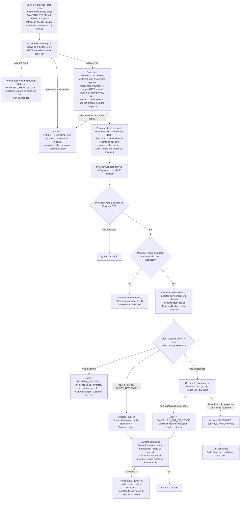

## Checkout plan

Today checkout runs inside the monolith. This plan moves it into four services: Cart, Inventory, Payment and Order, plus the external payment provider. Each service owns its own database, and no service reads another's tables. Services talk by HTTP request or by events on the shared message broker. The Order service drives the sequence. When the customer presses Place order, Order saves the order, asks Inventory to reserve all the stock, then asks Payment to charge. The provider reports the result later by webhook, so Order waits for an event from Payment. On success Order claims the stock and confirms the order, and Cart clears the cart. On failure the cart stays exactly as it was. If the payment succeeds after the hold has lapsed and the stock is gone, we refund in full, cancel the order and email the customer. We never keep money for an order we cannot fulfil and never ship a partial order. One place (Order) owns the status, so the failure branches stay simple. The customer's screen polls Order for the status (Processing payment, then confirmed, declined or cancelled).

### Terms

- Reservation (hold): stock set aside for one order for 10 minutes. If the order has not claimed it by then, the stock goes back on sale.
- Claim: turning a hold into a sale for an order.
- Order id: made new each time the customer presses Place order. A retry after a failure is a new order with a new id, a new charge key and a new hold.
- Idempotency key: an id sent with a request so a retry cannot do the work twice. We use the order id, for every charge request to the provider and for every call to Inventory and Payment. A repeated call for the same order does what the first did.
- Snapshot: the cart lines and prices copied into the order at Place order. Later cart edits or price changes do not affect the order.
- Webhook: an HTTP call from the provider to Payment reporting the final result (succeeded or declined). It usually arrives in seconds but can take up to 30 minutes, and the provider may send the same one more than once.
- Event: a message on the broker. A service that is down receives its events when it comes back. A consumer tells the broker it has handled an event only after it has finished, so a crash makes the broker deliver it again.
- Open order: an order in AWAITING_STOCK or AWAITING_PAYMENT.

### Diagram

### What each service stores

- Cart: the customer's cart. Cleared only on OrderConfirmed.
- Inventory: stock counts and holds with their expiry times, one hold per order id.
- Payment: payment records (order id, provider reference once known, status), refund records, and the provider event ids already processed (unique constraint).
- Order: orders, the snapshot, the status, and for an AWAITING_PAYMENT order a mark that Payment accepted the charge. Only Order changes statuses: AWAITING_STOCK, REJECTED_SHORT_STOCK, AWAITING_PAYMENT, PAYMENT_DECLINED, FAILED_TECHNICAL, CONFIRMED, CANCELLED_OUT_OF_STOCK. A database rule allows only one open order per cart.
- Order and Payment also keep an outbox table: each event is written there in the same transaction as the change, and a sender repeats it to the broker until the broker accepts it.

### Steps

1. **Place order** (customer). Order saves the order as AWAITING_STOCK with the snapshot. If the cart already has an open order, Order returns that order instead, so a double press gives one order and one charge, and no new order can start for the cart until the open one reaches a final status. If Order crashes, a sweep (see step 7) picks the order up.
2. **Reserve** (Order calls Inventory). Reserve is all-or-nothing, so if any line is short nothing is reserved and no payment is requested. Order sets REJECTED_SHORT_STOCK and tells the customer which items are short. Inventory keeps one hold per order id, so a retried call returns the existing hold. If Inventory never answers (a few retries, about one minute in all), Order sets FAILED_TECHNICAL and tries once to release.
3. **Charge** (Order calls Payment). Order saves AWAITING_PAYMENT, then sends the order id and the amount, which is the sum of the snapshot lines. Payment looks nothing up. Payment saves the payment record PENDING before it calls the provider, so a record exists whenever the provider might have charged. It sends the order id as both idempotency key and charge reference, then replies and Order marks the charge accepted. If the provider call fails or Payment crashes, Order gets an error or no answer and retries. The key stops a second charge and Payment returns the existing record. After the retries, Order sets FAILED_TECHNICAL and tries once to release.
4. **Webhook** (provider calls Payment). Payment first checks the provider event id. If it is already stored, it ignores the call and replies OK. Otherwise it finds the payment record by the order id in the webhook (the provider reference may not be stored yet if Payment crashed). It stores the event id, updates the record and publishes PaymentSucceeded or PaymentDeclined with the order id. If no record is found, Payment stores the event id, alerts a person, replies OK and publishes nothing, because it cannot tell which order the money belongs to.
5. **Order handles the payment event** (Order subscribes to the broker). It acts only if the order is AWAITING_PAYMENT, so a repeated event does nothing.
   - Declined: Order sets PAYMENT_DECLINED and tries once to release the hold. The cart is unchanged and the customer can retry as a new order.
   - Succeeded: go to step 6.
   - Not AWAITING_PAYMENT (for example FAILED_TECHNICAL, where a charge went through after Order gave up): on success Order publishes RefundRequested and the status stays as it is, so the customer is never charged for nothing. A decline is ignored.
   Order acknowledges the event only after it has finished, which for a success means after the claim reply and the new status are saved. If Order crashes mid-claim, the broker delivers the event again, the order is still AWAITING_PAYMENT, and the claim is repeated safely. If Order is down, the broker holds the events.
6. **Claim** (Order calls Inventory), retried until Inventory replies, with an alert to a person if it keeps failing. The payment is recorded, so nothing is lost meanwhile. Inventory checks the hold. If it is live, it is claimed. If it lapsed, Inventory tries one all-or-nothing re-reserve of every line (kept to avoid refunding when stock is still there). A repeated claim of a claimed hold returns claimed.
   - Claimed or re-reserved: Order sets CONFIRMED and publishes OrderConfirmed. Cart consumes it and clears the whole cart (clearing an empty cart is harmless).
   - Stock gone: Order sets CANCELLED_OUT_OF_STOCK, publishes RefundRequested and emails the customer. We never ship partial orders.
7. **Order crash sweep.** When Order starts, and then every minute, it looks for stuck orders. Orders in AWAITING_STOCK for over two minutes get the reserve call repeated, then the charge. Orders in AWAITING_PAYMENT for over two minutes whose charge is not marked accepted get the charge call repeated. Both are safe because of the order id. Without the sweep such an order would block the cart for good.
8. **Refund** (Payment consumes RefundRequested). Payment finds the payment record by the order id, creates a refund record and refunds the full amount at the provider. If the provider fails, the refund stays PENDING and is retried until it succeeds, and repeated failure alerts a person. A refund is never dropped. The order status does not change when the refund finishes or fails; the refund record holds that state.

### When things fail

| Failure | What happens |
|---|---|
| Any line short | Nothing reserved, no payment, REJECTED_SHORT_STOCK, customer told which items |
| Inventory or Payment gives no answer | Same call retried with the same order id, then FAILED_TECHNICAL and one release attempt, cart unchanged |
| Release fails or Order crashes before it | Not retried. The hold expires after 10 minutes and stock goes back on sale (stock is unavailable for up to 10 minutes meanwhile) |
| Payment declined | PAYMENT_DECLINED, one release attempt, cart unchanged |
| Duplicate webhook | Event id already stored, ignored |
| Webhook with no matching payment record | Event id stored, person alerted, nothing published |
| Success after the hold lapsed, stock sold | Refund in full, CANCELLED_OUT_OF_STOCK, email |
| Success after Order gave up | RefundRequested, status unchanged |
| Refund fails at provider | Stays PENDING, retried, alert for repeated failure |
| Event lost or repeated | Outbox resends until accepted, consumers ignore repeats |
| Order crash | Sweep repeats the stuck call |

Any failure before CONFIRMED leaves the cart exactly as it was.

### Open questions

- If no webhook arrives within 30 minutes, the order stays AWAITING_PAYMENT and the cart stays blocked from a new order. Not decided whether to query the provider or cancel.
- Alert destination and retry interval for failed refunds, failed claims and unmatched webhooks are not decided.
- Which service sends the customer email is not decided; Order triggers it.
- OrderConfirmed clears the whole cart, so items added after Place order are lost. Not decided whether to remove only the snapshot lines.
- Exact retry count and timeout for Order's calls are not decided; one minute in all is a placeholder, as are the two-minute and one-minute sweep figures.
- How the customer's payment method reaches the provider (for example a token from the browser) is not decided. No service stores raw card details in this plan.
- How often the screen polls Order is not decided.
- Not checked: that our provider lets us set a reference on a charge and returns it in the webhook. Matching by order id depends on it.
- Broker redelivery settings (delay, limit) are not decided.
