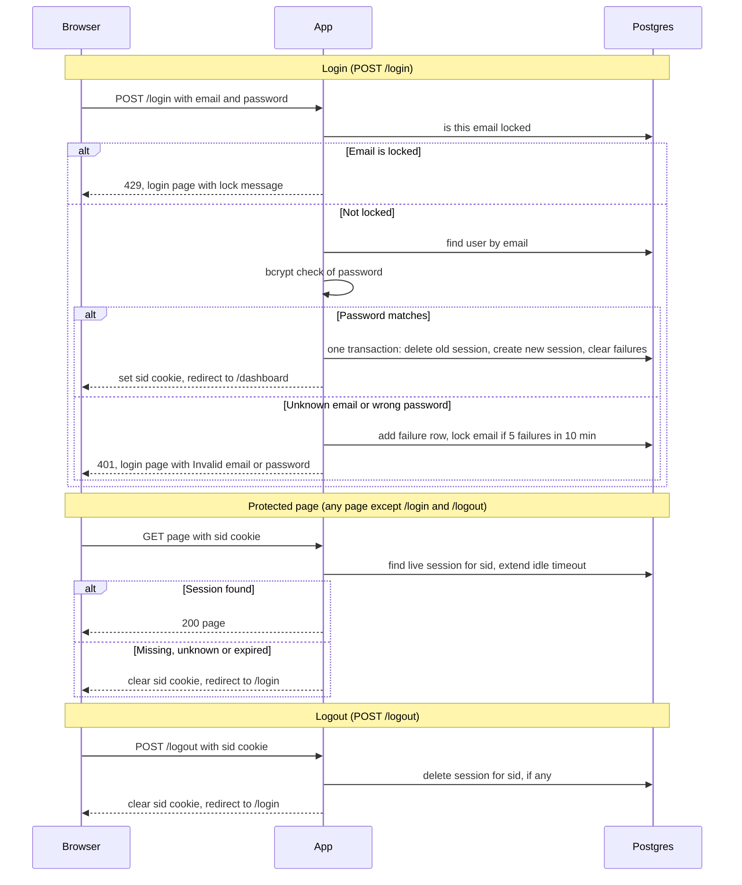

## Auth plan

**What this is.** Sign-in for the team-scheduling app. Today the app has no sign-in, and every page is public. After this change, every page except `/login` needs a signed-in user. The app is server-rendered and runs as two identical instances behind a load balancer, with no sticky sessions, so any request may reach either instance. A user posts email and password to `/login`. If the password matches, the app stores a session row in Postgres and sends a cookie that holds only that row's random ID. Each later page request looks up that row and checks its expiry times. All state lives in Postgres because the two instances do not share memory.

### Terms and stored data
- **Instance**: one running copy of the app. There are two.
- **Load balancer**: the front door that sends each request to one of the two instances.
- **Postgres**: the shared database that both instances use.
- **Postgres clock**: the time the database reports, read with `now()`. Both instances use it, so they agree on the time.
- **Session**: a row in the `sessions` table. It says which user is signed in and when that sign-in ends.
- **sid cookie**: the browser cookie that holds a session's random ID and nothing else.
- **HttpOnly**: page scripts in the browser cannot read the cookie.
- **Secure**: the browser sends the cookie only over HTTPS.
- **SameSite=Lax**: the browser does not send the cookie on most requests that other websites start.
- **bcrypt**: a slow, one-way hash of a password. `users.password_hash` stores it.
- **Dummy hash**: a fixed bcrypt hash. It is checked when no user has the email, so an unknown email takes as long as a real one.
- **Upsert**: a database write that inserts a row, or updates the existing row with the same key.
- **Fail closed**: when a check cannot run, refuse the request rather than allow it.
- **Idle timeout**: a session ends after 30 minutes with no requests. Each request restarts the 30 minutes.
- **Absolute timeout**: a session ends 12 hours after login, however active it is.
- **Failure row**: one `login_failures` row for each failed sign-in attempt.
- **Lock**: one `login_locks` row. It refuses sign-ins for one email until its time passes.
- **Cleanup job**: a timer inside each instance that deletes old rows every 10 minutes.

Stored data:
- `users` (existing): `id`, `email` (lowercase, unique), `password_hash`.
- `sessions`: `id` (random 256-bit value, also the cookie value), `user_id`, `created_at`, `idle_expires_at`, `absolute_expires_at`.
- `login_failures`: `email`, `failed_at`.
- `login_locks`: `email` (primary key), `locked_until`.

### Flow

### Rules the arrows do not show
- Lockout counts attempts per email only. Real and unknown emails are counted and locked the same way.
- Every time check uses the Postgres clock, never the clock of an instance.
- Expired rows stay in the table until the cleanup job removes them. The protected-page check ignores them anyway.
- `GET /login` shows the sign-in form. The form's submit starts the login steps below.

### Steps

**Login (`POST /login`).** Starts when the sign-in form is posted.

1. Lowercase the email. Check `login_locks` for this email. If `locked_until` is later than the Postgres clock, stop and return 429. Do not check the password and do not write a failure row. This applies to real and unknown emails alike, so the 429 does not show whether an account exists.
2. Find the `users` row with this email. Check the password with bcrypt against `password_hash`. If no user has the email, check against the dummy hash instead, then treat the attempt as a failure. The dummy check is my choice, not a brief requirement. It keeps the timing the same either way.
3. On a match, run one database transaction. It does three things. It deletes the session the incoming `sid` cookie points to, if the browser sent one. If the cookie is missing or points to nothing, this delete removes nothing and login continues. It inserts a new `sessions` row with a new random ID and both expiry times. It deletes this email's `login_failures` rows. If any part fails, the transaction rolls back and the old session stays. After the commit, set the `sid` cookie to the new ID with HttpOnly, Secure and SameSite=Lax, and redirect to `/dashboard`. The ID is new on every login, so an ID seen before sign-in cannot be used after it.
4. On a mismatch, run one database transaction. It inserts a `login_failures` row for the email. It counts this email's failure rows with `failed_at` in the last 10 minutes, by the Postgres clock. If the count is 5 or more, it upserts the `login_locks` row with `locked_until` 15 minutes from now. An old, expired lock row for this email is replaced this way. Then return 401 and the login page with "Invalid email or password". No cookie is set. This attempt still gets 401. The next attempt gets 429 while the lock lasts. Unknown emails are counted and locked the same way as real ones, so a lock never reveals that an account exists.

**Protected page (any page except `/login` and `/logout`).** Starts on any request for such a page, with or without a `sid` cookie. No cookie counts as missing.

1. Find the `sessions` row whose `id` is the cookie value and whose `idle_expires_at` and `absolute_expires_at` are both later than the Postgres clock.
2. If found, set `idle_expires_at` to the earlier of the Postgres clock plus 30 minutes and `absolute_expires_at`. Then serve the page. The idle time never runs past the absolute time, so the 12-hour limit always holds. The page reads `user_id` from the row to know who is signed in. Being signed in is the only check. The brief sets no roles, so every protected page accepts any signed-in user.
3. If not found, clear the `sid` cookie and redirect to `/login`. The user is not sent back to the page they asked for. After signing in, they go to `/dashboard`. Expired rows stay until the cleanup job removes them. Step 1 refuses them anyway.

**Logout (`POST /logout`).** Starts when the logout is posted. Logout is not a protected page. It does not check for a signed-in user, so it works the same with or without a session.

1. Delete the `sessions` row whose `id` is the `sid` cookie value, if one exists. If none exists, do nothing.
2. Clear the `sid` cookie and redirect to `/login`. The session is already deleted when this reply is sent, before the reply goes out. The reply is the same with or without a session.

**Cleanup job.** Starts on a timer. Each instance runs it every 10 minutes. Both run it. That is harmless, because deleting a row that is already gone changes nothing. It deletes:
- `sessions` rows past either expiry time,
- `login_failures` rows older than 10 minutes,
- `login_locks` rows whose `locked_until` has passed.

Cleanup is housekeeping only. Protected-page step 1 already refuses expired sessions.

### Choices
- **Storage: Postgres, for sessions, failure rows and locks.** Both instances already share Postgres, so no new service is needed. Process memory fails because the two instances do not share it. Redis is not in the stack today, and nothing here needs its speed, so it is not added.
- **Expiry: two stored timestamps, checked on every request against the Postgres clock.** The check is one query, and the two instances cannot disagree about the time.
- **Session IDs: 256-bit random values from a cryptographic random source.** They are stored unhashed for now. See open questions.
- **Abandoned sessions: they expire on their own, and the cleanup job deletes the rows.** A session with no requests ends after 30 minutes.
- **Lockout: per email only, not per IP.** The brief sets it per email. Login reads no IP address or other identity, so attempts are told apart by the lowercased email alone.
- **Login replaces only the browser's own session.** Other sessions of the same user, on other devices, are left alone, because a user may be signed in on several devices.
- **Storage failure: fails closed.** No page is served and no sign-in succeeds without a working check. The 5-second reply limit is my choice; the brief sets none. It is one limit for the whole request, not one per database call.

### What happens when things fail

| Where | What goes wrong | What the browser gets |
|---|---|---|
| Login step 1 | Email is locked | 429, login page: Too many failed attempts. Try again in 15 minutes. |
| Login step 4 | Unknown email or wrong password | 401, login page: Invalid email or password. No cookie. |
| Login steps 1 to 2 | Database error, or no reply within 5 seconds | 503, login page: Sign-in is temporarily unavailable. Try again shortly. No cookie and no failure row. |
| Login step 3 | Transaction fails | Transaction rolls back, so the old session is untouched. 503 as above. |
| Login step 4 | Database error while writing the failure row or lock | 503 as above. The failed attempt may not be counted. |
| Protected step 1 | Database error, or no reply within 5 seconds | 503 error page. Page not served. Cookie kept, no redirect. |
| Protected step 3 | Session missing, unknown or expired, or no cookie | Cookie cleared, redirect to `/login`. |
| Logout step 1 | Database error | 503 error page, cookie kept so the user can retry. The session may stay active until it expires. |
| Cleanup | Database error | Logged. The next run tries again. No user impact. |

The 5-second limit stops the wait and sends the 503. If the database finishes after that, the browser ignores the late reply, but its change is kept. A late login leaves a session with no cookie, which expires by itself. A late failure row may count an attempt the user saw as 503.

### Open questions
- Per-email lockout lets anyone lock out a real user by guessing their email. The brief requires per-email. Should there also be a per-IP limit?
- Two wrong guesses sent at the same moment may both count, so a few extra guesses can get past the limit.
- Session IDs are stored unhashed. Should they be hashed, so a copy of the database cannot be used as live sessions?
- The brief does not say what a signed-in user sees at `GET /login`, or whether they are redirected to `/dashboard`.
- Sign-up and password reset are out of scope, so this plan does not say how `users` rows and their `password_hash` values are created.
