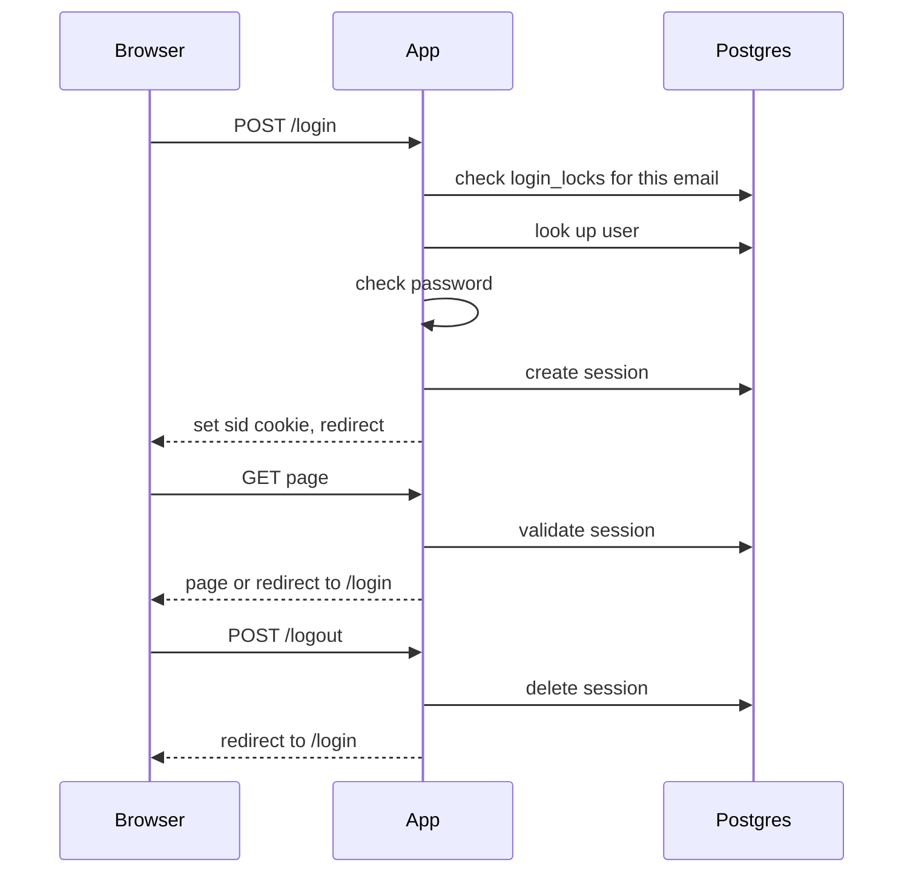

## Auth plan

This adds sign-in to a server-rendered app that today has only public pages. A user posts an email and password to `/login`. The app checks lockout and credentials, then stores a session row in Postgres and sets a cookie holding only the random session ID. Every other page checks that row on the server. Both app instances share one database, so no sticky sessions and no Redis are needed.

Terms:
- Session: a row in `sessions(id, user_id, created_at, last_seen_at)`. The row is what proves the user is signed in.
- `sid`: the cookie. It holds only the session ID, a random value of at least 128 bits from a secure random source. No user data goes in it.
- Cookie flags: HttpOnly (scripts cannot read it), Secure (sent only over HTTPS), SameSite=Lax (not sent on most cross-site requests).
- `login_failures(email, failed_at)`: one row per failed login.
- `login_locks(email, locked_until)`: a row means that email is locked until that time.
- Fail closed: on a storage error, deny access instead of letting the user in.

Steps, in the order they happen. Every page except `/login` needs a valid session.

1. Login starts with `POST /login`. The app lowercases the email before any lookup.
2. Lock check. If `login_locks` has a row for the email with `locked_until` in the future, reply HTTP 429 with the login page ("Too many attempts, try again later"). Do not check the password. Lockout is per email, not per IP, and unknown emails are counted too, so lockout never reveals whether an account exists.
3. Credentials check. Look up the user and compare the password. If the email is unknown or the password is wrong, add a `login_failures` row and reply HTTP 401 with the login page showing "Invalid email or password". Both cases reply identically. If the email now has 5 failures in the last 10 minutes, create a `login_locks` row with `locked_until` = now + 15 minutes.
4. Successful login. Delete that email's `login_failures` rows. Then, in one transaction, delete the session the incoming `sid` pointed to (if any) and insert a new session with a fresh random ID. This happens even if the browser already sent a `sid`, so the old ID is dead. Set the `sid` cookie and redirect to `/dashboard`.
5. Protected request. Find the session row by ID. It is valid only if `last_seen_at` is within 30 minutes and `created_at` is within 12 hours, using the database clock. If valid, set `last_seen_at` to now (this restarts the idle clock; `created_at` never changes, which gives the 12-hour cap) and serve the page. If the session is missing, unknown or expired, delete the row if there is one, clear the cookie and redirect to `/login`.
6. Logout is `POST /logout`. Delete the session row if one exists, then clear the cookie and redirect to `/login`. The result is the same when there is no session.
7. Cleanup. Every 5 minutes each app instance deletes expired sessions, `login_failures` older than 10 minutes and `login_locks` past `locked_until`. Running on both instances is harmless because the deletes are idempotent. This is housekeeping only, since the checks above already reject expired rows.

When things fail:

| Where | What the user sees | What the app does |
|---|---|---|
| Locked email | HTTP 429, login page | Skips the password check |
| Unknown email or wrong password | HTTP 401, "Invalid email or password" | Records a failure, may create a lock |
| Missing or expired session | Redirect to `/login` | Deletes the row if any, clears the cookie |
| Postgres errors during login, validation or logout | HTTP 503, plain "Service unavailable, try again" page | Fails closed: serves no protected page, creates no session, treats no one as signed in, leaves the cookie unchanged |

Open questions:
- None that block the design.