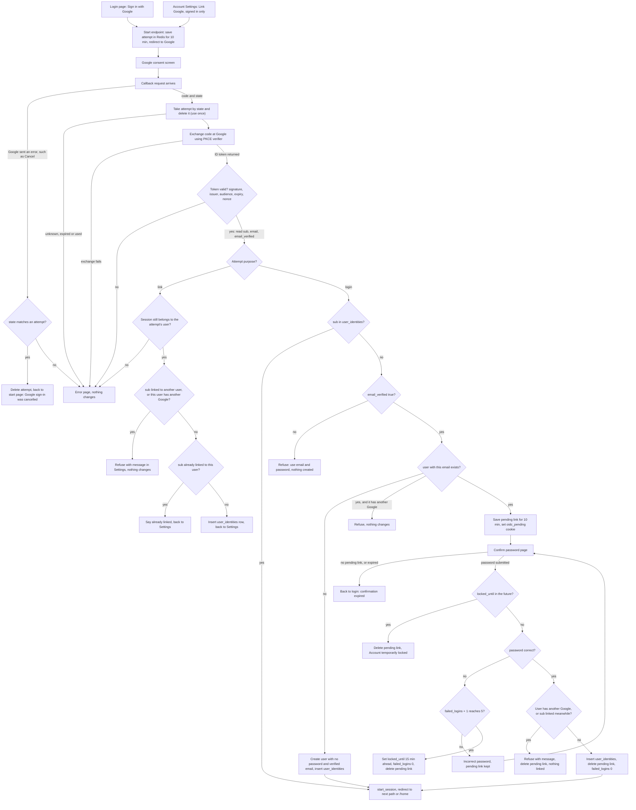

# Google sign-in

Adds "Sign in with Google" to the login page and to Account Settings. It uses OpenID Connect (OIDC) with the authorization-code flow and PKCE. Today a user signs in with email and password at POST /login. A correct password calls `start_session`, which creates a `sessions` row and sets the `sid` cookie. Google sign-in ends in that same call, so it gives the same session as a password login. No new session type is added.

The main flow: a start endpoint saves a 10-minute attempt in Redis and sends the browser to Google. The callback uses that attempt once, exchanges the code and checks the ID token. Then it signs in a linked Google account, creates a new account, or asks for the password of an existing account before linking it. Any failure shows a message and changes nothing.

## Terms

- **OIDC (OpenID Connect)**: a sign-in layer on top of OAuth 2.0. Google tells us who the user is.
- **Authorization-code flow**: Google sends back a short code, and our server swaps it for tokens. We request the scopes `openid email profile`.
- **PKCE**: we keep a secret verifier on the server and send only its hash (the challenge) to Google. We send the verifier when we swap the code, so a stolen code alone is useless.
- **ID token**: a signed token from Google that says who the user is. We read only `sub`, `email` and `email_verified`. We keep no Google access or refresh tokens.
- **sub**: Google's permanent ID for an account. We identify Google accounts only by `sub`, never by email.
- **state**: a random value we send to Google and get back on the callback. It finds our saved attempt and rejects forged or replayed callbacks.
- **nonce**: a random value that must appear inside the ID token. It stops a token from another login from being used here.
- **Redis**: a fast key-value store. Its keys can expire on a timer. We already use it for rate limits.
- **Attempt**: a Redis record for one sign-in round trip. It holds the state, nonce, PKCE verifier, purpose (`login` or `link`), the next path, and for linking, the user id.
- **Pending link**: a Redis record for an existing account that is waiting for its password. It holds the user id, sub, email and next path.
- **user_identities**: our table that links one Google `sub` to one user.
- **start_session**: the existing function that creates a `sessions` row and sets the `sid` cookie. It then redirects to the next path if that is a relative path on our site, otherwise to `/home`.
- **Lockout**: the existing rule. Five wrong passwords lock the account for 15 minutes (`failed_logins`, `locked_until`).

## Diagram

Notes:
- The callback finds the attempt by the state in Google's redirect, not by a cookie.
- The confirm page is reached only from the last login case.
- Google's email is never written to `users.email`.

## Steps

1. **Start.** Starts when the user clicks Sign in with Google on the login page, or Link Google in Account Settings. Settings needs a signed-in session. Without one, the user goes to the login page. The endpoint saves the attempt in Redis under `oidc:attempt:<state>` for 10 minutes. The attempt records the purpose and either the next path (login) or the signed-in user id (link). The endpoint then redirects to Google with scope `openid email profile`, the state, the nonce and the PKCE challenge. If Redis is down, it shows an error page and creates no attempt.

2. **Callback.** Starts when Google redirects back to us. Each step below ends the callback unless it says otherwise.
   - If Google sent an error and the state matches an attempt, delete the attempt. Send the user back to the page they started from, with "Google sign-in was cancelled." If the state matches no attempt, show an error page, because we cannot tell where the user started.
   - Otherwise, take the attempt by its state and delete it in one step. Each attempt is used once. An unknown, expired or already-used state shows an error page and changes nothing.
   - Exchange the code at Google's token endpoint with the PKCE verifier. If the exchange fails, show an error page. The attempt is already gone, so the user starts again.
   - Check the ID token: signature, issuer, audience (our client id), expiry, and nonce equal to the attempt's nonce. If any check fails, show an error page.
   - Read `sub`, `email` and `email_verified`. Continue to step 3 for a link attempt, or step 4 for a login attempt.

3. **Link from Settings (purpose `link`).** Matching uses `sub` only. No password is asked for, the emails need not match, and `email_verified` is not needed. Checks run in this order.
   - If the session no longer belongs to the user in the attempt, for example after a sign-out mid-way, show an error page and change nothing.
   - If the `sub` is linked to another user, or this user already has a different Google account, refuse with a message in Settings.
   - If the `sub` is already linked to this user, say so and return to Settings.
   - Otherwise insert a `user_identities` row and return to Settings. No new session is created.

4. **Login (purpose `login`).** Lowercase the email from Google. Then the first matching case applies. Matching uses `sub`, so a linked user whose Google email has changed still reaches the same account.
   - If the `sub` is linked, call `start_session` for that user and redirect to the saved next path or `/home`.
   - If the `sub` is not linked and `email_verified` is false, refuse with a message on the start page that points to email and password. Nothing is created.
   - If the `sub` is not linked, the email is verified, and no user has that email, create a user with `password_hash` NULL and `email_verified_at` set to now. Insert the `user_identities` row, then call `start_session`. If a concurrent sign-up takes the email first, show an error page and create nothing.
   - If the `sub` is not linked, the email is verified, and a user M has that email: if M already has a different Google account, refuse with a message on the start page and change nothing. Otherwise save a pending link under `oidc:pending:<id>` for 10 minutes, set the cookie `oidc_pending=<id>` (HttpOnly, Secure, SameSite=Lax), and redirect to the confirm page. No session is created yet.

5. **Confirm password.** Reached only from the last case in step 4. The page shows M's email and a password box. The pending link is found by the `oidc_pending` cookie. Each submission runs these checks in order.
   - If the pending link is missing or expired, go back to login with "Your confirmation expired. Sign in with Google again." The cookie is ignored once the Redis record is gone.
   - If `locked_until` is in the future, delete the pending link and show "Account temporarily locked." The password is not checked. This check runs before the password check, as in the existing sign-in rules.
   - If the password is wrong, add 1 to `failed_logins`. If that makes 5, set `locked_until` 15 minutes ahead, set `failed_logins` to 0, delete the pending link and show "Account temporarily locked." Otherwise show "Incorrect password." and keep the pending link until it expires.
   - If the password is right, check that M has no other Google account and that the `sub` is still unlinked. If either fails, refuse with a message, link nothing and delete the pending link. Otherwise set `failed_logins` to 0, insert the `user_identities` row, delete the pending link, clear the `oidc_pending` cookie and call `start_session` for M.

## Where state lives

| State | Where | Lifetime | Removed by |
|---|---|---|---|
| Attempt | Redis `oidc:attempt:<state>` | 10 minutes | The callback deletes it when it reads it. Otherwise it expires. |
| Pending link | Redis `oidc:pending:<id>`, plus cookie `oidc_pending` | 10 minutes | Success, a lock, or expiry. The cookie is ignored once the Redis record is gone. |
| Google link | Postgres `user_identities` | Until unlinked | Unlink in Settings, or deleting the user (cascade). |
| Google-created user | `users` row, `password_hash` NULL | Permanent | Same as any user. |
| Session | `sessions` row, plus `sid` cookie | 14 days, slid forward | Sign-out, password reset, or expiry (existing behaviour). |

Schema changes:
- `users.password_hash` becomes nullable. A user with no password can sign in only with Google. Password login for such a user shows the same generic message as a wrong password, and the counters do not change.
- `user_identities(google_sub UNIQUE, user_id UNIQUE, created_at)`. The two unique columns enforce one user per Google account and one Google account per user.

## What happens when things fail

| Where | What goes wrong | What happens |
|---|---|---|
| Start | Redis is down | Error page. No attempt is created. |
| Settings start | No signed-in session | Redirect to login. |
| Callback | Google error, such as Cancel, with a known state | Attempt deleted. Back to the start page with "Google sign-in was cancelled." |
| Callback | Google error with an unknown state | Error page. Nothing changes. |
| Callback | Unknown, expired or used state | Error page. Nothing changes. |
| Callback | Code exchange fails (network, Google error or bad response) | Error page. Nothing changes. The attempt is already gone, so the user starts again. |
| Callback | ID token invalid, or nonce differs | Error page. Nothing changes. |
| Settings link | Session no longer belongs to the attempt's user | Error page. Nothing changes. |
| Settings link | `sub` linked to another user, or this user has another Google | Refuse, with a message in Settings. Nothing changes. |
| Settings link | Database write fails | Error page. Nothing is linked. |
| Login | Unlinked `sub`, email not verified | Refuse, pointing to email and password. Nothing is created. |
| Login | Matched user already has a different Google | Refuse, with a message on the start page. Nothing changes. |
| Login | A concurrent sign-up takes the email (unique email) | Error page. Nothing is created. |
| Confirm | Pending link missing or expired | Back to login: "Your confirmation expired. Sign in with Google again." |
| Confirm | Account locked when submitted | Pending link deleted. "Account temporarily locked." |
| Confirm | Wrong password, fewer than 5 failures | "Incorrect password." `failed_logins` + 1. Pending link kept until it expires. |
| Confirm | Fifth wrong password | Account locked for 15 minutes, `failed_logins` 0, pending link deleted. "Account temporarily locked." |
| Confirm | Link conflict (the `sub` or the user got linked meanwhile, or M now has another Google) | Refuse with a message. Nothing linked. Pending link deleted. |
| Confirm | Database write fails | Error page. Nothing linked. Pending link kept until it expires. |
| Password login | Account has no password (Google-only) | Same generic message as a wrong password. Counters unchanged. |

## Unlinking Google

Settings unlink deletes the `user_identities` row only if `password_hash` is not NULL. The server makes this check, not the page. If `password_hash` is NULL, the server refuses and tells the user to set a password first. The user does that with the existing reset email: POST /forgot sends a link valid for one hour.

## Open questions

- Should a locked account (`locked_until` in the future) also block Google sign-in? The brief does not say. As written, Google sign-in does not check the lock.
- Linking an existing account does not set `email_verified_at`. The brief does not say whether it should.
- The existing files do not describe CSRF protection for the confirm form. It is assumed to follow the app's usual form protection.