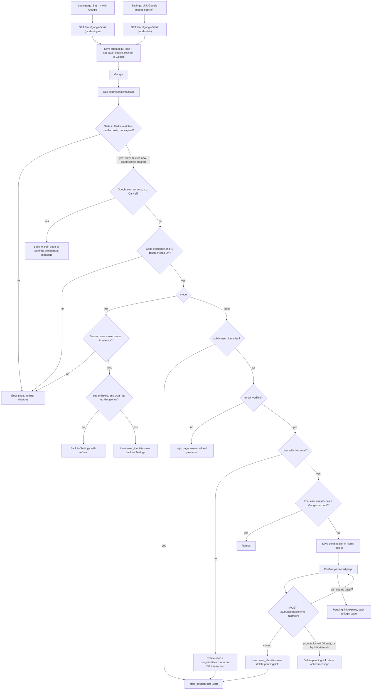

# Google sign-in

Today one server-rendered backend signs users in with email and password (`POST /login`, bcrypt, lockout after 5 wrong passwords). Every login ends in `start_session`. PostgreSQL holds users and sessions, and Redis holds short-lived data such as rate limits. This change adds "Sign in with Google" (OpenID Connect, authorization-code flow with PKCE, scopes `openid email profile`). A start endpoint sends the browser to Google, a callback receives the answer, and success ends in the same `start_session`. Temporary state lives in Redis and permanent state in one new table, so the existing tables and login behaviour stay as they are.

## Terms

- **sub**: Google's permanent ID for an account. We identify Google accounts by `sub`, never by email.
- **state**: a random value that names one sign-in attempt. It comes back on the callback and is the key of that attempt's Redis entry.
- **nonce**: a random value Google copies into the ID token. The callback checks it, so a replayed token is rejected.
- **PKCE verifier**: a random secret we keep and send to Google when exchanging the code. It proves the app that started the attempt is the one finishing it.
- **ID token**: the signed token Google returns. We read only `sub`, `email` and `email_verified`. We keep no Google access or refresh tokens.
- **mode**: `login` (started from the login page) or `link` (started from Account Settings).
- **pending link**: a half-finished link of a Google `sub` to an existing user, waiting for that user's password.
- **start_session(user_id)**: the existing function. It deletes any old `sid` session, inserts a `sessions` row, sets the `sid` cookie and redirects to `next` (only a relative path on our site is accepted) or `/home`. Google login calls it, so there is no new session type.

## Diagram

## Where state lives

| State | Where | Lifetime and removal |
|---|---|---|
| Attempt: `state` (key), PKCE verifier, nonce, mode, `next`, and for `link` the user id | Redis `oauth:state:<state>` | 10 minute TTL. The callback reads and deletes it in one step, so a callback is honoured once. |
| `oauth` cookie holding `state` (HttpOnly, Secure, SameSite=Lax) | Browser | Ties the attempt to the browser that started it: the callback requires it to equal the `state` query value, then clears it. |
| Pending link: random id (key), user id, `sub` | Redis `oauth:pending:<id>`; id in an HttpOnly cookie | 10 minute TTL from when it is saved. Deleted on success, on lockout and by expiry. |
| Google link | New table `user_identities` (`id`, `user_id` UNIQUE FK to users ON DELETE CASCADE, `sub` UNIQUE, `created_at`) | Permanent. Removed by Unlink or by deleting the user. We do not store Google's email. |
| Session | Existing `sessions` table | Unchanged. |

`users.password_hash` becomes nullable. A password login for a user with no hash fails like any wrong password, with the generic message. Google never changes `users.email`. The unique `sub` and `user_id` columns enforce that a Google account links to at most one user and a user has at most one Google account. If a linked user's Google email changes, they still reach the same account, because only `sub` is looked up.

## Steps

The diagram shows the order. These notes add what it cannot.

1. **Start.** Triggered by the Login button or the Settings Link button (Settings requires a session). It creates `state`, nonce and PKCE verifier, saves the attempt in Redis, sets the `oauth` cookie and redirects to Google with the scopes, the PKCE challenge, `state` and nonce. `next` is copied unchecked from the login page's `next` query parameter, if any; `start_session` validates it later. The return page (login page or Settings) follows from the mode. If Redis fails, show an error page.
2. **Callback, state check.** Google redirects the browser back. The callback deletes the Redis entry by `state` and checks the `oauth` cookie matches. If the entry is unknown, expired, already used or mismatched, or Redis fails, show an error page and change nothing. This enforces the 10 minute limit and once-only use. Until `start_session` the browser then holds no Google-related cookie, except the pending link cookie in step 7.
3. **Google error.** If Google sent an error (for example the user pressed Cancel), return the user to the login page or Settings with a neutral message. Nothing changes.
4. **Exchange.** Exchange the code with the PKCE verifier and check the ID token (signature, nonce). On failure, show an error page and change nothing. Then read `sub`, `email`, `email_verified`.
5. **Link mode (Settings).** The current session's user must be the user saved in the attempt; otherwise show an error page (the attempt is already used up, so the user starts again). No password is asked and the emails need not match. Refuse, back on Settings, if the `sub` is linked to anyone or the user already has a Google account. Otherwise insert the `user_identities` row. The session does not change.
6. **Login mode, known `sub`.** Call `start_session` for the linked user. Lockout is not checked: it guards password guessing, and Google has authenticated the user.
7. **Login mode, unknown `sub`.**
   - `email_verified` false: refuse and point to email and password. Nothing is created.
   - Verified email (compared lowercased) matches no user: in one database transaction, create a user (lowercased email, no password, `email_verified_at` now, other columns default, no name since the schema has none) and its `user_identities` row. If either insert fails, both roll back and an error page is shown. Then call `start_session`.
   - Verified email matches a user who already has a Google account: refuse.
   - Verified email matches a user without one: save a pending link and show the confirm password page. If Redis fails, show an error page and change nothing.
8. **Confirm password.** `POST /auth/google/confirm` (new; not `POST /login`) takes only the password. The user comes from the pending link found through its cookie, so no email is typed. If the cookie or entry is missing or expired, go back to the login page. Then apply the existing lockout rules: if `locked_until` is in the future, reject without checking the password and delete the pending link. A wrong password adds one to `failed_logins` and shows the page again; the fifth wrong one locks the account for 15 minutes, deletes the pending link and shows the locked message. A correct password resets `failed_logins`, inserts the `user_identities` row, deletes the pending link and calls `start_session`.
9. **Unlink (Settings).** Allowed only if the user's `password_hash` is not null; the password is not asked again. Delete their `user_identities` row. Otherwise refuse and tell them to set a password with the existing reset email (`POST /forgot`; using its link sets a password).

## Failures

| Where | Result |
|---|---|
| Unknown, expired, reused or mismatched `state`; Redis failure at start, callback or saving a pending link | Error page, nothing changes |
| Google returns an error | Back to origin, neutral message |
| Code exchange or ID token check fails | Error page, nothing changes |
| Link mode with no session or a different user | Error page, nothing changes |
| Unverified Google email | Refuse, nothing created |
| Other account already linked, or user already has another Google account | Refuse, nothing changes |
| Unique-constraint conflict or other insert failure (race) | Error page, nothing changes |
| Wrong password, not locked | Confirm page again |
| Account locks, or pending link expires | Pending link deleted, user starts over |
| Unlink with no password | Refuse, point to reset email |

## Rollout

Add the migration (`user_identities`, nullable `password_hash`) before deploying the code. Any code that reads `password_hash` must handle null.

## Open questions

- Whether unlink should ask for the password again is not specified; this plan only requires that a password exists.
- Whether a Google login for a linked but locked account should be allowed is not specified; this plan allows it.