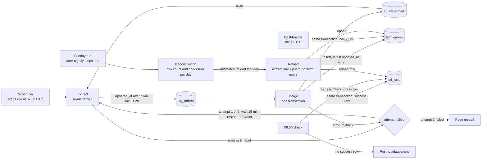

## Nightly orders ETL

Every night at 02:00 UTC a job copies the `orders` table from the app's read replica into the warehouse. Each run reads rows changed since the last good load, starting 2 hours earlier to catch late rows, and merges them so the warehouse keeps one row per order, always its latest version. On Sundays the same run also compares each of the last 30 days of orders with the replica and reloads any day that does not match. All pipeline state lives in the warehouse, because we have no write access to the app database. The merge and the high-water mark move commit in one transaction, so a failed night changes nothing and dashboards never see a half-loaded night.

### Terms

- **Replica**: a read-only copy of the app's Postgres database. The job only reads from it.
- **Warehouse**: the analytics database. Every table the pipeline writes lives here.
- **updated_at**: the time the app stamps on every write to an order. It is set when the row is written, not when the transaction commits.
- **deleted_at**: set when an order is deleted. The app never hard-deletes, so a delete is also a write that sets `updated_at`.
- **is_deleted**: a warehouse flag, true when `deleted_at` is set. Deleted orders stay in the warehouse.
- **High-water mark (hwm)**: the newest `updated_at` merged into the warehouse so far. Stored in `etl_watermark`.
- **Lookback**: a 2-hour overlap. A run starts 2 hours before the hwm. Bulk-import rows can become visible up to 90 minutes after their `updated_at`, so the overlap covers that window.
- **Staging (`stg_orders`)**: a warehouse table that holds one attempt's extracted rows. It is emptied at the start of each attempt.
- **Merge (upsert)**: insert an order that is new to the warehouse, or replace the stored row when the incoming row is newer.
- **Attempt**: one try of Extract and Merge. A nightly run makes up to three attempts.
- **Nightly run**: the 02:00 UTC run that loads new and changed rows and moves the hwm.
- **Run date**: the UTC date of the 02:00 start that a run belongs to.
- **Order-creation day**: the day an order was created. The reconciliation groups orders by it.
- **Reload**: a Sunday merge of one whole order-creation day, done by the reconciliation. It does not move the hwm.
- **Checksum**: one number computed over a set of rows. Equal checksums mean the sets match.
- **Page**: an alert sent to the on-call person's pager.

Notes: the arrows show where data moves. The 06:00 check and the dashboards run on the clock, not after a step. The attempt loop sits inside the nightly run.

### Steps

1. **Start (02:00 UTC).** The scheduler starts one nightly run each night. On Sundays the same run also does step 7, after its nightly steps end. The run keeps its attempt count in memory so it can wait 15 minutes between attempts. All other state lives in the warehouse tables named below.
2. **Extract.** Starts at the beginning of each attempt. The run reads the hwm from `etl_watermark` and sets start = hwm minus 2 hours. It runs one read-only query on the replica for every order with `updated_at` later than start. Deleted orders match too. The run empties `stg_orders` and writes the rows there. Nothing is written to the app. If the replica or the query fails, the attempt fails.
3. **Merge (one warehouse transaction).** Starts when Extract finishes. The run opens one transaction and does three things, then commits:
   - Upserts each staged row into `fact_orders` by `order_id`. A stored row is replaced only when the staged `updated_at` is equal or later, so the latest version wins and a repeated copy changes nothing. Sets `is_deleted` to true when `deleted_at` is set. Deleted rows stay in `fact_orders`.
   - Moves `etl_watermark` to the largest `updated_at` in staging. If staging is empty, the hwm stays where it is.
   - Writes a success row to `etl_runs` for this run date.

   If any part fails, the transaction rolls back, nothing changes, and the attempt fails.
4. **Dashboards (06:00 UTC).** Analyst dashboards read `fact_orders` at 06:00 UTC, whether or not step 3 has committed. They see either the new night or the previous one, never a partial load. They never read `stg_orders`.
5. **Retry and page.** An attempt fails on a replica error, a query error, a merge error or a timeout. The timeout covers one whole attempt, Extract and Merge together, and a timed-out attempt counts as failed. A new attempt starts only after the failed one has ended, so attempts never overlap. A failed attempt writes a failed row to `etl_runs` with the error text. The run waits 15 minutes and starts the next attempt at Extract. Extract restarts because staging is emptied and the hwm did not move. Attempt 2 starts 15 minutes after attempt 1 fails. Attempt 3 starts 15 minutes after attempt 2 fails. If attempt 3 fails, the job pages on-call. The on-call engineer decides what to do. Nothing re-runs the job automatically.
6. **06:00 check.** At 06:00 UTC the check looks in `etl_runs` for a nightly success row with this run date. It ignores success rows from earlier nights and from reloads. If it finds one, it does nothing. If it finds none, it posts a staleness alert to #data-alerts. The check does not stop a run still in progress. If that run commits later, its data arrives late.
7. **Sunday reconciliation.** Starts in the Sunday run after the nightly steps (2 to 6) have ended, whether they committed or all attempts failed. So it never overlaps a nightly attempt and can reuse `stg_orders`. For each order-creation day in the last 30 days, it computes the row count and a checksum of `order_id` plus `updated_at`, once on the replica and once in `fact_orders` (deleted rows included). If either number differs, it reloads that day in one transaction. The reload extracts every order created that day from the replica, empties `stg_orders`, and merges the rows with the upsert and `is_deleted` rules of step 3. It skips the watermark part, so the hwm does not move, because moving it on one day could skip late rows from other days. It writes its own `etl_runs` row marked as a reload. The 06:00 check ignores that row.

### What happens when things fail

| Failure | What happens | hwm | Warehouse |
|---|---|---|---|
| Replica unreachable or extract query error | Attempt fails, failed row in `etl_runs`, retry per step 5 | Unchanged | Unchanged. Staging is emptied on retry. |
| Timeout | Attempt ends as failed, retry per step 5 | Unchanged | Unchanged |
| Merge or watermark write error | Transaction rolls back, attempt fails, retry per step 5 | Unchanged | Previous night still shown |
| Warehouse down | Nothing can be committed, so the attempt fails. The failed row may not be saved, but the run still counts the attempt and retries per step 5. | Unchanged | Previous night still shown |
| Run process stops during the retry waits | No retry and no page. The next 02:00 run starts from the same hwm and loads the missed rows. | Unchanged | Previous night still shown until the next run |
| All three attempts fail | Page on-call. The on-call engineer decides what to do. | Unchanged | Previous night shown. 06:00 check posts a staleness alert. The next night starts from the same hwm, so it also loads the missed rows. |
| Replica behind, so rows appear after the lookback | Nightly run misses them | Unchanged for those rows | Sunday reconciliation finds the mismatch and reloads that day |
| Reconciliation finds a mismatch | Day reloaded in one transaction | Unchanged | That day is corrected |
| Reconciliation reload fails | Transaction rolls back, so that day keeps its old rows | Unchanged | That day stays as it was until a later check fixes it |
| Load commits after 06:00 | Staleness alert already posted at 06:00 | Moves at commit | New night shown at the next dashboard refresh |

Re-running a night extracts the same rows and merges them with the same result, so a manual re-run after a page is safe.

### Open questions

- Which tools run the scheduler, the 06:00 check and the paging? The brief does not name them.
- How long is the timeout for one attempt? The brief does not set it.
- What is the hwm before the first successful load, and so how far does the first run reach back?
- Which column holds the order-creation time that the reconciliation groups days by?
- Does the Sunday reconciliation retry or page when it fails, including when a reload fails?
- If the run process stops during the retry waits, who is told? The brief does not say.