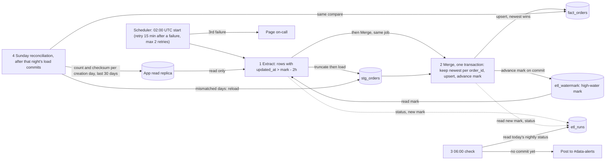

# Nightly orders ETL

Every night at 02:00 UTC one job copies new and changed rows of the app's `orders` table from a Postgres read replica into the warehouse table `fact_orders`. Extract copies them into a staging table, then Merge upserts them into `fact_orders` and moves the high-water mark in one warehouse transaction, so dashboards never see a half-loaded night. The overlap, the one-row-per-order merge and a weekly reconciliation exist because rows can become visible after their `updated_at`.

Today there is no pipeline. We cannot write to the app database, so everything the pipeline keeps lives in the warehouse.

## Terms

- **Replica**: the app's Postgres read replica. The only source; read-only.
- **Warehouse**: the analytics database. Holds all pipeline tables below.
- **`updated_at`**: set to the write time on every write to an order. Soft delete (setting `deleted_at`) is a write too, so it also moves `updated_at`. The app never hard-deletes.
- **Visible late**: a bulk-import transaction can stay open up to 90 minutes, and `updated_at` is stamped at write, not commit. So a row can appear up to 90 minutes after its `updated_at`.
- **High-water mark** ("the mark"): the largest `updated_at` loaded successfully. It is the single row in `etl_watermark` and only moves forward.
- **Lookback**: 2 hours. Each night extracts rows with `updated_at` greater than the mark minus 2 hours. This covers the 90-minute lateness, and means the same order is extracted more than once.
- **`stg_orders`**: staging table. Raw copy of the extracted rows, all versions. Emptied at the start of every attempt (not after Merge, so a failed run can be inspected).
- **`fact_orders`**: the final table. Exactly one row per `order_id`, always its most recent version. Deleted orders stay, with `is_deleted` true.
- **`etl_runs`**: one row per attempt: kind (nightly or reconcile), run date, attempt number, status (running, success or failed), rows extracted, new mark, times. Read by the 06:00 check and by people debugging.
- **Scheduler**: whatever system fires jobs on a schedule. It starts runs, detects failures, retries and pages on-call.
- **Attempt**: one execution of Extract followed by Merge, in the same job. It succeeds or fails as a whole. Its run date is the UTC date of the 02:00 start it belongs to.

## Diagram

## Steps

1. **Extract.** Started by the scheduler at 02:00 UTC, or by a retry. It records an `etl_runs` row (kind nightly, status running) and empties `stg_orders`. It reads the mark from `etl_watermark` and copies every replica row with `updated_at` greater than mark minus 2 hours into `stg_orders`, all columns including `deleted_at`, soft-deleted rows included. It stores the largest `updated_at` it copied in its `etl_runs` row as the new mark (empty if it copied nothing). If it fails, the attempt fails and nothing else has changed.
2. **Merge.** Runs in the same job as soon as Extract finishes; the scheduler does not start it separately. In one warehouse transaction it:
   - keeps the row with the greatest `updated_at` for each `order_id` in `stg_orders`;
   - upserts these into `fact_orders` on `order_id`, replacing an existing row only if the staged `updated_at` is greater than or equal to the stored one, so an older version never overwrites a newer one;
   - sets `is_deleted` to true when `deleted_at` is not null; rows are never physically removed;
   - reads the new mark from this attempt's `etl_runs` row and sets `etl_watermark` to the greater of that and the current mark. A night that copies only old overlap rows, or nothing, therefore leaves the mark unchanged. It then marks the `etl_runs` row success.

   Before committing, the transaction checks that its `etl_runs` row is still running, and rolls back if the scheduler has already marked it failed. It commits as a whole or not at all, so the mark advances only when the data is loaded. Re-running a night is harmless because the merge is idempotent.
3. **Failure detection, retry and paging.** The scheduler treats an attempt as failed if the job exits with an error, crashes, or runs past a timeout. On a timeout it kills the job, so nothing from that attempt keeps writing. It marks the `etl_runs` row failed (if the job could not) and starts a new attempt 15 minutes after the failure, up to two more times (three attempts total). Because the wait counts from the failure and the failed job is stopped, attempts never overlap. Each attempt starts from Extract with the same mark. After the third failure the scheduler pages on-call, and nothing runs until the next night. A person may start a manual rerun at any time; it is an ordinary attempt from Extract, safe because the merge is idempotent.
4. **06:00 check.** A separate scheduled check at 06:00 UTC reads the nightly `etl_runs` rows whose run date is today's UTC date. If none has status success (including when an attempt is still running or failed), it posts a staleness alert to #data-alerts. Reconciliation rows are ignored. Dashboards refresh at 06:00 regardless and show the previous committed night. The check does not stop retries; a later success is picked up by the next refresh.
5. **Sunday reconciliation.** It catches rows that became visible later than the lookback covers (for example when the replica lagged). The scheduler starts it on Sundays only after that night's Merge has committed; if the nightly load never commits, it is skipped and the days are compared again next Sunday (it shares `stg_orders` and `fact_orders` with the nightly load, so it must not run alongside or after a failed one). It records its own `etl_runs` row with kind reconcile, so the 06:00 check never counts it as the night's load. It empties `stg_orders`, then for each order-creation day in the last 30 days compares the row count and a checksum of `order_id` + `updated_at` between the replica and `fact_orders` (deleted orders included on both sides). It copies the replica rows of all mismatched days into `stg_orders`, then runs the step 2 merge once. This fixes rows rather than only reporting them. Its new mark is left empty, so it never changes the mark. On failure it is retried from its start with the same timeout, kill, retry and paging rules as step 3.

## Failure summary

| Where | What happens |
| --- | --- |
| Extract fails | Staging may be partial. Mark unchanged. Next attempt empties staging and starts again. |
| Merge fails | Transaction rolls back. `fact_orders` and the mark are unchanged. Retry. |
| Attempt hangs or crashes | After the timeout, or on crash, the scheduler kills the job, counts the attempt as failed and retries 15 minutes later. A killed job cannot commit. |
| Third attempt fails | Scheduler pages on-call. Mark stays, so the next night's lookback includes the missed rows. |
| Not committed at 06:00 | Staleness alert in #data-alerts. Dashboards show the last committed night. |
| Reconciliation fails | Same retries and paging. Days not yet reloaded are compared again next Sunday. |
| Nightly load not committed on Sunday | Reconciliation is skipped until next Sunday. |

## Rollout

Build the three warehouse tables, then Extract and Merge, then the 06:00 check, then reconciliation.

## Open questions

- Which scheduler product is used, and how it pages on-call, is not decided here.
- The attempt timeout value is not decided.
- The initial mark, and how to backfill history before the first run.
- Reconciliation assumes `orders` has a creation timestamp to group by day; the column name is not confirmed.
