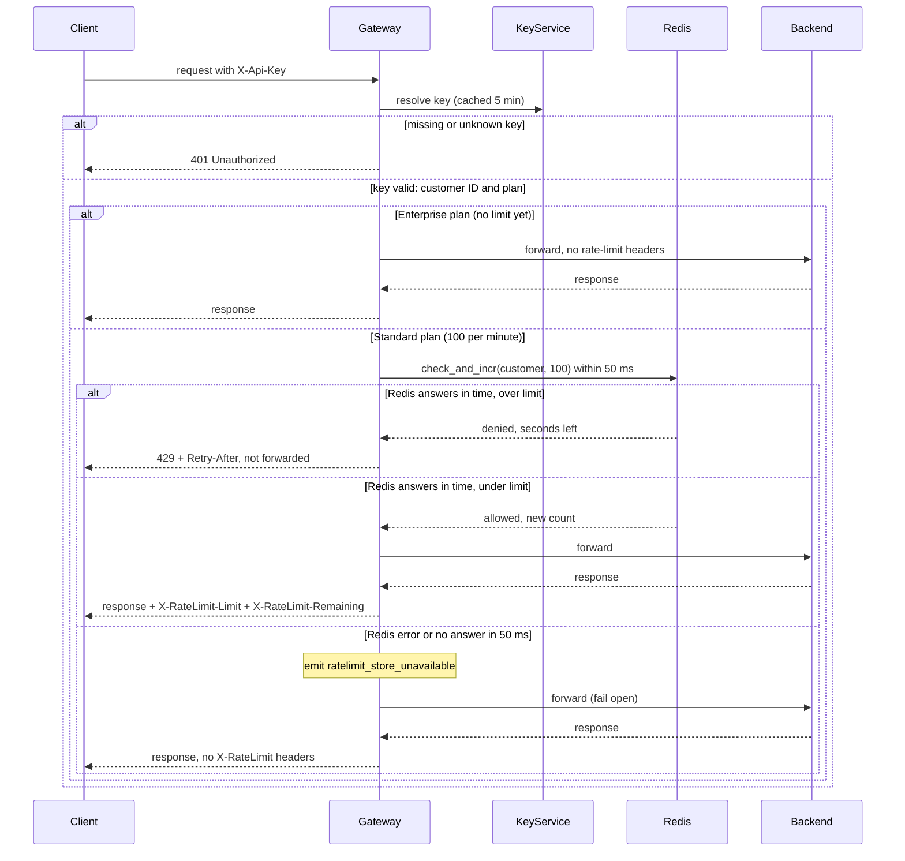

# Per-customer rate limiting in the API Gateway

Today the API Gateway checks each request's `X-Api-Key` with Key Service, then forwards the request to the backend that owns its route. This design adds a rate-limit check between those two steps: each customer gets a budget of requests per clock minute (100 for Standard customers), and a request over budget gets `429` and is never forwarded. The counts live in Redis, a store that all six gateway instances share, so spreading one customer's traffic across instances does not multiply their limit. If Redis is slow or down, the gateway forwards the request anyway, so an outage of the counter store does not take the API down.

## Terms

- **API key**: the secret a client sends in the `X-Api-Key` header.
- **Key Service**: the existing service that turns an API key into a customer ID and a plan.
- **Customer ID**: one per customer. All of a customer's keys share it, so they share one budget.
- **Plan**: `Standard` or `Enterprise`. The plan sets the limit.
- **Backend**: the service that owns a request's route. The gateway's existing routing picks it.
- **Redis**: a shared store that every gateway instance reads and writes. It holds the counters and can run a script as one step.
- **Counter key**: the Redis key that counts one customer's requests in one minute. It looks like `rl:<customer ID>:<minute>`.
- **Lua script**: a small program that Redis runs as one step, so no other Redis command runs in the middle. The script here is `check_and_incr`.
- **Fixed window**: one clock minute, such as 12:05:00 to 12:05:59. A new window starts each minute. Chosen because it is the simplest correct option for a first version.
- **TTL (time to live)**: how long Redis keeps a key before it deletes the key on its own.
- **Retry-After**: an HTTP response header that tells the client how many seconds to wait before it tries again.
- **Fail open**: when the counter store cannot answer, let the request through instead of rejecting it.

## Flow

The diagram shows the order. The steps below add the rules the diagram cannot show.

## Steps

1. **Key check.** A request arrives. The gateway asks Key Service for the key's customer ID and plan. Each instance caches the answer in memory for 5 minutes, so most requests do not call Key Service. A missing or unknown key gets `401` at once. Redis is not read or changed. Because of the cache, a revoked key keeps working, and a plan change applies late, for up to 5 minutes on each instance.

2. **Pick the limit.** The plan sets the limit. `Standard` gets 100 requests per minute. `Enterprise` has no limit yet, because Product has not decided one (see open questions). Using a placeholder or the Standard limit would set Enterprise policy without Product. An Enterprise request skips step 3 and is forwarded in step 4 with no rate-limit headers.

3. **Count in Redis.** The gateway calls `check_and_incr` with the customer ID and the limit, and waits at most 50 ms. The 50 ms is counted from when the gateway sends the call. The limit is passed in on each call, so the script does not hard-code 100. The script uses the counter key `rl:<customer ID>:<minute>`. The minute is the Redis server's clock divided by 60, rounded down, so every instance agrees on it. In one atomic step, the script:
   - If the count is already at the limit, denies the request without incrementing. It returns the seconds left in the minute.
   - Otherwise adds 1. If this is the first request in the minute, it sets the key's TTL to 60 seconds, so each minute uses a new key that expires on its own. It returns allowed, the new count and the seconds left in the minute.

   Because the check and the increment are one step, two instances cannot both take the last slot. Denied requests use no budget. The seconds left is at least 1. The gateway uses no clock of its own for limits, so `Retry-After` and `Remaining` both come from the script's reply. The gateway's only clock is the 5-minute key cache.

4. **Reject or forward.** The gateway looks up the route as it does today. Whether it looks up the route before or after step 3 makes no difference, because the check uses only the customer ID and plan.
   - Denied: return `429` with `Retry-After` set to the seconds left in the minute. Do not forward. This response carries only `Retry-After`, not the `X-RateLimit-*` headers.
   - Allowed: forward to the backend and return its response whatever its status. The request has already counted, so a backend `500` still uses budget. Add `X-RateLimit-Limit` (100) and `X-RateLimit-Remaining` (100 minus the new count the script returned).

5. **Fail open.** This starts when the Redis call errors, or when no answer arrives within 50 ms. The gateway forwards the request anyway, emits `ratelimit_store_unavailable`, and sends no `X-RateLimit-*` headers, because the request did not pass the check. The gateway does not retry.
   - Redis may or may not have run the script before the gateway gave up. The gateway cannot stop a script it has already sent. If the script ran, the count includes the request. A late answer that arrives after 50 ms is ignored, but its increment still counts.
   - Missed requests are not added back later. Each minute's counter is separate and expires after 60 seconds. When Redis returns, the next request in the current minute creates or increments the counter, and nothing needs repair. So during an outage a customer can get more than 100 requests in one minute.

## What happens when things fail

| What fails | What happens |
|---|---|
| Missing or unknown key | `401`. Redis is not read or changed. |
| Over the limit | `429` with `Retry-After`. Not forwarded. Uses no budget. |
| Redis errors or takes over 50 ms | Forward anyway, emit `ratelimit_store_unavailable`, no rate-limit headers. The count may or may not include the request. |
| Backend fails, for example returns `500` | Already counted. Its response goes back to the client. |
| Backend times out or is unreachable | Already counted. The client gets the error the gateway returns today. The brief does not define that error (see open questions). |
| Key Service slow or down | Not changed by this design (see open questions). |

## Open questions

- **Enterprise limit.** Product has not chosen one. Until they do, this version does not limit Enterprise customers, so a noisy Enterprise customer is not yet protected.
- **Key Service outage.** The brief does not say what the gateway does today when Key Service is slow or down. Fail open covers only the counter store. A request whose key cannot be resolved cannot be authenticated, so this design does not forward it. Confirm the current behavior.
- **Backend timeout or unreachable.** The brief does not say what the client gets in this case, or whether the gateway sets a backend timeout at all. Confirm the current gateway response.
- **Revoked keys and plan changes.** The brief describes no way to clear the 5-minute cache. Confirm that a delay of up to 5 minutes is acceptable, and whether a way to clear it is wanted.
- **Metric.** The brief says only to emit `ratelimit_store_unavailable`. Confirm who receives it, and whether it also logs or alerts.
- **Window edge.** A fixed window lets a customer send up to 200 requests in a few seconds across a minute boundary: 100 at the end of one minute and 100 at the start of the next. Accepted for a first version.
- **429 headers.** As specified, `429` carries only `Retry-After`, not the `X-RateLimit-*` headers. Confirm this is wanted.