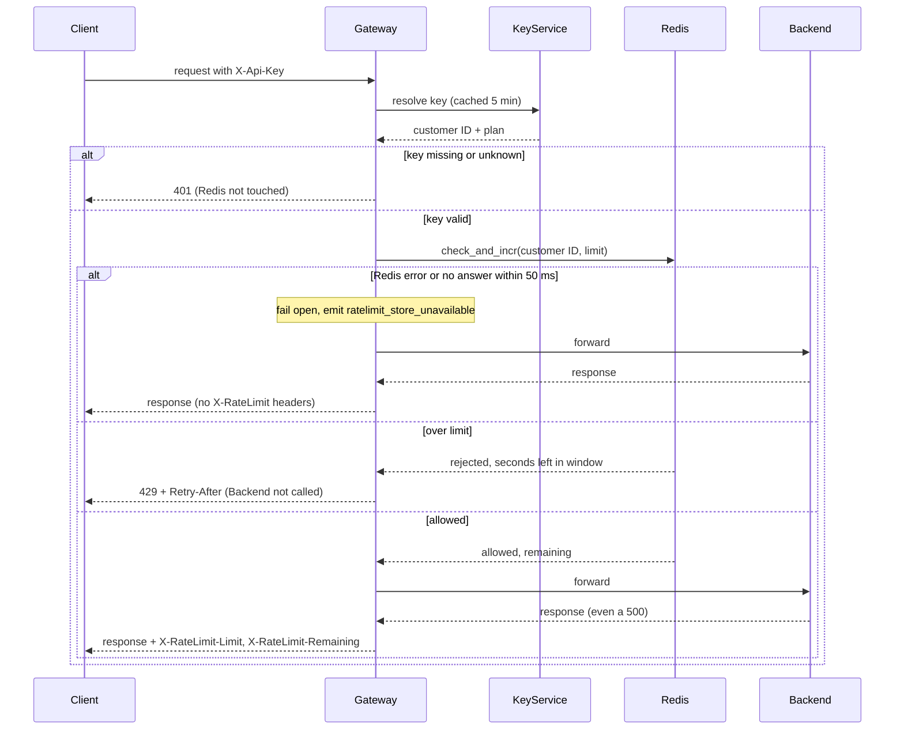

# Rate limiting

Per-customer rate limiting in the API Gateway. Today the Gateway (6 stateless instances behind a load balancer) resolves the `X-Api-Key` header through the Key Service, caches the answer in memory for 5 minutes, and forwards the request to the backend that owns the route. We add one step between authentication and forwarding: the Gateway asks a shared Redis counter whether the customer is still under their limit. Redis is shared so that 6 instances cannot give a customer 6x their limit. If Redis fails, the Gateway lets the request through.

## Terms

- **Gateway**: the public entry point. Any instance can receive any request.
- **Key Service**: resolves an API key to a customer ID and a plan (Standard or Enterprise). One customer can have several keys; the limit belongs to the customer, not the key.
- **Redis**: the shared store that holds the counters.
- **Lua script**: a small program Redis runs as one uninterruptible step.
- **check_and_incr**: our Lua script. It checks the count and increments it in that one step, so concurrent requests on different instances cannot overshoot the limit.
- **Window**: the fixed clock minute. The counter key is `rl:{customerId}:{minute}`, where `minute` is the Redis server time divided by 60 (Redis time is used so all instances agree). The key expires after 120 seconds, so old counters clean themselves up.
- **Fail open**: when the counter store is broken, let requests through instead of blocking them, so a counter outage cannot take the API down.

## Flow

## Notes

- **Authentication first.** A missing or unknown key gets `401` and never reaches Redis, so it cannot read or change any counter.
- **Limit.** The Gateway takes the plan from the Key Service answer and maps it to a limit: Standard is 100 requests per minute. Enterprise is not decided yet (Product owns it); no number is chosen here. A plan change takes effect when the cached Key Service answer expires, so the old plan's limit can apply for up to 5 minutes. This avoids adding a cache-invalidation mechanism.
- **check_and_incr** takes the customer ID and the limit. It reads the counter for the current minute.
  - If the count is already at the limit, it increments nothing and returns "rejected" plus the seconds left in the minute. So 429 responses use no budget.
  - Otherwise it increments and returns "allowed" plus the remaining budget (limit minus new count). It sets the 120-second expiry when it creates the key.
  - It never resets an existing count. If the limit passed in changes mid-minute, it just compares the existing count with the new limit.
- **Counting.** An allowed request counts even if the backend then fails (for example with 500).
- **Retry-After** is the number of seconds until the current minute ends (at least 1), worked out in the script from Redis time. The window is a fixed clock minute, so the client's budget resets then.
- **Headers.** `X-RateLimit-Limit` is the customer's limit and `X-RateLimit-Remaining` is the value check_and_incr returned. They go on every response to a request that passed the check, except under fail open (see below).
- **Fixed-window trade-off.** A customer can send up to 100 requests just before a minute boundary and 100 just after. This is accepted for a first version.

## Failures

| What fails | What happens |
|---|---|
| Key missing or unknown | `401`, no counter touched |
| Over limit | `429` with `Retry-After`, not forwarded, no budget used |
| Redis errors, or the single call takes longer than 50 ms | Forward anyway, emit `ratelimit_store_unavailable`, omit `X-RateLimit-*` headers (the remaining budget is unknown, and made-up values would mislead clients). If the script still ran in Redis after the Gateway gave up, that request is counted too; this is accepted rather than adding a retry or queue. |
| Backend fails | Response passes through; the request stays counted |
| Key Service slow or down | Not changed by this design; behaves as it does today (see open questions) |

## Open questions

- Enterprise limit: waiting on Product. Until it is set, the Gateway's behavior for Enterprise customers is undecided (skip the check, reject, or another rule), and no limit value is passed to check_and_incr for them. This design does not choose.
- Key Service timeout or outage behavior: not known; this design does not change it.
- Whether the Gateway's 5-minute key cache also holds unknown keys: not known; this design does not change it.
