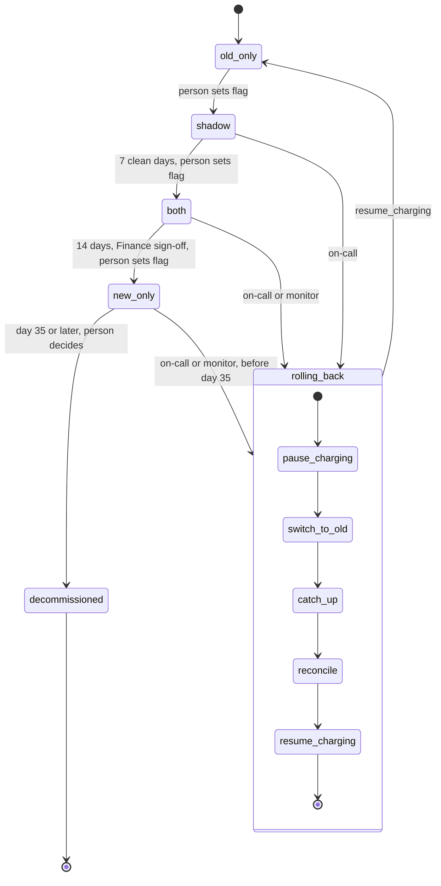

## Billing engine rollout

This is a state machine for moving billing from the old engine to the new one. Today the old billing workers read usage events, compute invoices, write them to the ledger and charge customers. The switch must be gradual, reversible and never charge a customer twice, so the rollout moves forward one mode at a time, with a person making each move once its gate has passed. Rollback can start from `shadow`, `both` or `new_only` and always ends in `old_only`. Its steps run in order and can be retried, so no billing period is charged twice and no due charge is dropped.

### Terms

- **billing_mode**: the one global flag in the config service. Its value is the current mode.
- **usage event log**: the store of usage events that both engines read. It keeps 35 days of events.
- **ledger**: the system of record for invoices and charges.
- **shadow store**: a separate store for invoices that are computed but not charged.
- **due charge**: an invoice for a billing period that is computed but not yet charged.
- **charging engine**: the one engine allowed to issue charges. In a normal mode, it is the engine the mode names. During a rollback, the rollback record names it.
- **mismatch**: an invoice total that differs by more than one cent between the two engines, for the same customer.
- **mismatch rate**: mismatched invoices divided by invoices compared, for one day.
- **nightly comparison job**: runs each night in `shadow` and `both`. It writes one row per customer to `comparison_results`.
- **comparison_results**: the table of those rows. Each row holds both totals and whether they differ by more than one cent. A row that no person has marked resolved is an **unresolved mismatch**.
- **clean day**: a day whose mismatch rate is under 0.1%, with at least 5,000 invoices compared.
- **gate**: the evidence a forward move needs. The rollout tool computes it from `comparison_results`.
- **charge failure rate**: the share of the new engine's charges that fail.
- **billing monitor**: watches the new engine's charge failure rate and can start a rollback.
- **rollout tool**: computes gates, refuses moves whose gate has not passed, starts rollbacks, runs their steps and writes the rollback record.
- **rollback record**: one record per rollback. It holds the start mode, the trigger (on-call or monitor), the charging engine, and each step marked not started or done.

### Modes

Only one engine charges customers in each mode.

- **old_only**: the old engine does everything. The new engine is off.
- **shadow**: the old engine charges and writes the ledger. The new engine reads the same usage events and writes its invoices to the shadow store. It never charges and never writes the ledger. The nightly comparison runs. Its errors are recorded but never start a rollback.
- **both**: the new engine charges and writes the ledger. The old engine keeps computing every invoice into the shadow store without charging, so it stays current. The nightly comparison continues.
- **new_only**: the old engine stops computing. With no second engine, the nightly comparison does not run. No gate applies to staying here. The only limit is day 35.

### Forward moves

A person sets `billing_mode` to the next mode once its gate has passed. Moves go one mode at a time and never skip one. If the gate has not passed, the rollout tool refuses the move and the mode stays. Nothing else is switched by hand. Each engine reads `billing_mode` and acts as its mode says. So entering `shadow` starts the new engine's read-and-shadow work, and entering `both` moves charging to the new engine.

Gates:

- **old_only to shadow**: no gate. A person sets the flag.
- **shadow to both**: 7 consecutive clean days. A night with no comparison is not clean, because the gate needs evidence on every day.
- **both to new_only**: 14 days in `both` with no unresolved mismatches, plus Finance sign-off.

### Rollback

**Start.** Rollback can start from `shadow`, `both` or `new_only`. It has one of two triggers:

- **On-call**, by hand, at any time, subject to the 35-day limit below.
- **The billing monitor**, when the new engine's charge failure rate is above 2% over any 10-minute window in `both` or `new_only`. Shadow errors never start one.

Only one rollback runs at a time. A second start is refused, and the running rollback record is shown. The rollout tool creates the rollback record first.

**Steps.** The rollout tool runs the steps itself, in this order. It starts each step once the step before it is marked done in the rollback record. It marks each step done when it finishes. A retry resumes at the first step not marked done. Which steps run depends on the start mode:

| Start mode | Steps that run |
|---|---|
| `shadow` | `resume_charging` only. The old engine has charged all along. |
| `both` | All steps. `catch_up` runs only if usage events are pending. |
| `new_only` | All steps. `catch_up` reprocesses the events the old engine skipped. |

1. **pause_charging.** Starts when the rollback record is created. The new engine stops charging and writes no new invoices to the ledger. Due charges already in the ledger stay there, uncharged, until `reconcile`. Usage events that arrive now stay in the usage event log. Data kept: the ledger, which keeps the charges already made. On failure: retried.
2. **switch_to_old.** Starts after `pause_charging`. The rollout tool writes the old engine as the charging engine in the rollback record. `billing_mode` still shows the old mode. From now on the old engine may charge only the due charges that `reconcile` finds. Normal charging waits for `resume_charging`. Data kept: the rollback record. On failure: retried. Setting the mark again changes nothing.
3. **catch_up.** Starts after `switch_to_old`. The old engine reads the usage event log and computes invoices for events it has not yet computed, into the shadow store. It does not charge. From `new_only`, this covers the events it skipped. From `both`, it runs only if events are pending. Events that arrive later are computed as they arrive, as in `both`, until `resume_charging`. Data: reads the usage event log, writes the shadow store. On failure: retried. It picks up only events not yet computed.
4. **reconcile.** Starts after `catch_up`. For each customer and billing period, the old engine compares its invoice with the ledger. Data: reads the ledger, the shadow store and the rollback record. Then:
   - A period the ledger already shows as charged is left alone.
   - A period the new engine never wrote to the ledger still has an invoice in the shadow store, because the old engine computed it in `both` or `catch_up` computed it. That period is a due charge. It is charged at the old engine's invoice amount, and the ledger is written.
   - A difference between the ledger and the old invoice on a charged period is recorded as a mismatch for a person to resolve. The ledger's charge stands, with no refund and no second charge.
   - Before every charge, reconcile checks the ledger, so a repeated run cannot charge a period twice.
   - On failure: retried.
5. **resume_charging.** Starts after `reconcile`. The old engine charges as normal. The new engine turns off and writes nothing more to the shadow store. The rollout tool sets `billing_mode` to `old_only` and marks the rollback done. Data kept: `billing_mode`. On failure: retried. `billing_mode` keeps the old mode until this step completes.

**After a rollback.** All gates reset. A person must set the flag to `shadow` again, and the 7-day count starts from that day. Earlier clean days do not count. While a rollback runs, the nightly comparison keeps writing rows, but a rollback resets all gates, so those rows never count toward a gate.

### What happens when things fail

| What fails | What happens |
|---|---|
| New-engine error in `shadow` | Recorded. No rollback. |
| Charge failure rate above 2% in `both` or `new_only` | The monitor starts a rollback. |
| Gate not met | The move is refused and the mode stays. |
| A night with no comparison in `shadow` | Not a clean day, so the 7-day count restarts. |
| Unresolved mismatch at `both` to `new_only` | Gate not met. The mode stays in `both`. |
| Finance sign-off not given | The mode stays in `both`. |
| A ledger charge from the new engine differs from the old invoice | The ledger charge stands. No refund and no second charge. Recorded as a mismatch. |
| A rollback step fails | Retried, starting at the first step not marked done. |
| Rollback requested while one is running | Refused. The running rollback record is shown. |
| Rollback requested after day 35 in `new_only` | Refused. There is no way back. |
| Failure rate still high after a rollback | No new rollback starts, because the new engine is off in `old_only`. A new rollout starts again at `shadow`. |

### Decommissioning

Day 35 counts from the day `billing_mode` became `new_only`. From day 35, a person may decommission the old engine. It then stops computing and charging, and the ledger is kept. After day 35 there is no rollback. The usage event log keeps only 35 days of events, so the old engine could not reprocess the events it skipped.

### Where state lives

- `billing_mode` in the config service: the current mode. Nothing else holds the mode.
- `comparison_results`: the gate evidence.
- The rollback record: rollback progress, step marks and the charging engine.
- The ledger: invoices and charges. The shadow store: invoices that are computed but not charged.
- The usage event log: 35 days of usage events.

### Open questions

- Is the 5,000-invoice minimum checked per day or over the 7 days?
- Where is Finance sign-off recorded, and who gives it?
- Who marks a mismatch resolved, and where is that recorded?
- Where are the start of the 14 days in `both` and the start of the day-35 count recorded? Does a night with no comparison in `both` reset the 14-day count?
- How many retries does a rollback step get before a person must step in?
- If a rollback starts before day 35 and runs past it, can it finish?
- For a due charge whose ledger invoice differs from the old engine's, should the old engine's amount always be charged?
- Should the nightly comparison run in `new_only` against the old engine's last results?
- What happens to the shadow store and `comparison_results` after decommissioning?
- Are charges that fall due after `reconcile` but before `resume_charging` charged, and if so by which step?