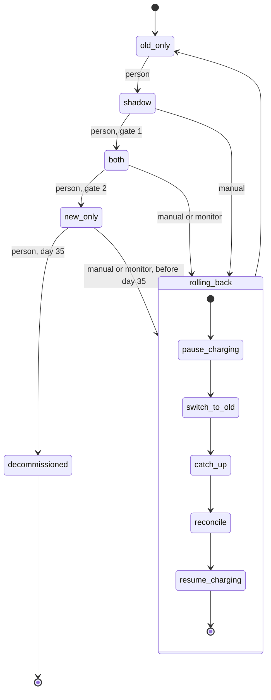

# Billing engine rollout

Today, billing workers run the old engine. It reads usage events from the usage event log (kept 35 days), computes invoices, writes them to the billing ledger (the system of record) and charges customers through the payment provider. The rollout moves to a new engine through four modes, one forward step at a time, each step made by a person. A rollback from any mode returns to `old_only`. Every charge first checks whether that customer and billing period was already charged, so nobody is charged twice.

## Terms

- `billing_mode`: one global flag in the config service. Values: `old_only`, `shadow`, `both`, `new_only`. Workers read it to know which engine does what. `rolling_back` is not a value of it.
- `mode_entered_at`: when the current mode was entered. It is stored next to the flag and set by the rollout tool whenever it changes `billing_mode`. The 14 days in `both` and the 35 days in `new_only` count from it.
- Rollout tool: the command that moves `billing_mode` forward and runs rollbacks. For a forward move it refuses if a rollback record exists, then reads `comparison_results`, computes the gate numbers itself, and refuses if the gate is not met. Otherwise it writes the new `billing_mode` and `mode_entered_at`. One run of a rollback does all remaining steps in order, then exits.
- Billing monitor: watches the new engine's charge failure rate and starts a rollback by calling the rollout tool.
- Shadow store: holds invoices that are computed but never charged or put in the ledger.
- Nightly comparison job: compares the two engines' invoices per customer and writes the results to `comparison_results`. A mismatch is an invoice total that differs by more than one cent. It stays "unresolved" until marked resolved in `comparison_results`.
- Charge record: an entry on the ledger for a customer and billing period, written only when a charge succeeds. Any engine checks it before charging and charges only if none exists.
- Rollback record: kept in the config service next to the flag. Its existence means a rollback is in progress. It holds the starting mode, that mode's entry time (copied from `mode_entered_at`, because switch_to_old overwrites it), the steps to run, which are done, and a `charging_paused` marker. The rollout tool creates it when a rollback starts, resumes from it, and deletes it after the last step.
- `charging_paused`: a field in the rollback record. Both engines read it before every charge and charge nothing while it is set.

## Modes

| Mode | Old engine | New engine |
|---|---|---|
| `old_only` | Computes, writes ledger, charges | Off |
| `shadow` | Computes, writes ledger, charges | Reads the same usage events, writes invoices to the shadow store only; never charges or writes the ledger |
| `both` | Computes into the shadow store only, so it stays current; never charges | Writes ledger, charges |
| `new_only` | Stopped | Writes ledger, charges |

The nightly comparison runs in `shadow` and `both`. The check of the charge record is what prevents a double charge on a forward move such as `shadow` to `both`: the ledger already holds the old engine's charges.

## Gates

Forward moves go in order with no skipping.

- Gate 1, `shadow` to `both`: 7 consecutive days with a mismatch rate under 0.1% and at least 5,000 invoices compared. The rate is mismatches divided by invoices compared; zero mismatches is not required. A night with no comparison results is not a day, so the run starts over.
- Gate 2, `both` to `new_only`: 14 days in `both` (from `mode_entered_at`) with no unresolved mismatches, plus Finance sign-off.

## Rollback

On-call can start a rollback by hand from `shadow`, `both` or `new_only` at any time before day 35 in `new_only`. The monitor starts one automatically when, in `both` or `new_only`, the new engine's charge failure rate is above 2% over any 10-minute window. New-engine errors in `shadow` are recorded but never trigger a rollback. If a rollback record already exists, a new start resumes it instead of beginning another. While a rollback runs, `billing_mode` keeps the starting mode until switch_to_old changes it.

Steps, in order:
1. pause_charging: set `charging_paused`, so neither engine charges. Invoices that fall due meanwhile are held, not dropped; reconcile handles them.
2. switch_to_old: set `billing_mode` to `old_only` and `mode_entered_at` to now. Workers read the flag, so the new engine stops and the old one takes over. Charging stays paused, so a worker that has not yet seen the change cannot charge.
3. catch_up: the old engine reprocesses usage events it skipped while not computing, and writes the invoices to the shadow store, as in `both`. The skipped events are those since `new_only` was entered, using the time in the rollback record.
4. reconcile: for each customer and billing period, take the old engine's invoice from the shadow store. If the ledger has no entry, write one. Charge only if no charge record exists. This also covers periods where the new engine tried and failed to charge, since a failed attempt leaves no charge record. Reconcile is the only thing that charges during a rollback.
5. resume_charging: clear `charging_paused`, then delete the rollback record, which ends the rollback. The old engine's normal run now charges periods as they fall due, still checking the charge record.

Which steps run:
- From `shadow`: only switch_to_old, because the new engine never charged or wrote the ledger.
- From `both`: all except catch_up, because the old engine kept computing.
- From `new_only`: all steps.

The new engine's ledger entries and charges are left as they are; a rollback reverses nothing already charged.

After any rollback the gates reset: the rollout goes through `shadow` again and its 7-day count starts over.

## Decommissioning

The old engine may be decommissioned after 35 days in `new_only` without a rollback, counted from `mode_entered_at` and separate from the 14 days in `both`. The 35 days match the usage event log's retention: after that catch_up cannot find the events, so from day 35 on there is no way back. From then, and after decommissioning, the tool refuses to start a rollback and a person is alerted.

## Failures

| Failure | Handling |
|---|---|
| A rollback step fails | The tool retries the same step. Repeating is safe because reconcile checks the charge record and progress is in the rollback record. |
| Retries keep failing | The rollback stays in progress with charging paused. Nobody is charged twice. A person must step in. |
| The rollout tool crashes mid-rollback | Nothing restarts it. A person, or the monitor firing again, runs the tool; it finds the rollback record and resumes at the recorded step. |
| A second rollback starts, or someone moves the flag forward, during a rollback | The tool resumes the existing rollback for the first, and refuses the second, because the rollback record exists. |
| The monitor fires from day 35 in `new_only`, or after decommissioning | No rollback starts. A person is alerted. |
| New-engine errors in `shadow` | Recorded only. |
| Mismatches | Gate not met, so the tool refuses to advance. |
| The nightly comparison does not run | That day does not count toward gate 1. |

## Open questions

- How many retries, at what interval, before a person is alerted? Who is alerted and how (also for a refused rollback after day 35)? Not decided.
- What does decommission remove: only the old engine code, or also its data? The ledger is kept.
- Are the usage event log, shadow store and `comparison_results` existing systems or new ones? Not decided.
- Who marks a mismatch resolved, and on what evidence? Not decided.
- Where is Finance sign-off kept, and how does the tool check it? Not known.
- Can the config service create the rollback record atomically, so two simultaneous starts cannot both succeed? Not known.
- Does the ledger hold the charge record, or must it be read from the payment provider? Assumed ledger; not verified. Can the engines read the config service at charge time? Not verified.
- A charge attempt that times out with an unknown result might have succeeded without a charge record. How is that detected before reconcile charges again? Does the provider support idempotency keys? Not known.
- Is the 5,000-invoice minimum a total over the 7 days or per night? Read as a total; not confirmed.
- How quickly do workers notice a flag change? Not known.
- In reconcile, if the ledger holds a differing new-engine invoice for a period not yet charged, which is kept and charged? Not decided. (A charged period is never charged again.)
- What schedules invoice computation and decides when a period is due? Not specified; the new engine is assumed to follow the old engine's schedule.
