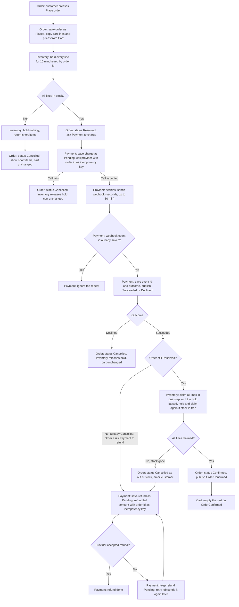

# Checkout plan

Checkout moves out of the monolith, where it runs today, into four services: Cart, Inventory, Payment and Order. Order drives the flow. It holds stock first, asks Payment to take the money, and confirms the order only after the payment provider reports success by webhook. If money arrives for an order that can no longer be filled, the full amount is refunded and the order is cancelled, so we never keep money for an order we cannot fulfil.

## Terms

- **Service**: one of the four separate programs. Each has its own database, and no other service reads it.
- **Order**: one purchase. Its status is Placed, Reserved, Confirmed or Cancelled.
- **Snapshot**: a copy of the cart lines and prices, saved on the order when Place order is pressed.
- **Hold**: stock set aside for one order for 10 minutes.
- **Claim**: turning a hold into a permanent stock deduction once payment succeeds.
- **Charge**: a request to take money from the customer. It is Pending until the outcome is known, then Succeeded or Declined.
- **Refund**: money sent back to the customer. It is Pending until the provider accepts it, then done.
- **Provider**: the outside payment company that moves the money.
- **Idempotency key**: an ID sent with a request so that a repeat of the same request does nothing new. Here it is the order id.
- **Webhook**: an HTTP call the provider makes to Payment to report a charge outcome. The plan assumes it carries the order id and a unique event id, which a repeat delivery of the same webhook repeats.
- **Broker**: the shared message system. Services publish events to it, and other services subscribe to them.
- **Event**: one message on the broker. Each event carries the order id.
- **Unique constraint**: a database rule that refuses a second row with the same value.
- **Retry job**: a background task in Payment that runs again on a timer. Its interval is not yet decided.

## Diagram

## Notes on the diagram

- Short stock: Payment is never called, so no money is taken.
- Call fails: the provider may still have accepted the charge. Its webhook can then arrive for a cancelled order, and the Succeeded branch refunds it.
- Duplicate webhook: it stops at the event id check (J) and is ignored.
- Refund refused: the refund stays Pending and loops back to T, and the retry job resends it until the provider accepts it.
- Only the Cart step changes the cart. Every other branch leaves it unchanged.

## Steps

Each step says what starts it, what it does, where its data is kept, and what happens when it goes wrong.

1. **Place order (Order).** Starts when the customer presses Place order in the UI. Order reads the cart lines and prices from Cart over HTTP and saves them as a snapshot on a new order with status Placed. Later cart edits or price changes do not change this order. Stored in: Order's database. If the cart cannot be read, no order is kept and the cart is unchanged. The UI does not wait for the outcome, which can take 30 minutes. It gets the order id back, then checks the order's status by that id until it is Confirmed or Cancelled, and shows short items from that status.

2. **Reserve stock (Inventory).** Starts when Order calls Inventory over HTTP with the order id and each line (item and quantity). Inventory holds every line in one step, or holds nothing. Each hold records the order id, item, quantity and an expiry 10 minutes ahead. Stored in: Inventory's database. Outcomes:
   - All lines held: Order sets status Reserved and goes on to step 3.
   - Any line short: Inventory holds nothing and returns the short items. Order sets status Cancelled, tells the customer which items are short, and requests no payment.
   - No answer from Inventory: Order sets status Cancelled. Any hold that was made expires by itself after 10 minutes.

3. **Take payment (Payment).** Starts when Order calls Payment over HTTP after the hold succeeds. Payment saves the charge as Pending and calls the provider with the amount and the order id as the idempotency key, so a repeat cannot charge twice. The provider's direct reply only accepts the request. The outcome comes later by webhook. Stored in: Payment's database. If the call fails, Order sets status Cancelled and calls Inventory to release the hold. The provider may still have accepted the charge, so step 6 handles a later success.

4. **Receive webhook (Payment).** Starts when the provider sends the outcome. This usually takes seconds and can take up to 30 minutes after the charge. Payment first saves the webhook's event id in a table with a unique constraint. The constraint means two copies arriving at once still count as one. If the id is already saved, Payment ignores the webhook. Otherwise Payment records the outcome on the charge and publishes a Succeeded or Declined event with the order id. Stored in: Payment's database, in the table of saved event ids and in the charge row. If the outcome is saved but the publish fails, see open questions.

5. **Declined (Order and Inventory).** Starts when Order receives a Declined event. Order subscribes to Payment's Succeeded and Declined events and matches each one to its order by order id. Order sets status Cancelled and calls Inventory to release the hold. The cart is unchanged. Stored in: Order's database for the status, and Inventory's database for the hold. If the release call fails, the hold expires after 10 minutes by itself.

6. **Succeeded (Order and Inventory).** Starts when Order receives a Succeeded event, matched by order id as in step 5. If the order is already Cancelled, Order calls Payment over HTTP to refund the full amount, which is step 7. Order makes this call itself; no other service starts the refund. Otherwise Order asks Inventory to claim all lines together. Inventory checks the free stock and deducts it in one database transaction, so two orders cannot both take the last unit. If the hold is still valid, the claim deducts its stock. If the hold has lapsed and the stock is still free, Inventory holds and claims the lines again in that same transaction. Stock is deducted only for paid orders, and only once.
   - Every line claimed: Order sets status Confirmed and publishes OrderConfirmed.
   - Any line gone: nothing is deducted. Order sets status Cancelled as out of stock, emails the customer, and calls Payment to refund (step 7).

   Stored in: Inventory's database for holds and stock, and Order's database for the status. If Inventory does not answer the claim, Order repeats the claim with the same order id, and Inventory ignores the repeat. When to stop repeating is an open question.

7. **Refund (Payment).** Starts when Order calls Payment over HTTP to refund an order it cannot fulfil. Order makes this call in two cases, both from step 6: a Succeeded event for an order that is already Cancelled, and a Succeeded event where a line's stock is gone. Payment refuses the refund unless the charge is Succeeded. In that case it sends nothing to the provider and returns an error. Otherwise Payment saves the refund as Pending and refunds the full amount with the order id as the idempotency key. It marks the refund done when the provider accepts it. Stored in: Payment's database. If the provider refuses or fails, the refund stays Pending. The retry job in Payment picks up every Pending refund and sends it again with the same order id until the provider accepts it.

8. **Empty cart (Cart).** Starts when Cart receives OrderConfirmed. Cart empties the cart. Stored in: Cart's database. If Cart misses the event, the cart is not emptied. See open questions.

## Rules that always hold

- Each service reads and writes only its own database. Services talk over HTTP or through broker events.
- Only Payment talks to the provider.
- Stock is reserved before any payment is requested. Reservation is all or nothing.
- Every charge and refund request carries the order id as its idempotency key.
- A webhook is processed once, however many times it arrives.
- We never keep money for an order we cannot fulfil, and we never ship partial orders.
- A refund is never dropped. A failed refund stays Pending until it succeeds.
- The cart is emptied only when the order is Confirmed.
- If checkout fails for any reason, the cart stays exactly as it was, so the customer can try again.
- The customer is told which items are short.
- Order repeats a claim or refund call that gets no answer, with the same order id. Inventory's claim and Payment's refund both ignore a repeat.

## What happens when things fail

| Situation | What happens | Cart | Money |
| --- | --- | --- | --- |
| Cart cannot be read at Place order | No order is kept | Unchanged | None taken |
| Short stock | Nothing is held, no payment is requested, short items are shown | Unchanged | None taken |
| Inventory gives no answer | Order is cancelled, any hold expires after 10 minutes | Unchanged | None taken |
| Provider call fails | Order is cancelled, hold is released. A charge the provider accepted anyway is refunded when its webhook arrives | Unchanged | None taken, or refunded if the provider charged anyway |
| Payment declined | Order is cancelled, hold is released | Unchanged | None taken |
| Duplicate webhook | Ignored | Unchanged | Unchanged |
| Success, hold lapsed, stock still free | Stock held and claimed again, order confirmed | Emptied | Taken |
| Success, hold lapsed, stock gone | Order cancelled, email sent, full refund | Unchanged | Refunded |
| Success for an order already cancelled | Order calls Payment to refund in full | Unchanged | Refunded |
| Refund refused or failed | Refund stays Pending and is retried | Unchanged | Not yet returned, never dropped |
| Inventory does not answer the claim | Order repeats the claim with the same order id (when to stop is an open question) | Unchanged | Taken, order still Reserved |

## Open questions

- Does the provider's webhook include the order id and a unique event id? The plan assumes both.
- Does the provider's direct reply to a charge ever show success? The plan assumes it only accepts the request.
- What happens if no webhook arrives at all? The brief gives only the 30-minute maximum.
- If Payment saves an outcome but the broker is down, how is the event published later?
- How often does the refund retry job run, and who is told when a refund keeps failing?
- How long does Order keep repeating a claim or refund call that gets no answer, and who is told?
- How does the provider keep charge and refund idempotency keys apart? The plan assumes they are different provider calls, so their keys do not clash. If the provider uses one key space, the refund key needs a different prefix.
- When a payment succeeds after the hold lapsed and the stock is still free, the plan holds it again. The brief only names the refund case. Should the plan always refund instead?
- The plan says Order sends the customer's cancellation email. Is that confirmed?
- Which screen and message does the customer see while the order waits, and how are short items shown?
- If Cart misses OrderConfirmed, when does the cart empty?
- How does Order tell Payment the order's amount for the charge request, and what happens when Order's own call to Payment gets no answer or times out at charge time? Only a failed provider call is covered.
- What does Order do when a Declined or Succeeded event arrives for an order that is not in the expected state, other than already Cancelled? For example, a Declined event after the order is Confirmed.