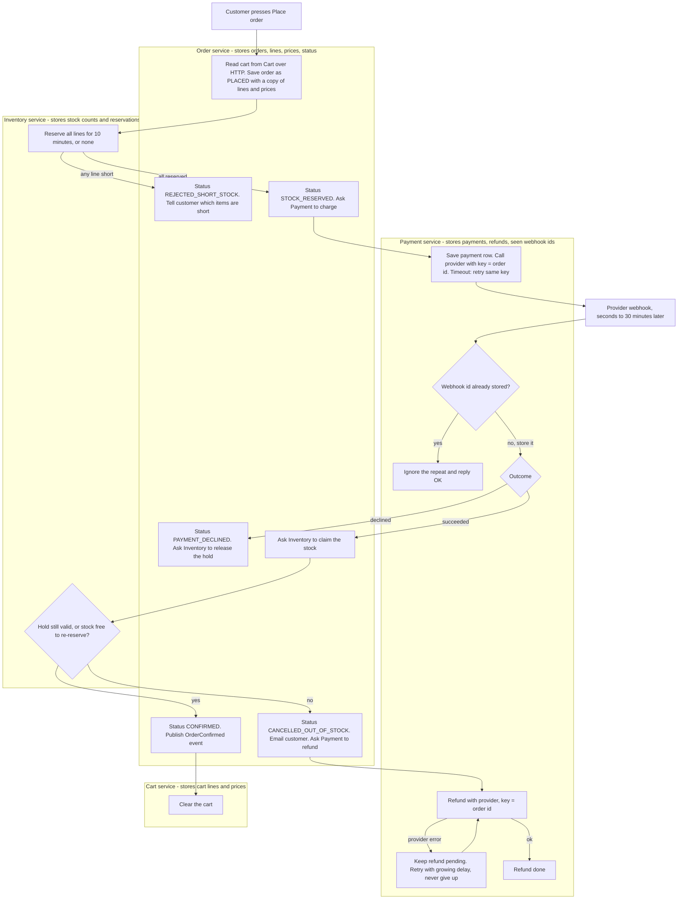

## Checkout plan

Checkout moves out of the monolith into four services: Cart, Inventory, Payment and Order. When the customer presses Place order, Order saves a snapshot of the cart, Inventory holds the stock for 10 minutes, and Payment charges through the provider. Order confirms the order only when the provider reports success and the stock is still ours. If the payment succeeds after the stock has gone, the money is refunded and the order is cancelled.

### Terms

- **Cart**: keeps each customer's lines and prices, and clears them when told an order is confirmed.
- **Inventory**: keeps stock counts and reservations.
- **Payment**: the only service that talks to the payment provider. Keeps one payment row and any refund row per order, plus the ids of webhooks it has seen.
- **Order**: runs the checkout. Keeps the order, a copy of its lines and prices as at Place order, and its status. It is the only service that changes an order's status.
- **Provider**: the external company that charges cards. It answers a charge with "accepted" and sends the real result (succeeded or declined) later by webhook.
- **Webhook**: an HTTP call the provider makes to Payment. It usually arrives in seconds, can take up to 30 minutes, and can be delivered more than once.
- **Reservation**: Inventory's record that stock for an order's lines is held until a time limit (10 minutes). Unclaimed, it expires and the stock goes back on sale.
- **Claim**: turning a reservation into a permanent sale once payment has succeeded.
- **Idempotency key**: a value sent with a provider request. The provider treats a repeat of the same key as the same request, so it never charges or refunds twice. Ours is the order id.
- **Event**: a message on the shared broker. The broker stores it until the receiving service takes it, so a service that is down receives it later.
- **Outbox**: a table in a service's own database. An event is written there in the same transaction as the change it reports, then published from the table, and published again after a restart if needed. So it cannot be lost.
- **Order statuses**: PLACED, STOCK_RESERVED, REJECTED_SHORT_STOCK, PAYMENT_DECLINED, CONFIRMED, CANCELLED_OUT_OF_STOCK.

### Rules

- Each service owns its database. No service reads another's tables. Services talk over HTTP or through events.
- Later cart edits or price changes never affect an existing order.
- We never ship partial orders and never keep money for an order we cannot fulfil.
- The cart is emptied only when the order is confirmed. Every failure leaves the cart exactly as it was, so the customer can try again.

### Diagram

### Steps and failures

The diagram shows the path. These notes add what starts each step, how it works, and what happens when it fails.

1. **Place order.** The customer's request goes to Order first. If the cart already has an order that is PLACED or STOCK_RESERVED (for example a double click), Order returns that order instead of creating another, so stock is never held twice and the card is never charged twice. If that order is still PLACED, Order repeats the reserve step for it. Otherwise Order reads the cart from Cart, saves a new order as PLACED with a copy of the lines and prices, then asks Inventory to reserve. The screen shows the order's current status, which Order serves on request, so the customer sees "waiting for payment" until a final status arrives.
2. **Reserve.** Order calls Inventory over HTTP and waits. Inventory checks every line in one database transaction and stores a reservation keyed by order id, with an expiry time 10 minutes ahead. A reservation counts as holding stock only until that time, so the limit is exact; a sweep job each minute returns expired stock to sale. If any line is short, Inventory reserves nothing and names the short items. Order sets REJECTED_SHORT_STOCK and shows them to the customer. No payment is requested and the cart is untouched. If Inventory is down or does not answer in time, Order leaves the order PLACED, requests no payment, and tells the customer to try again. A reservation made late for that order simply expires.
3. **Charge.** Order sets STOCK_RESERVED and asks Payment to charge, by an HTTP call carrying the order id and the total of the saved order lines. Payment saves a payment row (unique per order id), so a repeated call is harmless. If Order's call fails or times out, Order repeats it up to 3 more times, 5 seconds apart. If Payment still does not answer, the order stays STOCK_RESERVED and the customer is told to try again. Payment sends the provider the charge with the order id as the key; the reply is only "accepted". If the provider call times out, Payment sends it again with the same key, up to 3 more times, 5 seconds apart. If the provider never answers, the payment row stays pending and the order stays STOCK_RESERVED (see Open questions).
4. **Webhook.** Payment looks up the provider's event id in its own database. If it is already stored, the repeat is ignored and answered OK. Otherwise, in one transaction, Payment stores the id and writes the outcome to its outbox, then publishes the outcome to Order as an event. A crash in between cannot lose the outcome. Order may receive the same outcome more than once, so it acts on an outcome only while the order is STOCK_RESERVED and ignores it in any other status.
5. **Declined.** Order sets PAYMENT_DECLINED and asks Inventory to release the hold. If that request fails, Order does not retry: the hold expires on its own after 10 minutes. The cart is untouched and the order is finished. Pressing Place order again creates a new order with a new id, so it gets a new idempotency key.
6. **Succeeded.** Order asks Inventory to claim the stock. If the hold is still valid, Inventory makes it permanent. If the hold has lapsed, Inventory tries to reserve the same lines again, all or nothing; if that works, the stock is claimed. Claiming is safe to repeat for the same order id. If the claim call times out or errors, Order does not treat that as a refusal: it repeats the claim until Inventory gives a definite yes or no. Only a "no" leads to step 8.
7. **Confirmed.** Order sets CONFIRMED and writes OrderConfirmed to its outbox in the same transaction. Cart consumes the event and clears the cart; clearing twice is harmless. If Cart is down, the broker keeps the event until Cart returns.
8. **Out of stock.** Order sets CANCELLED_OUT_OF_STOCK, emails the customer, and asks Payment to refund the full amount. Payment sends the refund with the order id as its key.
9. **Refund fails.** Payment keeps the refund row pending and retries with a growing delay (1 minute, doubling, capped at 1 hour). It never stops retrying, so a refund is never dropped. After 5 failed attempts it also raises an alert for a person. Order is not told when the refund completes: the order stays CANCELLED_OUT_OF_STOCK and refund progress is visible only in Payment.

### Open questions

- Which service sends the out-of-stock email is not decided; this plan has Order do it.
- If no webhook arrives within 30 minutes, or the provider never answers the charge, or Payment never answers Order's charge call, nothing yet releases the hold or closes the order.
- If Inventory never answers a repeated claim, the order stays STOCK_RESERVED and the money is held; no limit is set.
- The refund retry delays, the alert threshold and the charge retry counts and spacing are our choice, not given by the brief.
- The brief does not say how the customer is told about a confirmed or declined order beyond the status on screen; only the out-of-stock email is specified. Whether the customer is told when a refund completes is also not decided.
- Returning the open order on a repeated Place order means a customer who edited the cart in between gets the old snapshot; not decided how to handle that.
