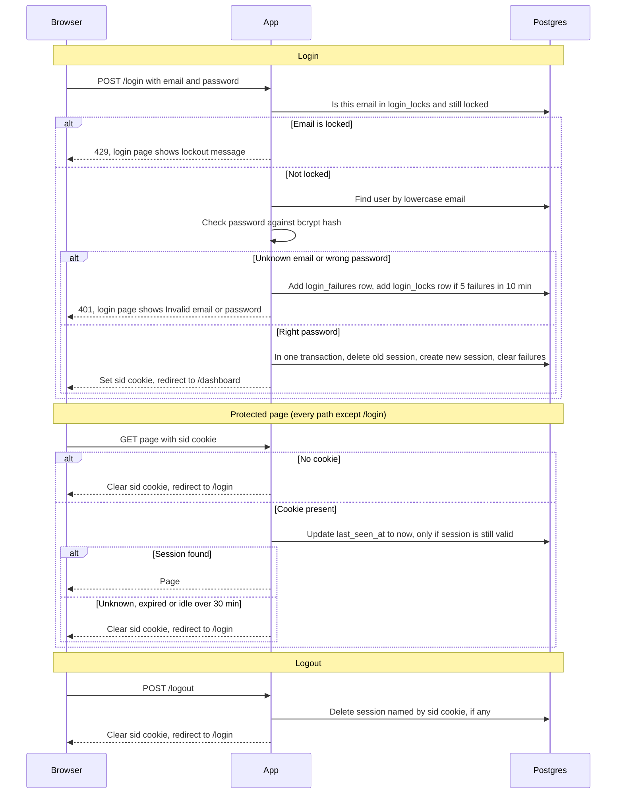

## Auth plan: login with server-side sessions

Today every page in the app is public. After this change, every page except `/login` needs a signed-in user. A user signs in with email and password. The server stores the session in Postgres and gives the browser only a random session ID in a cookie named `sid`. Each protected request looks that ID up in Postgres, so either of the two app instances can answer it. Failed logins are also counted in Postgres, so the lockout works across both instances.

**Terms**
- **Session:** a row in the `sessions` table that says which user is signed in and when that sign-in ends.
- **Session ID:** a random, unguessable string. On its own it means nothing. The server looks it up.
- **sid cookie:** the browser cookie that holds only the session ID.
- **Cookie flags:** HttpOnly hides the cookie from page scripts. Secure sends it only over HTTPS. SameSite=Lax stops most cross-site requests from sending it.
- **Sticky session:** a load balancer rule that sends one browser to the same app instance every time. We do not use it, so session data must live outside the app.
- **Redis:** an in-memory data store often used for sessions. It is not part of this stack today.
- **bcrypt hash:** the one-way form of a password, stored in `users.password_hash`.
- **Lockout:** refusing logins for one email for a while after too many failed attempts.
- **Cleanup job:** a timer that deletes old rows from the database.

**Tables**
- `users` (existing, not changed): `id`, `email` (stored lowercase, unique), `password_hash`.
- `sessions`: one row per session. Fields: `id`, `user_id`, `created_at`, `last_seen_at`, `expires_at`.
- `login_failures`: one row per failed login attempt. Fields: `email`, `failed_at`.
- `login_locks`: one row per locked email. Fields: `email`, `locked_until`.

**Flow**

**Rules for the flow above**
- **Email:** the typed email is lowercased before any lookup or count.
- **Same error for unknown email and wrong password:** both get HTTP 401 and the login page showing "Invalid email or password". Nothing reveals whether an account exists.
- **Lockout:** when an email has 5 failed attempts within any 10-minute period, logins for that email are refused for 15 minutes with HTTP 429. The lock starts at the 5th failure. While locked, the password is not checked. Failed attempts are recorded for any email typed, known or not, so a 429 does not reveal whether an account exists either. Once the lock is set, that email's failure rows are deleted, so the count starts fresh when the lock ends.
- **Refused attempts:** a 429 attempt is not recorded as a failure and does not extend the lock.
- **Successful login:** clears that email's failure rows. Creates a new random session ID every time, even if the browser sent an old one. Deletes the session the incoming cookie pointed to. Creating and deleting happen in one database transaction. Then redirects to `/dashboard`.
- **Cookie:** `sid`, flagged HttpOnly, Secure and SameSite=Lax. It holds only the session ID. No user data goes in it.
- **Session lifetime:** a session ends 30 minutes after the last request or 12 hours after login, whichever comes first. Every protected request sets `last_seen_at` to now. `expires_at` is set once, to login time plus 12 hours.
- **Checking a session:** every protected request runs one query. The session counts only if it exists, `expires_at` is in the future and `last_seen_at` is within the last 30 minutes. The check happens on every request, so it does not depend on the cleanup job.
- **Logout:** deletes the session named by the cookie, if there is one, before replying. Then clears the cookie and redirects to `/login`. With no session, the reply is the same.
- **Cleanup job:** runs on a timer. Deletes sessions past `expires_at` or idle over 30 minutes, `login_failures` rows older than 10 minutes, and `login_locks` rows past `locked_until`.

**Design choices**
- **Postgres, not process memory and not Redis.** Process memory cannot work with two instances. Postgres is already shared by both instances and already running, so no new service is needed to run, secure or back up. A session check is one indexed lookup, which a small team's app can afford. Redis would add a service this app does not need yet.
- **Expiry is recorded as two timestamps on the session row** (`expires_at` and `last_seen_at`) and checked at read time.
- **Abandoned sessions** are removed by the cleanup job. They stop working at their expiry time even before removal.
- **Failure counts** live in `login_failures`, one row per failure, and locks live in `login_locks`. Both are in Postgres so both instances see them.

**What happens when things fail**

| Where | What goes wrong | What the user sees | What the server does |
|---|---|---|---|
| Lock check at login | Database error | Login page: "Sign-in is unavailable right now. Try again shortly." HTTP 503 | Does not check the password. Sets no cookie. |
| User lookup or password check at login | Database error | Same 503 | Sets no cookie. Changes nothing. |
| Recording a failed attempt | Database error | Same 503 | Fails closed, so the attempt is not silently left uncounted. |
| Successful login (create new session, delete old one) | Database error | Same 503 | The transaction is rolled back. The old session stays, no new cookie is set, and the user can try again. |
| Protected page, session check | Database error | "The app is temporarily unavailable. Try again shortly." HTTP 503 | Cannot tell whether the session is valid, so it keeps the cookie and does not redirect to login. |
| Logout, delete session | Database error | "Sign-out failed. Try again." HTTP 503 | Keeps the cookie so the user can retry. The session still ends within 12 hours. |
| Cleanup job | Any error | Nothing shown to users | Logs the error and tries again on the next run. Stale rows do not affect checks. |

**Open questions**
- How often the cleanup job runs. The interval is not chosen yet.
- Timing: an unknown email skips the bcrypt check, so it may respond faster than a wrong password. The brief asks for identical responses but does not say whether timing must match. Decide whether to run a dummy bcrypt check for unknown emails.
- The exact wording of the 429 and 503 messages is our choice, not the brief's. Confirm it in review.