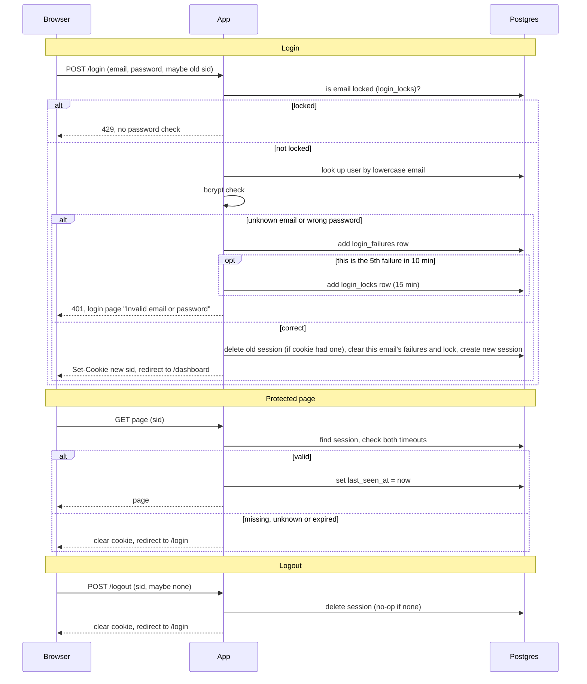

## Login with server-side sessions

Today every page of this server-rendered app is public. After this change every page except `/login` needs a signed-in user. A successful `POST /login` creates a session row in Postgres and gives the browser a cookie holding only a random session ID. Every later request looks that ID up in Postgres. Postgres is used because both app instances already share it, so no sticky sessions and no new service (Redis) are needed.

### Existing system
- Server-rendered HTML pages and form posts. No SPA, no API clients.
- Two identical app instances behind a load balancer, with no sticky sessions. Any request can reach either instance, so no state may live in process memory.
- One Postgres database. Its `users` table has `id`, `email` (lowercase, unique) and `password_hash` (bcrypt). Sign-up and password reset are out of scope.

### Terms
- **Session**: a row in `sessions` that says "this browser is signed in as this user".
- **Session ID (`sid`)**: a long random value (from a cryptographic random source) that is the only thing in the cookie. It carries no user data.
- **Idle timeout**: 30 minutes with no requests. Every request restarts this clock.
- **Absolute timeout**: 12 hours after login, no matter how active the user is. Whichever timeout comes first ends the session.
- **Failure count**: failed logins for one email in the last 10 minutes.
- **Lockout**: after 5 failures within any 10-minute period, that email cannot log in for 15 minutes.

### State (all in Postgres)
- `sessions`: `id`, `user_id`, `created_at`, `last_seen_at`. A session is expired if `now - last_seen_at > 30 min` or `now - created_at > 12 h`. Expiry is checked on every read, so correctness never depends on cleanup.
- `login_failures`: `email`, `failed_at`. One row per failed attempt. Unknown emails are recorded too, so lockout cannot reveal whether an account exists.
- `login_locks`: `email`, `locked_until`.

### Rules that apply throughout
- Emails are lowercased before any lookup or storage.
- Cookie `sid` is flagged HttpOnly, Secure and SameSite=Lax.
- Unknown email and wrong password get the identical response: HTTP 401 and the login page showing "Invalid email or password". For an unknown email the app still runs a bcrypt check against a dummy hash, so response time does not give it away.
- The cookie is always cleared with the same flags it was set with.

### Diagram

### Notes on the steps
1. **Login check order.** The lock check comes before the password check, so a locked email gets 429 even with the right password. The failure count is read from `login_failures` (rows newer than 10 minutes), so both instances agree. Two simultaneous attempts on different instances could both slip in just before the limit. This is accepted.
2. **Failed login.** Insert a failure row; if the count in the last 10 minutes is now 5, insert a lock row with `locked_until = now + 15 min`. Respond as in the rules above.
3. **Successful login.** Always create a brand-new session ID, even if the browser sent one. If the incoming cookie pointed to a session, delete that row. Delete that email's failure rows and lock row. Redirect to `/dashboard`.
4. **Protected request.** Applies to every page except `/login`. Valid means the row exists and neither timeout has passed. Updating `last_seen_at` on each request is what restarts the idle clock.
5. **Logout.** The session row is deleted before the reply is sent. With no cookie or an unknown ID it behaves the same: clear the cookie, redirect to `/login`.
6. **Cleanup of abandoned sessions.** A job on each instance runs every 10 minutes and deletes expired `sessions` rows, `login_failures` older than 10 minutes and `login_locks` past `locked_until`. Deletes are idempotent, so two instances running it is harmless. It only saves space; expiry is already enforced on read.

### When things fail
Storage errors never let anyone in: the app fails closed. Cause of failure is logged on the server, not shown to the user.

| Where | Postgres unreachable or errors |
|---|---|
| Login | HTTP 503 with a plain "Sign-in is temporarily unavailable, please try again" page. No session is created. If the lock check itself fails, do not check the password. |
| Protected page | HTTP 503 with the same kind of page. The cookie is kept, because the session may still be valid. The user is not shown any protected content. |
| Logout | HTTP 503 and the cookie is kept, so the user can retry. We do not pretend the session was destroyed. |

### Open questions
- None from the brief. Rate limiting by IP (as opposed to by email) is not requested and is not covered.
- CSRF protection for form posts beyond SameSite=Lax is not specified.