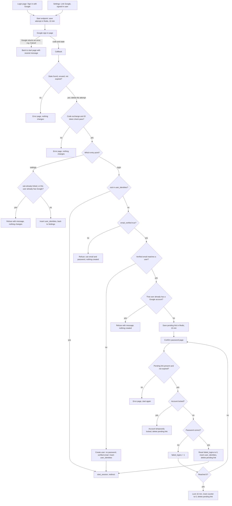

# Google sign-in

Today a user signs in with email and password. `POST /login` checks the password, then `start_session` creates a row in the `sessions` table and sets the `sid` cookie. This adds "Sign in with Google" beside that. A user starts on the login page or in Account Settings, and the start endpoint saves a short-lived attempt in Redis. Google sends the browser back to our callback, which checks the attempt and reads the ID token. Known Google accounts sign in directly. New or matching accounts are created or linked, and every success ends in the same `start_session` that password login uses.

## Terms

- **OpenID Connect (OIDC)**: a sign-in layer on top of OAuth 2.0. Google tells our server who the user is.
- **Authorization code flow with PKCE**: Google sends the browser back with a one-time code. Our server swaps it for tokens. PKCE is a secret we create and later show to Google, so a stolen code is useless.
- **state**: a random value we send to Google and expect back. It ties a callback to the attempt we started.
- **nonce**: a random value that Google copies into the ID token. It proves the token answers this attempt.
- **ID token**: a signed statement from Google about the user. We read only `sub`, `email` and `email_verified`.
- **sub**: Google's permanent ID for the account. It does not change when the email changes. We look up every Google account by `sub`.
- **Redis**: an in-memory store. Its keys can expire on their own after a set time (TTL). Today it holds only short-lived data such as rate limits.
- **user_identities**: a new table that links one Google `sub` to one user.
- **start_session**: the existing function that creates a session row and sets the `sid` cookie. Google sign-in calls it unchanged.
- **Pending link**: a half-finished link that waits for the password. It lives in Redis for 10 minutes.
- **Callback**: our URL that Google sends the browser back to.

## Flow

## Steps the diagram does not show

1. **Start.** The login page's "Sign in with Google" button or Settings' "Link Google" button calls the same start endpoint. Settings requires a signed-in user. The endpoint creates a random state, nonce and PKCE verifier. It saves them in Redis under the state, along with the entry point, the page to return to, and (for Settings) the signed-in user's id. It then sends the browser to Google with scopes `openid email profile`.
2. **Callback.** The callback fetches the attempt for the state and deletes it in one step, so each attempt works once. If no attempt is found, the state was unknown, expired or already used. Otherwise it exchanges the code with Google, sending the PKCE verifier. It checks the ID token and that the nonce matches. Then it reads `sub`, `email` and `email_verified`. Google's tokens are discarded. We keep no Google access or refresh tokens.
3. **Settings link.** Google's email does not need to match the user's email, and no password is asked. The new row is inserted and the user returns to Settings. `start_session` is not called, so the session does not change.
4. **Known account.** If the `sub` is in `user_identities`, that user is signed in whatever their Google email is now. Google's email never overwrites our stored email.
5. **New account.** The email is stored lowercased, as in the schema. The new `users` row has `password_hash` NULL and `email_verified_at` set to now. `user_identities` is inserted, then `start_session` runs.
6. **Pending link.** The pending link stores the `sub` and the matched user's id. It gets a random key, and the browser gets a cookie holding that key. This cookie is not a session. The user then sees the confirm-password page.
7. **Confirm password loop.** The page finds the pending link by its cookie key. The confirm check runs the same lockout as `POST /login`. A locked account is rejected without checking the password. A wrong password adds one failure and returns to this page. The fifth failure locks the account for 15 minutes and resets the counter, as in the existing rules. A correct password resets `failed_logins` to 0 and links the account. The pending link is deleted, then `start_session` runs.
8. **Unlink (Settings).** Only a user with a password can unlink. A user with no password is told to set one with the existing reset email at `/forgot`. Unlinking deletes the `user_identities` row and leaves the session unchanged. No password is asked for.
9. **Success.** Every Google sign-in ends in the existing `start_session`. That means the same session row, the same `sid` cookie and the same redirect rule: `next` if it is a relative path on our site, otherwise `/home`.

## Rules

- A Google account is identified only by `sub`. Email never identifies it.
- One Google account links to at most one user. One user has at most one Google account. `user_identities` enforces both with unique columns.
- The round trip to Google must finish within 10 minutes. Each attempt's callback works once.
- Google sign-in creates no new session type.

## Where new state lives

| State | Where | Lives for | Removed by |
|---|---|---|---|
| Attempt: state, nonce, PKCE verifier, entry point, return page, user id for Settings | Redis | 10 minutes | Callback deletes it, or it expires |
| Pending link: `sub`, matched user id | Redis | 10 minutes | Successful confirm, lockout, or expiry |
| Pending-link cookie: key to the pending link | Browser | Until the pending link is gone | Expires with the pending link |
| `user_identities` row: `user_id` (unique), `google_sub` (unique), `created_at` | PostgreSQL | Permanent | Unlink in Settings, or deletion of the user (cascade) |
| `users.password_hash` | PostgreSQL | Permanent, now nullable. NULL for Google-only users | Set by password reset |

## What happens when things fail

| When | User sees | Changes |
|---|---|---|
| Google returns an error, e.g. the user pressed Cancel | Back to the page they started on, with a neutral message | Nothing |
| State unknown, expired or already used | Error page | Nothing |
| Code exchange or ID token check fails (including nonce mismatch) | Error page, start again | Nothing. The attempt is already deleted |
| Settings: `sub` already linked to anyone, or this user already has a Google account | Refusal message | Nothing |
| Login: `email_verified` is false | Refusal: use email and password | Nothing is created |
| Login: matched user already has a Google account | Refusal message | Nothing is created |
| Confirm: pending link missing or expired | Error, start again | Nothing |
| Confirm: account locked | "Account temporarily locked" | Pending link deleted |
| Confirm: wrong password | Wrong-password message, try again | `failed_logins` + 1 |
| Confirm: fifth wrong password | Locked message | Locked 15 minutes, counter reset, pending link deleted |
| Unlink: user has no password | Tell the user to set a password with the reset email first | Nothing |

## Open questions

- What does password login show for a Google-only user with no password? The brief does not say.
- Can a matched account with no password be confirmed? The brief does not say. As written, such an account cannot confirm.
- What happens if the user's session ends between Settings start and callback? The callback uses the user id saved at start. The brief does not say whether to check the session again.
- What happens if Redis is unavailable? The brief does not say.
- Should a successful password confirmation mark the email as verified? The brief does not say.