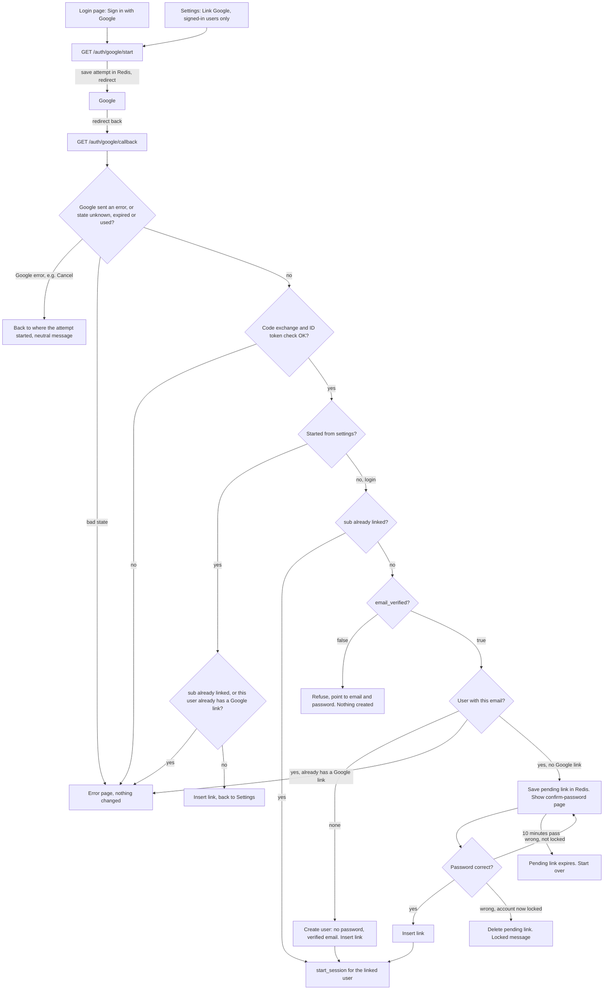

# Google sign-in

Today users sign in with email and password at POST /login, and a successful login calls `start_session`, which creates the one kind of session we have. This adds "Sign in with Google" (OpenID Connect, authorization-code flow with PKCE) to the login page and to Account Settings. The user goes to Google and comes back to our callback, which finds, links or creates a user by Google's `sub` and then calls the same `start_session`. The new state is small: one table, two kinds of Redis entry, and a nullable `password_hash`.

## Terms

- **OIDC / ID token**: Google tells us who the user is in a signed token. We read only `sub`, `email` and `email_verified`. We ask for scopes `openid email profile`. We keep no Google access or refresh token.
- **`sub`**: Google's permanent ID for an account. We identify a Google account by `sub`, never by email.
- **PKCE verifier**: a random secret we make before leaving. Google will only give us the login code back if we present it, so a stolen code is useless.
- **`state`**: a random one-time ID for one attempt. It ties the callback to the attempt that started it.
- **`nonce`**: a random value Google copies into the ID token. We check it matches, so an old token cannot be replayed.
- **start_session**: existing function. It replaces any old session and sets the `sid` cookie. It redirects to `next` (a relative path on our site) or to /home.
- **Lockout**: existing rule. A wrong password adds 1 to `failed_logins`. At 5, `locked_until` is set 15 minutes ahead and the count resets to 0. While `locked_until` is in the future, the password is not checked.
- **Link**: a row in `user_identities` joining one user to one `sub`.

## Flow

## Steps and state

1. **Start** (`/auth/google/start`). Started by the login button or by the Settings button (signed-in users only). It makes `state`, `nonce` and the PKCE verifier. It saves them in Redis under the `state` value, along with where the attempt started (login or settings), the user ID if from settings, and `next` if from login. The entry lives 10 minutes, which is the limit for the whole round trip. Then it redirects to Google. If Redis is down, it shows the error page and nothing is sent to Google.
2. **Callback** (`/auth/google/callback`). Google redirects here. It reads and deletes the Redis entry in one step, so each attempt is honoured once.
   - No entry (unknown, expired or already used `state`): error page, nothing changes.
   - Google sent an error (for example Cancel): send the user back to the login page or Settings, whichever the attempt came from, with a neutral message ("Google sign-in was not completed").
   - Otherwise exchange the code, with the verifier, for the ID token and check its signature, audience and `nonce`. If the exchange or the check fails, show the error page and change nothing. There is no retry. The user presses the button again.
3. **Decide.** The callback now has `sub`, `email` and `email_verified`. Emails are compared lowercased.
   - **Started from settings**: the signed-in user must be the one saved in the entry. No password is asked and the emails need not match. Refuse if this `sub` is linked to anyone else, or this user already has a Google link. Otherwise insert the link and return to Settings.
   - **Started from login, `sub` already linked**: call `start_session` for that user. Their Google email may have changed; it does not matter and we never change our stored email.
   - **Unlinked, `email_verified` false**: refuse and point the user to email and password. Nothing is created.
   - **Unlinked, verified email matches no user**: create a user with no password and the email verified, insert the link, call `start_session`.
   - **Unlinked, verified email matches a user**: if that user already has a different Google account linked, refuse. Otherwise store a pending link in Redis (`sub`, user ID, 10-minute life) and set a short-lived HttpOnly cookie holding its random ID. Show the confirm-password page.
4. **Confirm password** (POST from the confirm page). It follows the lockout rules above.
   - Account already locked, or the wrong password that triggers the lock: delete the pending link and show the locked message.
   - Wrong password, not locked: count the failure and show the page again.
   - Correct password: reset `failed_logins` to 0, insert the link, delete the pending link, call `start_session`.
   - Pending link missing or expired: tell the user to start again from the login page.
5. **Unlink** (Settings). Allowed only if the user has a password. Otherwise tell them to set one using the existing reset email (POST /forgot). That sets a password and the button then works.

## Where state lives

| State | Where | Removed by |
|---|---|---|
| `state`, `nonce`, verifier, entry point, user ID, `next` | Redis, 10-minute expiry | callback reads it once; otherwise expiry |
| Pending link (`sub`, user ID) | Redis, 10-minute expiry, ID in a cookie | success, lockout, or expiry |
| Google link | new Postgres table `user_identities` | unlink, or deleting the user (cascade) |
| Session | existing `sessions` table | existing rules |

`user_identities(id, user_id UNIQUE REFERENCES users ON DELETE CASCADE, sub UNIQUE, created_at)`. The two UNIQUE constraints enforce one Google account per user and one user per Google account. Store only `sub`. If an insert hits a UNIQUE constraint (two attempts racing), show the error page and change nothing.

`users.password_hash` becomes nullable. A user with no password cannot pass the password check at /login; they get the same generic wrong-login message as an unknown email. Google never changes `users.email` or the password.

## Failures

| Where | What happens |
|---|---|
| Unknown, expired or used `state` | Error page, nothing changes |
| Google returns an error | Back to the starting place, neutral message |
| Code exchange or ID token check fails | Error page, nothing changes, user presses the button again |
| `email_verified` false | Refuse, point to email and password, nothing created |
| Matching user has another Google account | Refuse |
| Settings: `sub` linked elsewhere, or user already linked | Refuse |
| Wrong password at confirm | Existing lockout; the lock discards the pending link |
| Pending link expires | Start over |
| Unlink without a password | Tell the user to set one by reset email |
| Redis or database error | Error page, nothing half-done |

## Build and rollout

Add `user_identities` and make `password_hash` nullable in one migration. Then add the start and callback endpoints, the confirm page, and the two buttons.

## Open questions

- Which Google client ID and secret, and which redirect URI per environment, are not decided.
- Whether a Google-only user who signs in should see a prompt to set a password is not decided.