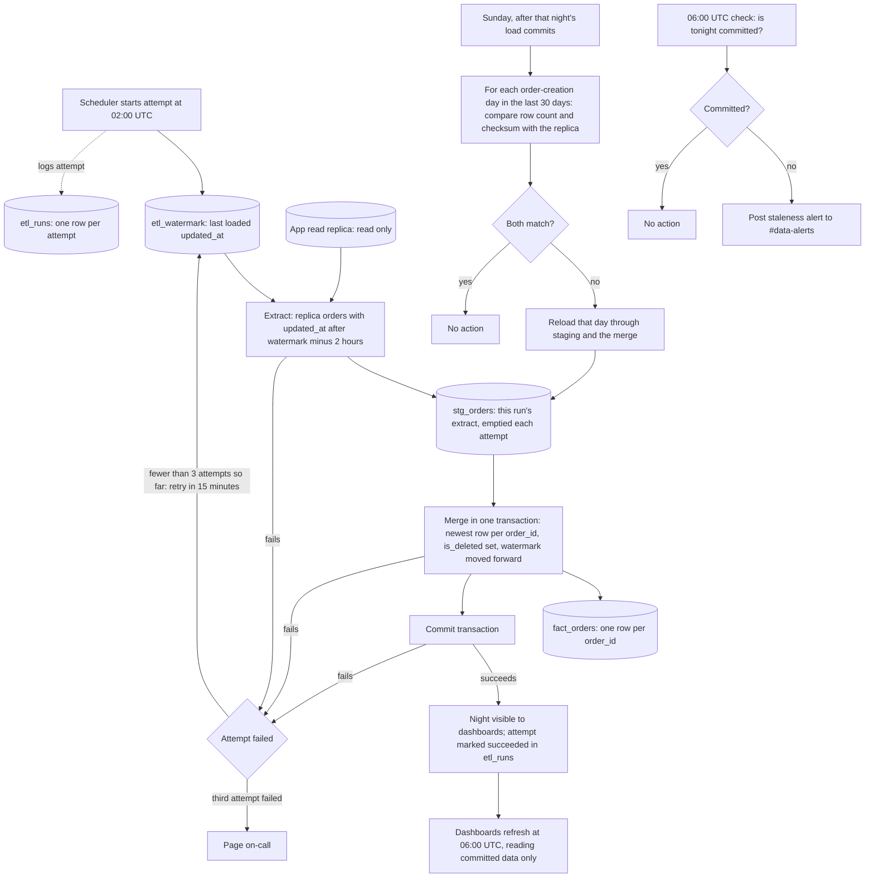

## Nightly orders ETL

This nightly job copies the app's `orders` table from the Postgres read replica into the analytics warehouse, starting at 02:00 UTC. Each run reads the orders changed since the last successful load (minus a 2-hour lookback), stages them, and merges them into `fact_orders`, which holds one row per order, in a single transaction. Dashboards see either the old night or the new one, never a partial load. The lookback exists because bulk imports can make rows visible up to 90 minutes after their `updated_at`. A Sunday reconciliation catches rows that arrive later than the lookback covers.

This is a new pipeline. No existing system changes.

### Terms

- **App replica**: a read-only copy of the app's Postgres database. The pipeline reads only from it and never writes to the app.
- **Warehouse**: the analytics database. The pipeline writes to it, and all of the pipeline's own state lives there.
- **`updated_at`**: the time of the last write to an order. Every write sets it, including a delete.
- **Soft delete**: the app never removes an order. It sets `deleted_at` instead. The warehouse keeps the order and sets `is_deleted`.
- **Bulk import**: a large app transaction that can stay open for up to 90 minutes. Its rows get `updated_at` when they are written, not when the transaction commits, so they can appear late.
- **High-water mark (watermark)**: the latest `updated_at` the warehouse has successfully loaded. Stored in `etl_watermark`.
- **Lookback**: 2 hours, subtracted from the watermark on every run, so late rows are read again.
- **Staging (`stg_orders`)**: a temporary table holding one run's extract. It is emptied at the start of each attempt.
- **`fact_orders`**: the warehouse table of orders. Its key is `order_id`, so it holds exactly one row per order.
- **Merge**: insert each order that is new, and update each order that already exists, matched on `order_id`.
- **Commit**: the moment a load becomes visible. Dashboards read only committed data.
- **Checksum**: one number computed over all the `order_id` and `updated_at` values of a set of rows. Equal checksums mean the two sets match.
- **`etl_runs`**: a warehouse log with one row per attempt.
- **On-call**: the engineer paged when the job has failed three times.

### Diagram

### Steps

Attempts run at 02:00, 02:15 and 02:30 UTC. Each attempt repeats the same steps from the start, using the same watermark.

1. **Start.** The scheduler starts the attempt and logs it in `etl_runs`. The attempt reads the watermark from `etl_watermark`.
2. **Extract.** It reads every order from the replica whose `updated_at` is later than the watermark minus 2 hours. It writes these rows to `stg_orders`. Nothing is written to the app.
3. **Merge, in one warehouse transaction.** The merge follows these rules:
   - Keep one row per `order_id` in staging: the one with the newest `updated_at`.
   - Update an existing `fact_orders` row only when the staged `updated_at` is newer. Insert the order if it is new. An older copy never overwrites a newer one, so overlapping extracts and re-runs change nothing.
   - Set `is_deleted` to true when `deleted_at` is set. Deleted orders stay in `fact_orders`.
   - Set `etl_watermark` to the larger of the old watermark and the largest `updated_at` in this extract. The watermark only moves forward. It is updated in the same transaction, so it moves only when the data loads.
4. **Commit.** The transaction commits, which makes the night visible to dashboards. The attempt is marked succeeded in `etl_runs`.

A delete is a write, so it sets `updated_at` and is picked up by the normal extract like any other change.

### What happens when things fail

If an attempt fails, dashboards keep showing the last committed night, and the watermark stays where it was. The next night's run therefore starts from the same point and picks up the missed rows.

| Where it fails | What happens | Watermark |
|---|---|---|
| Extract from the replica | Attempt fails. Staging is discarded. Retry in 15 minutes. | Unchanged |
| Merge or watermark update | Transaction rolls back. Nothing becomes visible. Retry in 15 minutes. | Unchanged |
| Commit | Nothing becomes visible. Retry in 15 minutes. | Unchanged |
| Third attempt fails | Page on-call. | Unchanged |
| Night not committed by 06:00 UTC | Post a staleness alert to #data-alerts. Dashboards refresh anyway and show the last committed night. | Unchanged |
| Sunday reconciliation finds a mismatch | Reload that day through staging and the merge. | Unchanged. Reconciliation never moves the watermark. |

### Sunday reconciliation

Some rows become visible later than the lookback covers, for example when the replica falls behind. Reconciliation finds them.

1. It runs on Sunday, after that night's load commits.
2. For each order-creation day in the last 30 days, it compares the row count and the checksum of `order_id` + `updated_at` between the replica and the warehouse.
3. If either value differs, it reloads that whole day from the replica through staging and the merge.

### Open questions

- The plan assumes `orders` has a creation timestamp column for grouping by order-creation day. Its name needs confirming.
- How the first run starts, when no watermark exists yet, is not stated.
- If two versions of one order have the same `updated_at` in one extract, the plan keeps one of them. The brief does not say which.
- Rows that appear more than 30 days after their order was created are not checked by reconciliation. The brief does not say how to handle them.
- What happens if a Sunday reload fails is not stated.