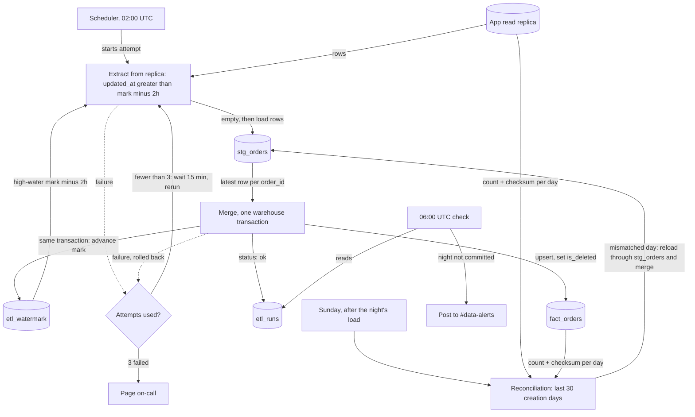

## Nightly orders ETL

Every night a job copies changed rows from the app's `orders` table into the warehouse table `fact_orders`. It reads only from the app's Postgres read replica and keeps all its bookkeeping in the warehouse, because we have no write access to the app database. Each night loads into a staging table, then one warehouse transaction merges and advances the high-water mark, so dashboards only ever see a whole night. A weekly reconciliation repairs rows that arrive later than the nightly lookback can catch.

### Terms

- **Replica**: the app's Postgres read replica. The only source we read.
- **`updated_at`**: set to the write time on every write to an order. A soft delete is also a write.
- **`deleted_at`**: set by the app instead of deleting a row. The app never hard-deletes.
- **High-water mark**: the largest `updated_at` we have loaded successfully. Stored in `etl_watermark` (one row).
- **Lookback**: the 2 hours subtracted from the high-water mark when extracting. Bulk-import transactions can stay open for up to 90 minutes, and `updated_at` is stamped at write time, not commit time. A bulk row can therefore become visible up to 90 minutes after its `updated_at`.
- **`stg_orders`**: warehouse staging table that holds one attempt's extract. It is emptied at the start of every attempt.
- **`fact_orders`**: the table analysts read. Exactly one row per `order_id`, always its latest version. Deleted orders stay, flagged `is_deleted`.
- **`etl_runs`**: warehouse log with one row per attempt: night, attempt number, status, start and end time, row count.

### Diagram

### Steps

1. **Start (02:00 UTC, scheduler).** The scheduler starts attempt 1. The job writes a `running` row to `etl_runs`.
2. **Extract.** The job reads the high-water mark from `etl_watermark`. It selects replica rows where `updated_at` is later than the mark minus 2 hours, and loads them into `stg_orders` after emptying it. The same order may appear on several nights; that is expected. On failure, nothing in `fact_orders` or `etl_watermark` has changed, so the attempt simply fails (see step 5).
3. **Merge.** In one warehouse transaction, the job keeps the row with the latest `updated_at` for each `order_id` in staging. It upserts those rows into `fact_orders`, but only where the staged `updated_at` is at least the stored one, so an older version never overwrites a newer one. A set `deleted_at` becomes `is_deleted = true`, and the row is kept. In the same transaction it sets the high-water mark to the largest `updated_at` extracted, leaves it unchanged if nothing was extracted, and marks the `etl_runs` row `ok`. The transaction commits as a whole or not at all, so dashboards never see a half-loaded night, and the mark moves only when the data has loaded. Re-running a night changes nothing, because the merge is idempotent. On failure the transaction rolls back.
4. **06:00 UTC check.** Dashboards refresh at 06:00 whether or not the job has finished. At 06:00 a check reads `etl_runs`. If the night has no committed `ok` run, it posts a staleness alert to #data-alerts.
5. **Retry and paging.** After a failed attempt, the job waits 15 minutes and reruns from the extract step, up to two more times (three attempts in all). Each attempt gets its own `etl_runs` row. After the third failure, the job pages on-call. Retries may run past 06:00, and the 06:00 alert still fires in that case.
6. **Sunday reconciliation (after that night's load).** Some rows become visible later than the 2-hour lookback covers, for example when the replica falls behind. For each order-creation day in the last 30 days, the job compares the row count and a checksum of `order_id` + `updated_at` between the replica and `fact_orders`. A day that does not match is reloaded: the replica's orders for that creation day go through `stg_orders` and the same merge. A reload does not move the high-water mark. A reconciliation failure is recorded in `etl_runs` and left for the next Sunday; no automatic retry is planned.

### What happens when things fail

| Where | What happens |
|---|---|
| Extract | Staging is discarded and nothing else changed. Retry as in step 5. |
| Merge | Transaction rolls back, so `fact_orders` and the mark are unchanged. Retry as in step 5. |
| Third failed attempt | Page on-call. The mark stays where it was, so the next night's lookback re-reads the missed rows. |
| Night not committed by 06:00 | Staleness alert to #data-alerts. Dashboards show the previous complete night. |
| Reconciliation | Logged in `etl_runs`. The next Sunday checks the same days again. |

### Open questions

- Should a failed reconciliation page someone? The brief does not say, so for now it only logs.
- If the replica falls behind by more than 2 hours, rows are caught only by the next Sunday run. The brief accepts this, but analysts may see missing rows until then.