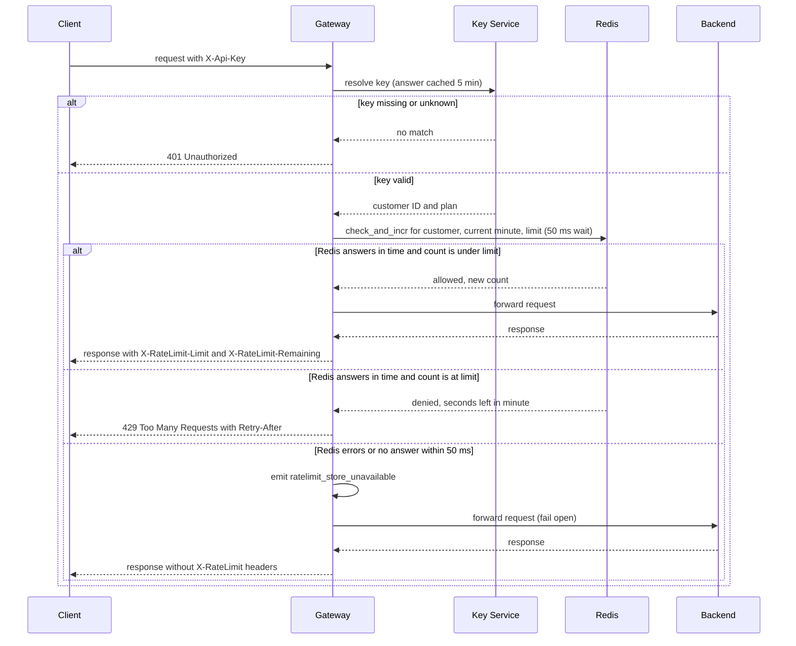

# Rate limiting

Per-customer rate limiting in the API Gateway, backed by Redis.

Today the API Gateway runs as 6 identical, stateless instances behind a load balancer, and any instance can take any request. For each request it reads the API key, asks the Key Service for the customer and plan (cached in memory for 5 minutes), forwards the request to the backend that owns the route, and returns that backend's response. This design adds a budget of requests per customer for each minute. All 6 instances share the budget through Redis. The gateway checks the budget after authentication and before forwarding, so a rejected request never reaches a backend.

## Terms

- **API key**: a secret string the client sends in the `X-Api-Key` header.
- **Customer**: the account that owns one or more API keys. All of a customer's keys share one budget.
- **Plan**: the customer's plan, either Standard or Enterprise. The plan sets the limit.
- **Key Service**: the existing service that turns an API key into a customer ID and a plan.
- **Redis**: a fast store shared by all gateway instances. The counters live here.
- **Counter**: how many requests a customer has used in the current minute.
- **Lua script**: a small program that Redis runs as one step, so no other command can run in the middle of it.
- **TTL (time to live)**: how long Redis keeps a key before it deletes it on its own.
- **Retry-After**: an HTTP header, in seconds, that tells a client how long to wait before it tries again.
- **Fail open**: when the rate-limit store does not answer, the gateway lets the request through anyway.
- **Diagram**: a Mermaid sequence diagram. Time runs down the page. Solid arrows are calls. Dashed arrows are replies.

## How a request flows

1. **Authenticate.** Any client request can reach any gateway instance. The gateway reads `X-Api-Key` and resolves it to a customer ID and plan. It uses its own in-memory cache for up to 5 minutes and calls the Key Service only when the key is not cached. The cache lives in each instance's memory, so a plan change can take up to 5 minutes to apply.
2. **Pick the limit from the plan.** Standard customers get 100 requests per minute. The Enterprise limit is not set yet (see open questions).
3. **Check and count in Redis.** The gateway calls `check_and_incr` with the customer ID, the current minute and the limit. The gateway waits at most 50 ms for the reply. The Lua script runs as one step in Redis:
   - It reads the counter for this customer and this minute. Each customer has one counter per minute, so all of the customer's keys share it.
   - If the counter is under the limit, it adds 1 and returns "allowed" with the new count. If the counter is new, it sets a TTL of 120 seconds, so old minutes clear themselves.
   - If the counter is at the limit, it adds nothing and returns "denied" with the seconds left in the minute. This value is `Retry-After`. It is rounded up to a whole second, and it is never less than 1.
   - Because the step is atomic, two instances cannot both read 99 and both allow a request. This is what keeps 6 instances from giving a customer 6 times the limit.
   - Redis uses its own clock to decide the minute, so instances with different clocks agree on the window.
   - The window is fixed, not sliding. This is the simplest shared design. Its cost: a customer can send 100 requests at the end of one minute and 100 more at the start of the next, which is 200 requests within a few seconds.
4. **Reject if over the limit.** The gateway returns `429 Too Many Requests` with `Retry-After` and does not forward the request. Nothing was added to the counter, so a rejected request does not use budget.
5. **Forward if under the limit.** The gateway forwards the request to the backend that owns the route and returns the backend's response. It adds `X-RateLimit-Limit` (the plan limit) and `X-RateLimit-Remaining` (the limit minus the count after this request). The request was counted in step 3, before forwarding. So a backend failure, such as a 500, still uses budget and is not refunded.

## What happens when things fail

| What goes wrong | What the gateway does | What is recorded |
| --- | --- | --- |
| Key is missing or unknown | Returns `401`. Does not forward. | No counter is read or changed. |
| Customer is over the limit | Returns `429` with `Retry-After`. Does not forward. | Nothing is added. |
| Backend fails after the check passed (for example 500) | Returns the backend's response, with the `X-RateLimit` headers. | The request already counted. It is not refunded. |
| Redis errors, or does not answer within 50 ms | Fails open: forwards the request anyway, emits `ratelimit_store_unavailable`, and returns the backend's response without `X-RateLimit` headers. The gateway has no count to report. | Unknown. Redis may have counted the request even though the gateway stopped waiting. |

While Redis is down, every request takes the fail-open path and emits the metric. The API keeps serving.

## Open questions

- **Enterprise limit:** Product has not decided it, and this design does not set a number. Until Product decides, the gateway has no Enterprise limit, so what happens to Enterprise requests is open.
- **Key Service failure:** the brief does not say what the gateway does when the Key Service cannot resolve a key. This design does not decide it.