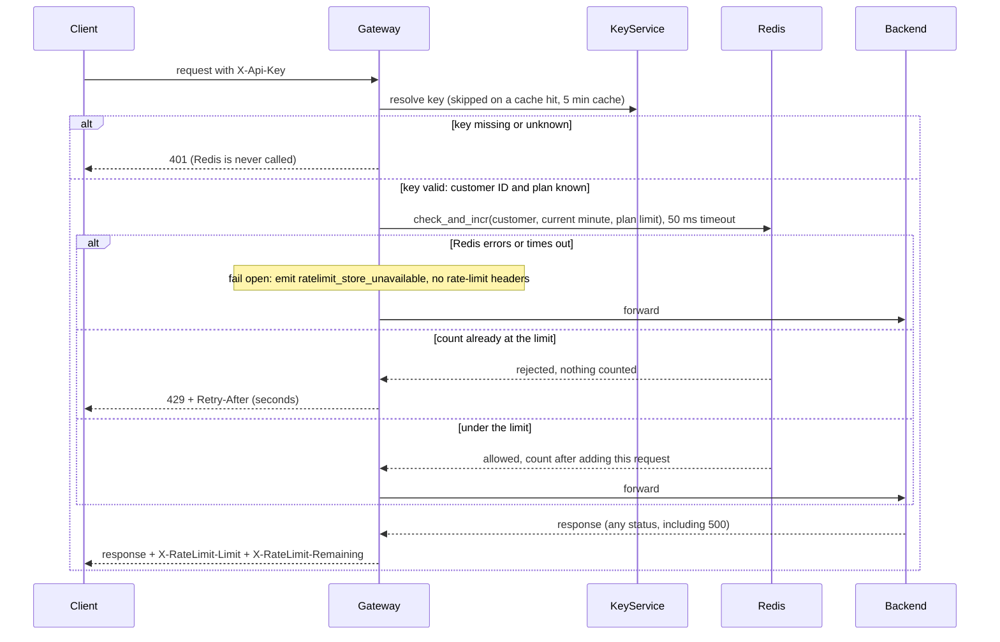

# Rate limiting

The API Gateway limits each customer to a fixed number of requests per minute, so one noisy customer cannot slow the API for everyone else. Today the gateway (6 stateless instances behind a load balancer, any of which can take any request) resolves the `X-Api-Key` header to a customer and plan through the Key Service, caches that answer for 5 minutes, then forwards the request to the backend. We add one step between authentication and forwarding: an atomic check-and-count in Redis, which all 6 instances share, so the count is the same whichever instance takes the request.

## Terms

- **Gateway**: the public entry point. All public traffic goes through it.
- **Key Service**: maps an API key to a customer ID and a plan (Standard or Enterprise). The gateway caches each answer in memory for 5 minutes.
- **Plan**: decides the customer's limit. Standard is 100 requests per minute. Enterprise is not decided (see Open questions).
- **Redis**: the shared in-memory store that holds the counters.
- **Window**: one clock minute (for example 12:07:00 to 12:07:59 UTC). Each customer has one counter per window. The count starts at 0 in each new window (a fixed window, not a sliding one).
- **Counter key**: `ratelimit:{customerId}:{minute}`. It is per customer, not per key, so all of a customer's API keys share one budget.
- **Lua script (`check_and_incr`)**: a small script Redis runs as one indivisible step. Because it is indivisible, two instances checking at the same moment cannot both pass on the last unit of budget, so the limit is not overshot.
- **TTL**: an expiry time on the counter key. Redis deletes the key after it, so old windows do not pile up.
- **Fail open**: when the counter store cannot be used, let the request through instead of rejecting it.

## Flow

## Notes on the steps

1. **Authenticate.** A missing or unknown key returns `401` and stops there. No counter is read or changed. If the Key Service itself fails, that is the existing behaviour and is not changed here.
2. **Check and count.** The gateway calls `check_and_incr` with the customer ID, the current minute and the plan's limit. The script reads the counter. If it is already at the limit, it returns "rejected" and changes nothing, so 429 responses use up no budget. Otherwise it adds 1 and returns the new count. On the first add in a window it sets the TTL to 120 seconds, which is longer than the window, so the key outlives its minute.
3. **Over the limit.** The gateway returns `429 Too Many Requests` and does not forward. `Retry-After` is the number of whole seconds until the current minute ends (60 minus the seconds already elapsed, at least 1), when the counter starts again from 0.
4. **Under the limit.** The gateway forwards the request. It counts against the budget even if the backend then fails, for example with a 500.
5. **Response headers.** Every response to a request that passed the check carries `X-RateLimit-Limit` (the plan's limit) and `X-RateLimit-Remaining` (limit minus the count the script returned). The 401 and 429 responses do not carry these two headers.
6. **Redis down or slow.** If Redis returns an error or does not answer within 50 ms, the gateway fails open. It forwards the request, emits the `ratelimit_store_unavailable` metric, and leaves out the two `X-RateLimit-*` headers because the count is unknown. A counter outage must not take the API down. While Redis is down, limits are not enforced.

## What happens when things fail

| What fails | Result |
|---|---|
| Key missing or unknown | `401`, counters untouched |
| Over the limit | `429` + `Retry-After`, not forwarded, budget unchanged |
| Redis error or no answer in 50 ms | Request forwarded, metric emitted, no `X-RateLimit-*` headers |
| Backend fails after the check passed | Failure returned to the client, request stays counted |

## Rollout

Deploy the same change to all 6 gateway instances. Until an instance has it, that instance does not enforce limits.

## Open questions

- Enterprise limit: Product has not decided. No number is chosen here. Until one is set, the Enterprise limit is TBD and the gateway cannot enforce it for Enterprise customers.
- Redis setup (single instance or replicated) is not decided. The design does not depend on it, because it fails open.
