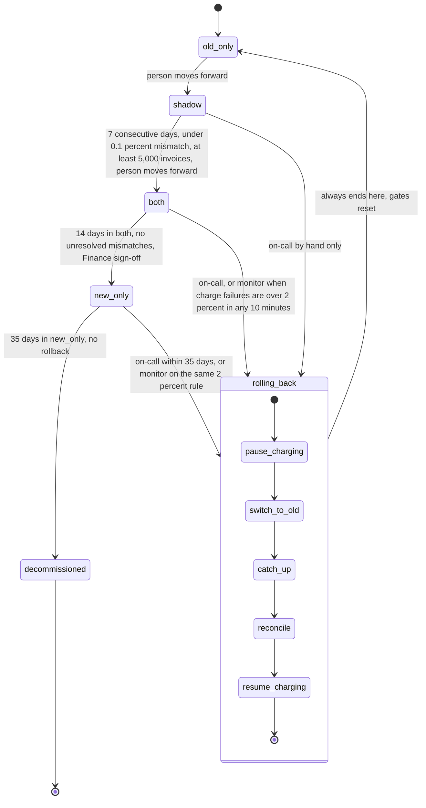

## Billing engine rollout

We are replacing the old billing engine with a new one. The switch must be gradual, reversible, and must never charge a customer twice. Today, billing workers run the old engine: it reads usage events, computes invoices, writes them to the ledger, and charges customers through the payment provider. The rollout moves through four modes, set by one flag, `billing_mode`. The new engine first runs beside the old one without charging, then takes over charging. A person makes every forward move. A rollback returns charging to the old engine and always ends in `old_only`.

### Terms

- **Old engine**: the billing code that runs today.
- **New engine**: the replacement billing code.
- **Usage event log**: the stored record of customer usage. It keeps events for 35 days.
- **Ledger**: the billing ledger. It is the system of record, the official copy of invoices and charges.
- **Payment provider**: the outside service that actually charges customers.
- **Config service**: the settings store that holds `billing_mode`.
- **billing_mode**: the one global flag. Its values are `old_only`, `shadow`, `both` and `new_only`.
- **Shadow store**: separate storage where invoices are written without charging and without touching the ledger.
- **Mismatch**: an invoice total that differs between the two engines by more than one cent.
- **Nightly comparison job**: runs each night and compares the two engines' invoices for each customer. It writes its results to `comparison_results`.
- **Billing monitor**: watches the new engine's charge failure rate and starts a rollback when it is too high.
- **Charge failure rate**: the share of the new engine's charges that fail.
- **Rollout tool**: the tool that moves the flag forward or starts a rollback. The brief calls it the rollout controller. It is not built yet.
- **Rollback record**: a record kept for each rollback.
- **Finance sign-off**: approval from Finance, needed before the move from `both` to `new_only`.

### Diagram

### How each mode runs

1. **old_only (start).** The old engine does everything. The new engine is off. The ledger is written by the old engine. If something goes wrong, there is no new engine running, so there is nothing to undo.

2. **shadow.** A person moves the flag from `old_only` to `shadow`. The old engine still charges and writes the ledger. The new engine reads the same usage events and writes its invoices to the shadow store. It never charges and never writes the ledger. Each night the comparison job checks every customer and records the results. Move to `both` only after 7 consecutive days with a mismatch rate under 0.1 percent and at least 5,000 invoices compared. If the new engine errors, the error is recorded. In this mode, errors never start a rollback.

3. **both.** A person moves the flag from `shadow` to `both` once the 7-day gate is met. The new engine charges and writes the ledger. The old engine keeps computing every invoice into the shadow store without charging, so it stays current. The comparison continues. If the new engine's charge failure rate is above 2 percent over any 10-minute window, the monitor starts a rollback automatically.

4. **new_only.** A person moves the flag from `both` to `new_only` only after 14 days in `both` with no unresolved mismatches and Finance sign-off. The old engine stops computing. The monitor still applies the same 2 percent rule. A rollback from here is possible only within 35 days.

5. **decommissioned.** After 35 days in `new_only`, with no rollback started, the old engine may be decommissioned. This is not one of the four `billing_mode` values. From day 35 on there is no way back.

### Rollback

**Starts** when on-call starts it by hand at any time in `shadow`, `both` or `new_only`, within the 35-day limit. It also starts automatically in `both` or `new_only` when the monitor sees the 2 percent failure rate. It always ends in `old_only`.

**Steps**, in order:

- **pause_charging**: stops the new engine from charging.
- **switch_to_old**: makes the old engine the one that charges.
- **catch_up**: the old engine reprocesses the usage events it skipped. This must happen first when rolling back from `new_only`, because the old engine stopped computing there.
- **reconcile**: matches charges and invoices by customer and billing period. It must never leave a customer charged twice for a billing period, and it must never drop a charge that is due.
- **resume_charging**: the old engine starts charging again. The rollback ends in `old_only`.

Any step that is not needed is skipped. Any step that fails can be retried.

**After any rollback**, the gates reset. The rollout must go through `shadow` again, and the 7-day count starts over.

### Where state lives

- The current mode is the `billing_mode` flag in the config service.
- Mismatches and nightly results are in `comparison_results`.
- Invoices from the new engine in `shadow` (and the old engine's invoices in `both`) are in the shadow store.
- The ledger is the system of record. The old engine writes it in `old_only` and `shadow`. The new engine writes it in `both`.
- Each rollback is written to its rollback record.
- Where the 7-day, 14-day and 35-day counts are kept is not stated in the brief.

### Open questions

- Where are the 7-day count, the 14-day count and the 35-day clock kept?
- Does the 5,000-invoice minimum count across all 7 days, or per day?
- Which rollback steps are skipped for each starting mode?
- What happens when a rollback step keeps failing after retries?
- Are the 35-day rollback limit and the 35-day usage event log retention the same clock?
- What fields do `comparison_results` and the rollback record hold?
- How does on-call start a manual rollback: through the rollout tool, or another path?
- Who at Finance signs off, and how is the sign-off recorded?